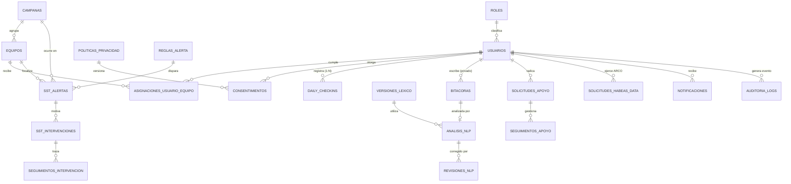

# P11 · Persistence — Especificación del Modelo de Datos Canónico (24 Tablas)

## 1. Identificación del Componente
* **Paquete Arquitectónico**: `P11 · persistence`
* **Componente C4**: `C08 · PostgreSQL` (Contenedor `pulso360-database`)
* **Motor**: PostgreSQL 18 (Relacional nativo con driver `pg`)
* **Base de Datos**: `pulso360_db`
* **Total de Tablas**: **24 tablas canónicas** (100% trazabilidad con PPI RF-01 a RF-18, C01-C14 y diseño previo de Base de Datos II).

---

## 2. Diagrama Entidad-Relación (Mermaid ERD)

---

## 3. Catálogo Canónico de las 24 Tablas

### Bloque A: Identidad, Control de Acceso y Estructura Organizacional
1. **`roles`**: Catálogo canónico de los 5 roles (`AGENTE`, `SUPERVISOR`, `SST`, `AUDITOR`, `ADMIN`).
2. **`campanas`**: Campañas operativas de Contact Center (ej. `Soporte Alpha`, `Retención Beta`).
3. **`equipos`**: Equipos de trabajo asignados a una campaña, con líder/supervisor y conteo de miembros.
4. **`usuarios`**: Cuentas del sistema, contraseña hasheada en `bcrypt`, intentos fallidos y bloqueo temporal.
5. **`asignaciones_usuario_equipo`**: Asignación activa o histórica de un usuario a un equipo, turno y horario.

### Bloque B: Privacidad y Consentimiento Informado (Ley 1581 de 2012)
6. **`politicas_privacidad`**: Historial formal de versiones de la política (`v2.4`) y avisos legales.
7. **`consentimientos`**: Registro auditable de aceptación de política y finalidades C1..C5 por usuario.

### Bloque C: Bienestar y Registro Personal del Agente
8. **`daily_checkins`**: Registro diario con las 6 dimensiones operativas (energía, carga, recuperación, apoyo, distanciamiento, ineficacia).
9. **`bitacoras`**: Espacio personal de desahogo. **Inviolable: Cero acceso a supervisores o SST**.

### Bloque D: Motor Léxico Determinista y NLP
10. **`versiones_lexico`**: Versiones del diccionario determinista local de palabras clave.
11. **`categorias_nlp`**: Catálogo de dimensiones psicosociales (sobrecarga, exigencia, bajo apoyo).
12. **`analisis_nlp`**: Resultados de clasificación automática sobre la bitácora con evidencias y confianza.
13. **`revisiones_nlp`**: Corrección humana y retroalimentación realizada por el propio agente.

### Bloque E: Prevención, Alertas Tempranas e Intervenciones SST
14. **`reglas_alerta`**: Umbrales configurables (ej. caída de recuperación > 15% durante 3 semanas).
15. **`sst_alertas`**: Alertas tempranas generadas automáticamente para SST.
16. **`sst_intervenciones`**: Planes de mitigación (pausas cognitivas coordinadas, talleres emocionales).
17. **`seguimientos_intervencion`**: Bitácora de evolución y avances de cada plan de intervención.

### Bloque F: Acompañamiento, Habeas Data, Reportes y Auditoría
18. **`solicitudes_apoyo`**: Solicitudes de acompañamiento psicosocial (anónimo o identificado).
19. **`seguimientos_apoyo`**: Notas de evolución clínica y psicosocial registradas por SST.
20. **`solicitudes_habeas_data`**: Peticiones formales de derechos ARCO (rectificación, portabilidad, supresión).
21. **`reportes_generados`**: Registro de reportes generados con hash criptográfico SHA-256 de integridad.
22. **`notificaciones`**: Avisos in-app dirigidos a usuarios o roles específicos.
23. **`auditoria_logs`**: Trazabilidad inmutable con encadenamiento criptográfico (`prev_hash`, `hash`).
24. **`configuracion_sistema`**: Parámetros de gobernanza: umbral $k$-anonimato ($k=5$), SLAs, políticas.

---

## 4. Invariantes de Privacidad en Base de Datos

1. **Aislamiento de la Bitácora**: Toda consulta a la tabla `bitacoras` desde endpoints del agente debe incluir obligatoriamente la cláusula `WHERE usuario_id = $1`.
2. **k-Anonimato ($k \ge 5$)**: Las consultas analíticas sobre `daily_checkins` deben verificar `COUNT(DISTINCT usuario_id) >= 5` antes de emitir promedios grupales.
3. **Consentimiento Previo**: Las inserciones en `daily_checkins` y `bitacoras` exigen verificar previamente que `c1_checkin = TRUE` en la tabla `consentimientos`.
