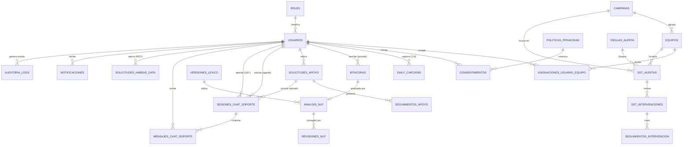

# P11 · Persistence — Especificación del Modelo de Datos Canónico (31 Tablas)

## 1. Identificación del Componente
* **Paquete Arquitectónico**: `P11 · persistence`
* **Componente C4**: `C08 · PostgreSQL` (Contenedor `pulso360-database`)
* **Motor**: PostgreSQL 18 (Relacional nativo con driver `pg`)
* **Base de Datos**: `pulso360_db`
* **Esquema canónico**: 26 tablas de dominio (Bloques A–G) + 5 tablas técnicas de infraestructura y jobs (Bloque H). Total: 31 tablas gestionadas en `schema.sql` y sincronizadas mediante `migrations/`.

---

## 2. Herramientas Operativas y Gestión de Esquema

* **`schema.sql` (Bootstrap DDL)**:
  Script de inicialización limpia destructiva (`DROP TABLE IF EXISTS ... CASCADE`). Recrea la totalidad de las 31 tablas, índices y restricciones de integridad. Utilizado exclusivamente para inicialización de entornos nuevos o reseteo de bases locales vacías.
* **`seed.sql` (Semilla de Datos)**:
  Carga inicial de catálogos obligatorios y datos demo para desarrollo (5 roles, campañas Alpha/Beta, equipos y usuarios preconfigurados con contraseña `Pulso360#2026`).
* **`migrate.js` (`npm run db:migrate -- --database NOMBRE`)**:
  Ejecutor transaccional de migraciones incrementales. Aplica secuencialmente los scripts bajo `migrations/`, calcula checksums SHA-256 e impide drift o alteraciones retroactivas mediante la tabla de control `pulso_migrations`.
* **`provision-local-app.js` (`node database/provision-local-app.js --database NOMBRE`)**:
  Script de seguridad para aprovisionamiento local. Crea el rol restringido `pulso360_app` con permisos DML exclusivos (`SELECT`, `INSERT`, `UPDATE`, `DELETE`), revoca privilegios DDL (`CREATE`, `DROP`), genera secretos criptográficos y configura los archivos de entorno (`.env`, `.env.maintenance`, `.env.test`).

---

## 3. Diagrama Entidad-Relación (Mermaid ERD)

---

## 4. Catálogo Canónico de las 26 Tablas

### Bloque A: Identidad, Control de Acceso y Estructura Organizacional
1. **`roles`**: Catálogo canónico de los 5 roles (`AGENTE`, `SUPERVISOR`, `SST`, `AUDITOR`, `ADMIN`).
2. **`campanas`**: Campañas operativas de Contact Center (ej. `Soporte Alpha`, `Retención Beta`).
3. **`equipos`**: Equipos de trabajo asignados a una campaña, con líder/supervisor y conteo de miembros.
4. **`usuarios`**: Cuentas del sistema, contraseña hasheada en `bcrypt`, intentos fallidos y bloqueo temporal.
5. **`asignaciones_usuario_equipo`**: Asignación activa o histórica de un usuario a un equipo, turno y horario.

### Bloque B: Privacidad y Consentimiento Informado (Ley 1581 de 2012)
6. **`politicas_privacidad`**: Historial formal de versiones de la política (`v2.4`) y avisos legales.
7. **`consentimientos`**: Registro auditable de aceptación de política y finalidades C1..C5 por usuario.

### Bloque C: Bienestar y Registro Personal del Agente
8. **`daily_checkins`**: Registro diario con las 6 dimensiones operativas (energía, carga, recuperación, apoyo, distanciamiento, ineficacia).
9. **`bitacoras`**: Espacio personal de desahogo. **Inviolable: Cero acceso a supervisores o SST**.

### Bloque D: Motor Léxico Determinista y NLP
10. **`versiones_lexico`**: Versiones del diccionario determinista local de palabras clave.
11. **`categorias_nlp`**: Catálogo de dimensiones psicosociales (sobrecarga, exigencia, bajo apoyo).
12. **`analisis_nlp`**: Resultados de clasificación automática sobre la bitácora con evidencias y confianza.
13. **`revisiones_nlp`**: Corrección humana y retroalimentación realizada por el propio agente.

### Bloque E: Prevención, Alertas Tempranas e Intervenciones SST
14. **`reglas_alerta`**: Umbrales configurables (ej. caída de recuperación > 15% durante 3 semanas).
15. **`sst_alertas`**: Alertas tempranas generadas automáticamente para SST.
16. **`sst_intervenciones`**: Planes de mitigación (pausas cognitivas coordinadas, talleres emocionales).
17. **`seguimientos_intervencion`**: Bitácora de evolución y avances de cada plan de intervención.

### Bloque F: Acompañamiento, Habeas Data, Reportes y Auditoría
18. **`solicitudes_apoyo`**: Solicitudes de acompañamiento psicosocial (anónimo o identificado).
19. **`seguimientos_apoyo`**: Notas de evolución clínica y psicosocial registradas por SST.
20. **`solicitudes_habeas_data`**: Peticiones formales de derechos ARCO (rectificación, portabilidad, supresión).
21. **`reportes_generados`**: Registro de reportes generados con hash criptográfico SHA-256 de integridad.
22. **`notificaciones`**: Avisos in-app dirigidos a usuarios o roles específicos.
23. **`auditoria_logs`**: Trazabilidad inmutable con encadenamiento criptográfico (`prev_hash`, `hash`).
24. **`configuracion_sistema`**: Parámetros de gobernanza: umbral $k$-anonimato ($k=5$), SLAs, políticas.

### Bloque G: Acompañamiento Ocupacional y Chat SST (RF-10)
25. **`sesiones_chat_soporte`**: Sesiones interactivas de apoyo con SST vinculadas a solicitudes de apoyo, con soporte anónimo o identificado y ciclo de triage (`pendiente`, `activa`, `cerrada`, `rechazada`, `cancelada`).
26. **`mensajes_chat_soporte`**: Registro cronológico e inmutable de mensajes intercambiados en las sesiones activas de chat entre el agente y el profesional SST.

### Bloque H: Soporte Técnico, Recuperación y Trabajos en Segundo Plano
27. **`password_reset_tokens`**: Tokens criptográficos UUID y hashes SHA-256 para recuperación segura de contraseña por correo.
28. **`lexico_activaciones`**: Registro inmutable de trazabilidad de cambios y activaciones de versiones del diccionario léxico NLP.
29. **`alert_job_state`**: Cursor y control de estado de ejecución del planificador periódico de alertas SST.
30. **`alert_job_runs`**: Historial de corridas de evaluación del job semanal con estado (`COMPLETED`/`FAILED`) y resumen JSONB.
31. **`alert_job_evaluations`**: Resultados y evaluaciones individuales emitidas por regla, campaña y equipo en cada corrida del job.

---

## 5. Invariantes de Privacidad en Base de Datos

1. **Aislamiento de la Bitácora**: Toda consulta a la tabla `bitacoras` desde endpoints del agente debe incluir obligatoriamente la cláusula `WHERE usuario_id = $1`.
2. **k-Anonimato ($k \ge 5$)**: Las consultas analíticas sobre `daily_checkins` deben verificar `COUNT(DISTINCT usuario_id) >= 5` antes de emitir promedios grupales.
3. **Consentimiento Previo**: Las inserciones en `daily_checkins` y `bitacoras` exigen verificar previamente que `c1_checkin = TRUE` en la tabla `consentimientos`.
