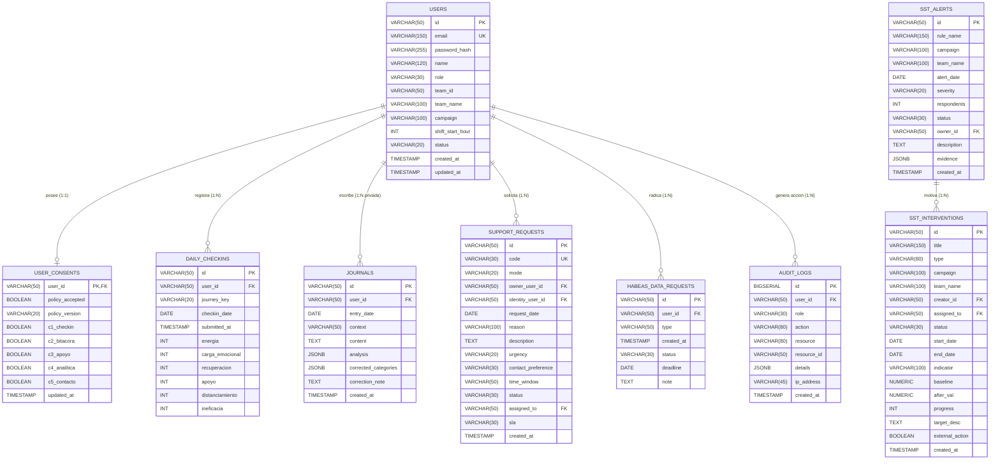

# P11 · Persistence — Especificación del Modelo de Datos (PostgreSQL)

## 1. Identificación del Componente
* **Paquete Arquitectónico**: `P11 · persistence`
* **Componente C4**: `C08 · PostgreSQL`
* **Motor**: PostgreSQL 18 (Relacional nativo con driver `pg`)
* **Base de Datos**: `pulso360_db`

---

## 2. Diagrama Entidad-Relación (ERD)

---

## 3. Principios y Reglas Inviolables de Privacidad

1. **Aislamiento Técnico de la Bitácora (`JOURNALS`)**:
   * Las consultas SQL a `JOURNALS` **deben** incluir obligatoriamente el filtro `WHERE user_id = $1`.
   * Ningún endpoint de supervisión ni de SST tiene autorización para ejecutar `SELECT * FROM journals` sin filtrar por el usuario autenticado propietario.
2. **k-Anonimato en Vistas Agregadas**:
   * Para calcular promedios de `DAILY_CHECKINS` por campaña o equipo, la consulta SQL debe verificar `COUNT(DISTINCT user_id) >= 5`.
   * Si no se cumple la cohorte mínima, la capa de dominio/servicio suprime el valor numérico para evitar la reidentificación de los operadores.
3. **Consentimiento Informado (Ley 1581 de 2012)**:
   * Ningún registro en `DAILY_CHECKINS` o `JOURNALS` puede procesarse si el usuario no tiene activo su consentimiento informado (`c1_checkin = true`).
