# Pulso360 — Compendio Maestro de Diagramas de Arquitectura y Software

Este documento reúne la especificación formal y el catálogo maestro de diagramas de ingeniería de software para **Pulso360**. Ha sido diseñado en sintaxis estándar **Mermaid** ejecutable y estructurado para respaldar la evaluación del **Proyecto Pedagógico Integrador (PPI)** y la materia de **Construcción de Software 3** (Tecnológico de Antioquia).

---

## 🗺️ Índice de Diagramas

1. [Diagrama 1: Arquitectura de Sistema (C4 Modelo Nivel 2: Contenedores)](#1-diagrama-de-arquitectura-c4-nivel-2-contenedores)
2. [Diagrama 2: Casos de Uso del Sistema (UML)](#2-diagrama-de-casos-de-uso-uml)
3. [Diagrama 3: Jerarquía y Flujo de Navegación de UI (Sitemap)](#3-diagrama-de-ui-sitemap-y-flujo-de-navegación)
4. [Diagrama 4: Flujos de Procesos Principales (Activity Diagrams)](#4-diagramas-de-flujo-de-procesos-principales)
   - [4.1 Check-in Diario y Bitácora Emocional con NLP](#41-flujo-de-check-in-diario-y-bitácora-emocional)
   - [4.2 Motor de Vigilancia Psicosocial y Alertas SST](#42-flujo-de-detección-y-generación-de-alertas-sst)
   - [4.3 Solicitud de Apoyo y Chat de Crisis en Tiempo Real](#43-flujo-de-solicitud-de-apoyo-y-chat-de-crisis)
5. [Diagrama 5: Diagrama de Componentes (Arquitectura de Capas Monorepo)](#5-diagrama-de-componentes-arquitectura-de-capas)
6. [Diagrama 6: Diagrama de Clases (Modelo de Dominio de Software)](#6-diagrama-de-clases-modelo-de-dominio)
7. [Diagrama 7: Diagrama Entidad-Relación (ER Conceptual/Lógico)](#7-diagrama-entidad-relación-er-conceptual)
8. [Diagrama 8: Diagrama Relacional (Modelo Físico de Base de Datos - PostgreSQL)](#8-diagrama-relacional-modelo-físico-postgresql)
9. [Diagrama 9: Diagrama de Despliegue (Infraestructura Docker Compose)](#9-diagrama-de-despliegue-docker-compose)
10. [Diagrama 10: Diagrama de Secuencia (Autenticación Segura y RBAC)](#10-diagrama-de-secuencia-autenticación-y-rbac)
11. [Diagrama 11: Diagrama de Estados (Ciclo de Vida de Alertas SST)](#11-diagrama-de-estados-alertas-sst)

---

## 1. Diagrama de Arquitectura (C4 Nivel 2: Contenedores)

Describe los subsistemas de alto nivel, protocolos de comunicación y fronteras de datos de Pulso360.

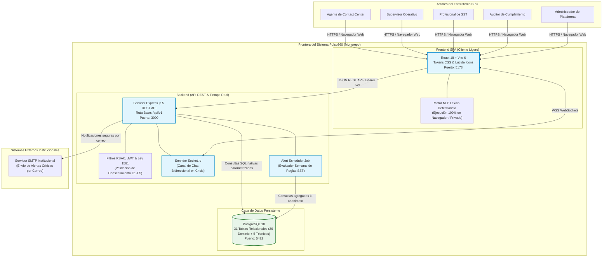

---

## 2. Diagrama de Casos de Uso (UML)

Mapea los 16 casos de uso del sistema frente a los 5 roles canónicos del sistema de control de acceso (RBAC).

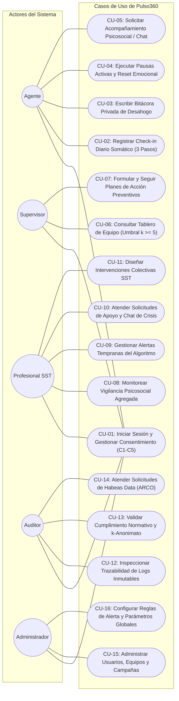

---

## 3. Diagrama de UI (Sitemap y Flujo de Navegación)

Representa la estructura jerárquica de vistas, pantallas públicas, controles de acceso por rol y rutas transversales.

```mermaid
graph TD
    PublicRoot["/ (Landing Page Institucional)"]
    PublicContact["/contactenos (Formulario de Contacto y Canales)"]
    PublicFundamentacion["/fundamentacion (Fundamentación Académica)"]
    Login["/login (Autenticación & Acceso Rápido para 5 Roles)"]
    Forgot["/recuperar-clave (Recuperación)"]
    Reset["/nueva-clave (Restablecimiento)"]

    PublicRoot --> PublicContact
    PublicRoot --> PublicFundamentacion
    PublicRoot --> Login
    Login --> Forgot
    Forgot --> Reset

    subgraph EspacioProtegido ["Espacio Protegido (ProtectedRoute / JWT RBAC)"]
        Consent["/consentimiento (Consentimiento Informado C1-C5)"]

        subgraph ModuloAgente ["Experiencia del Agente"]
            AgentePanel["/agente/panel (Tablero de Bienestar del Agente)"]
            AgenteCheckin["/agente/checkin (Check-in Somático en 3 Pasos)"]
            AgenteBitacora["/agente/bitacora (Bitácora Privada & Motor NLP)"]
            AgenteBienestar["/agente/mi-bienestar (Pausas Sonoras & Ejercicios)"]
            AgenteApoyo["/agente/apoyo (Canal de Crisis & Chat en Vivo)"]
            AgenteDatos["/agente/mis-datos (Gestión ARCO & Habeas Data)"]

            AgentePanel --> AgenteCheckin
            AgentePanel --> AgenteBitacora
            AgentePanel --> AgenteBienestar
            AgentePanel --> AgenteApoyo
            AgentePanel --> AgenteDatos
        end

        subgraph ModuloSupervisor ["Experiencia del Supervisor"]
            SuperPanel["/supervisor/panel (Tablero Agregado: k-anonimato N >= 5)"]
            SuperAcciones["/supervisor/acciones (Planes Preventivos Asignados)"]
            SuperPanel --> SuperAcciones
        end

        subgraph ModuloSST ["Experiencia de SST"]
            SstPanel["/sst/panel (Vigilancia Psicosocial Epidemiológica)"]
            SstAlertas["/sst/alertas (Gestión de Alertas Tempranas)"]
            SstReglas["/sst/reglas-alertas (Configuración de Umbrales SST)"]
            SstIntervenciones["/sst/intervenciones (Planes Colectivos)"]
            SstBuzon["/sst/buzon (Bandeja de Apoyo y Chat de Crisis)"]

            SstPanel --> SstAlertas
            SstPanel --> SstReglas
            SstPanel --> SstIntervenciones
            SstPanel --> SstBuzon
        end

        subgraph ModuloAuditor ["Experiencia del Auditor"]
            AuditorRedirect["/auditor/panel (Redirección canónica)"]
            AuditorAuditoria["/auditor/auditoria (Trazabilidad & Logs Inmutables)"]
            AuditorRedirect --> AuditorAuditoria
        end

        subgraph ModuloAdmin ["Experiencia del Administrador"]
            AdminRedirect["/admin/panel (Redirección canónica)"]
            AdminOrganizacion["/admin/organizacion (Campañas, Equipos y Turnos)"]
            AdminUsuarios["/admin/usuarios-roles (Control de Usuarios y Roles)"]
            AdminParametros["/admin/parametros (Configuración de Sistema)"]
            AdminImportar["/admin/importar (Importación CSV de Personal)"]
            AdminSolicitudes["/admin/solicitudes (Gestión ARCO & Habeas Data)"]

            AdminRedirect --> AdminOrganizacion
            AdminOrganizacion --> AdminUsuarios
            AdminOrganizacion --> AdminParametros
            AdminOrganizacion --> AdminImportar
            AdminOrganizacion --> AdminSolicitudes
        end

        subgraph ModulosTransversales ["Módulos Transversales"]
            Reportes["/reportes (Generador de Reportes con Hash SHA-256)"]
            Notificaciones["/notificaciones (Avisos Operativos In-App)"]
        end
    end

    Login -->|Rol == AGENTE| AgentePanel
    Login -->|Rol == SUPERVISOR| SuperPanel
    Login -->|Rol == SST| SstPanel
    Login -->|Rol == AUDITOR| AuditorAuditoria
    Login -->|Rol == ADMIN| AdminOrganizacion

    classDef pub fill:#fafafa,stroke:#616161,stroke-width:1px;
    classDef priv fill:#e3f2fd,stroke:#1565c0,stroke-width:1px;
    class PublicRoot,PublicContact,PublicFundamentacion,Login,Forgot,Reset pub;
```

---

## 4. Diagramas de Flujo de Procesos Principales

### 4.1 Flujo de Check-in Diario y Bitácora Emocional

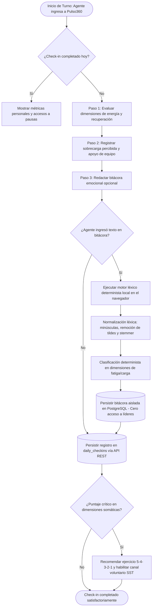

### 4.2 Flujo de Detección y Generación de Alertas SST

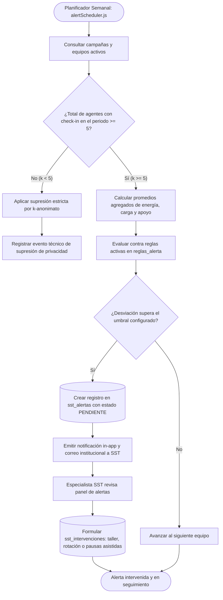

### 4.3 Flujo de Solicitud de Apoyo y Chat de Crisis

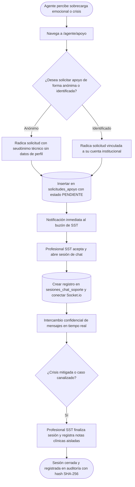

---

## 5. Diagrama de Componentes (Arquitectura de Capas)

Muestra la separación física y lógica entre el cliente React y los paquetes de backend.

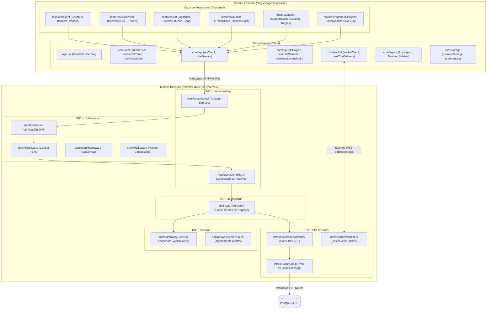

---

## 6. Diagrama de Clases (Modelo de Dominio)

Estructura de clases que rige la lógica de entidades, servicios y reglas de negocio del sistema.

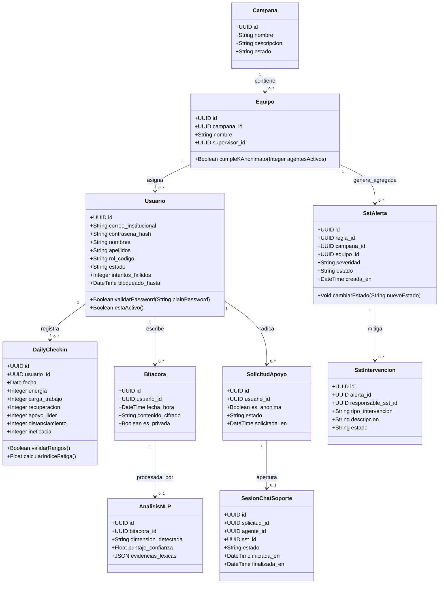

---

## 7. Diagrama Entidad-Relación (ER Conceptual)

Modelo lógico conceptual que define las relaciones cardinales entre las áreas de negocio de Pulso360.

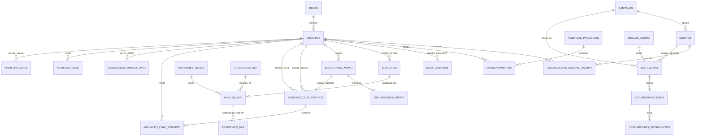

---

## 8. Diagrama Relacional (Modelo Físico PostgreSQL)

Esquema físico detallado de las 26 tablas canónicas de dominio de `backend/database/schema.sql`, con tipos de datos nativos, PKs, FKs y restricciones de integridad.

```mermaid
erDiagram
    roles {
        varchar codigo PK
        varchar nombre
        text descripcion
        timestamptz creado_en
    }

    campanas {
        uuid id PK
        varchar nombre
        text descripcion
        varchar estado
        timestamptz creado_en
    }

    equipos {
        uuid id PK
        uuid campana_id FK
        varchar nombre
        uuid supervisor_id FK
        timestamptz creado_en
    }

    usuarios {
        uuid id PK
        varchar correo_institucional
        varchar contrasena_hash
        varchar nombres
        varchar apellidos
        varchar rol_codigo FK
        varchar estado
        integer intentos_fallidos
        timestamptz bloqueado_hasta
        timestamptz creado_en
    }

    asignaciones_usuario_equipo {
        uuid id PK
        uuid usuario_id FK
        uuid equipo_id FK
        varchar turno
        boolean activo
        timestamptz asignado_en
    }

    politicas_privacidad {
        uuid id PK
        varchar version
        text contenido_legal
        boolean activa
        timestamptz publicada_en
    }

    consentimientos {
        uuid id PK
        uuid usuario_id FK
        uuid politica_id FK
        boolean finalidad_c1
        boolean finalidad_c2
        boolean finalidad_c3
        boolean finalidad_c4
        boolean finalidad_c5
        timestamptz otorgado_en
    }

    daily_checkins {
        uuid id PK
        uuid usuario_id FK
        date fecha
        integer energia
        integer carga_trabajo
        integer recuperacion
        integer apoyo_lider
        integer distanciamiento
        integer ineficacia
        timestamptz creado_en
    }

    bitacoras {
        uuid id PK
        uuid usuario_id FK
        timestamptz creado_en
        text contenido
        boolean tiene_analisis
    }

    versiones_lexico {
        uuid id PK
        varchar version
        text descripcion
        boolean activa
    }

    categorias_nlp {
        uuid id PK
        varchar codigo
        varchar nombre
        text descripcion
    }

    analisis_nlp {
        uuid id PK
        uuid bitacora_id FK
        uuid version_lexico_id FK
        varchar dimension_predominante
        numeric puntaje_confianza
        jsonb metadata
        timestamptz creado_en
    }

    revisiones_nlp {
        uuid id PK
        uuid analisis_nlp_id FK
        uuid usuario_id FK
        varchar dimension_corregida
        text justificacion
        timestamptz revisado_en
    }

    reglas_alerta {
        uuid id PK
        varchar codigo
        varchar metrica
        varchar operador
        numeric umbral
        varchar severidad
        boolean activa
    }

    sst_alertas {
        uuid id PK
        uuid regla_id FK
        uuid campana_id FK
        uuid equipo_id FK
        varchar severidad
        varchar estado
        timestamptz creada_en
    }

    sst_intervenciones {
        uuid id PK
        uuid alerta_id FK
        uuid sst_usuario_id FK
        varchar tipo
        text plan_accion
        varchar estado
        timestamptz iniciada_en
    }

    seguimientos_intervencion {
        uuid id PK
        uuid intervencion_id FK
        uuid sst_usuario_id FK
        text nota_evolucion
        timestamptz registrado_en
    }

    solicitudes_apoyo {
        uuid id PK
        uuid usuario_id FK
        boolean es_anonima
        varchar estado
        timestamptz solicitada_en
    }

    seguimientos_apoyo {
        uuid id PK
        uuid solicitud_id FK
        uuid sst_usuario_id FK
        text notas_confidenciales
        timestamptz registrado_en
    }

    solicitudes_habeas_data {
        uuid id PK
        uuid usuario_id FK
        varchar tipo_derecho
        varchar estado
        timestamptz radicada_en
    }

    reportes_generados {
        uuid id PK
        uuid generado_por_usuario_id FK
        varchar tipo_reporte
        varchar sha256_hash
        timestamptz creado_en
    }

    notificaciones {
        uuid id PK
        uuid usuario_id FK
        varchar titulo
        text mensaje
        boolean leida
        timestamptz creada_en
    }

    auditoria_logs {
        uuid id PK
        uuid usuario_id FK
        varchar accion
        varchar entidad
        uuid entidad_id
        varchar sha256_hash
        timestamptz creado_en
    }

    configuracion_sistema {
        varchar clave PK
        text valor
        text descripcion
        timestamptz actualizado_en
    }

    sesiones_chat_soporte {
        uuid id PK
        uuid solicitud_id FK
        uuid agente_id FK
        uuid profesional_sst_id FK
        varchar estado
        timestamptz iniciada_en
        timestamptz finalizada_en
    }

    mensajes_chat_soporte {
        uuid id PK
        uuid sesion_id FK
        uuid remitente_id FK
        text contenido
        timestamptz enviado_en
    }

    roles ||--o{ usuarios : "rol_codigo"
    campanas ||--o{ equipos : "campana_id"
    equipos ||--o{ asignaciones_usuario_equipo : "equipo_id"
    usuarios ||--o{ asignaciones_usuario_equipo : "usuario_id"
    politicas_privacidad ||--o{ consentimientos : "politica_id"
    usuarios ||--o{ consentimientos : "usuario_id"
    usuarios ||--o{ daily_checkins : "usuario_id"
    usuarios ||--o{ bitacoras : "usuario_id"
    bitacoras ||--o| analisis_nlp : "bitacora_id"
    versiones_lexico ||--o{ analisis_nlp : "version_lexico_id"
    analisis_nlp ||--o{ revisiones_nlp : "analisis_nlp_id"
    reglas_alerta ||--o{ sst_alertas : "regla_id"
    campanas ||--o{ sst_alertas : "campana_id"
    equipos ||--o{ sst_alertas : "equipo_id"
    sst_alertas ||--o{ sst_intervenciones : "alerta_id"
    sst_intervenciones ||--o{ seguimientos_intervencion : "intervencion_id"
    usuarios ||--o{ solicitudes_apoyo : "usuario_id"
    solicitudes_apoyo ||--o{ seguimientos_apoyo : "solicitud_id"
    solicitudes_apoyo ||--o| sesiones_chat_soporte : "solicitud_id"
    sesiones_chat_soporte ||--o{ mensajes_chat_soporte : "sesion_id"
    usuarios ||--o{ solicitudes_habeas_data : "usuario_id"
    usuarios ||--o{ reportes_generados : "generado_por_usuario_id"
    usuarios ||--o{ notificaciones : "usuario_id"
    usuarios ||--o{ auditoria_logs : "usuario_id"
```

---

## 9. Diagrama de Despliegue (Docker Compose)

Ilustra la orquestación en contenedores del entorno local y de evaluación.

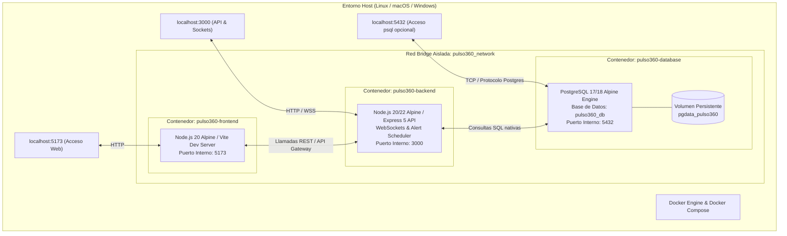

---

## 10. Diagrama de Secuencia (Autenticación y RBAC)

Representa el ciclo de vida de emisión, validación e inspección del JSON Web Token y control de acceso.

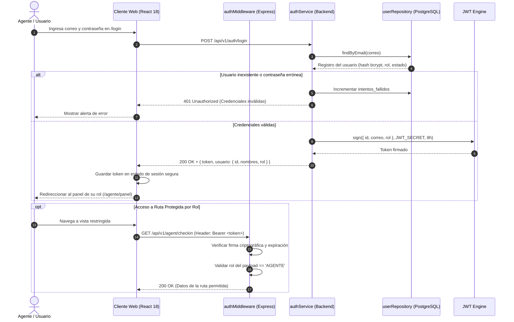

---

## 11. Diagrama de Estados (Alertas SST)

Máquina de estados finita que gobierna la evolución de una alerta psicosocial en el módulo SST.

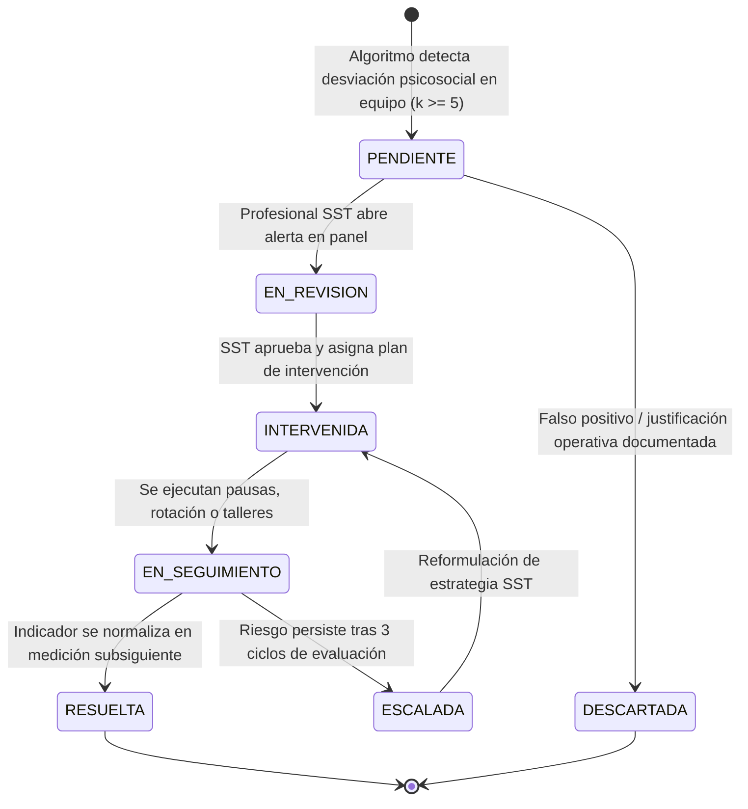
