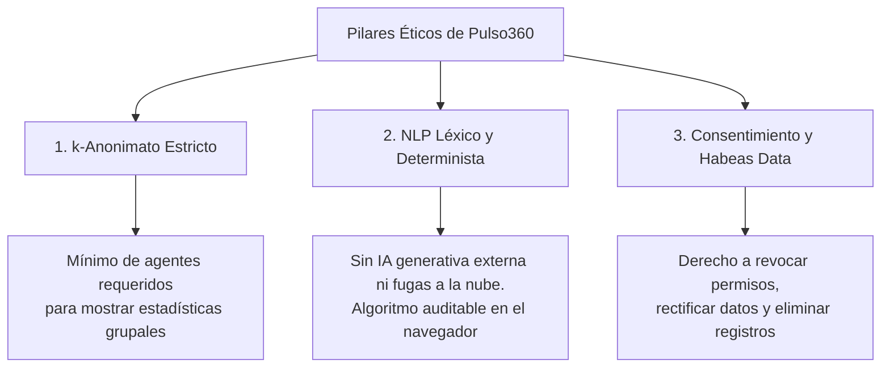

# Capítulo 00: Dominio, Contexto BPO y Ética de Privacidad

> **Objetivo del capítulo**: Comprender por qué existe Pulso360, en qué mundo opera (la industria de Contact Centers / BPO), cuáles son los dolores reales de los trabajadores que atiende y por qué la arquitectura técnica está fuertemente blindada por principios éticos y legales de privacidad.

---

## 1. La Realidad Operativa del Contact Center / BPO

Para entender el código de Pulso360, primero debemos entender **dónde se utiliza** y **a quién ayuda**.

**BPO** significa *Business Process Outsourcing* (Tercerización de Procesos de Negocio). En la práctica, se refiere a grandes empresas que operan centros de contacto (call centers) atendiendo a millones de usuarios finales en servicios al cliente, cobranzas, soporte técnico y ventas para bancos, telecomunicaciones, aerolíneas y salud.

### El Día a Día de un Agente de Operación
Un agente de contact center vive en un entorno de **alta presión cognitiva y emocional constante**:
- **Turnos rotativos**: Horarios que cambian constantemente entre mañana, tarde, noche o madrugadas, alterando los ciclos circadianos y el sueño.
- **Colas de llamadas incesantes**: El sistema telefónico (dialer) asigna llamadas automáticas una tras otra. En cuanto el agente cuelga una llamada, entra la siguiente en cuestión de segundos.
- **AHT (*Average Handle Time* / Tiempo Medio Operativo)**: Los agentes son evaluados por la cantidad de segundos que tardan en resolver una interacción. Si demoran demasiado para escuchar o calmar a un cliente furioso, su indicador operativo empeora.
- **Desgaste y Drenaje Emocional**: Recibir agresiones verbales, quejas exasperadas o situaciones de angustia de los clientes mientras se debe mantener una voz amable y cordial genera una condición conocida como **labor emocional**.
- **Fatiga Física**: Dolores cervicales por el uso prolongado de diademas (headsets), problemas posturales y fatiga vocal tras 8 horas continuas hablando.

---

## 2. El Problema del Software Tradicional: La Trampa de la Vigilancia

La mayoría de los sistemas que compran las empresas de BPO son **herramientas de vigilancia y control**:
- Monitorean pulsaciones de teclado por minuto.
- Toman capturas de pantalla aleatorias para ver qué hace el empleado.
- Miden cada segundo de desconexión del puesto de trabajo.

Cuando un empleado se siente constantemente vigilado, **pierde la confianza en la empresa**. Si a un empleado en ese entorno le pides que conteste una encuesta diciendo cómo se siente emocionalmente, **mentirá por miedo a ser despedido, sancionado o catalogado como "débil"**.

### La Misión de Pulso360: Bienestar con Dignidad
Pulso360 se diseñó desde sus cimientos bajo una premisa opuesta: **no es un software de vigilancia de empleados**. 

Su propósito es ser un **refugio de seguridad psicológica** donde:
1. El agente pueda desahogarse y registrar cómo se siente sin miedo a que su jefe directo lo lea.
2. La empresa pueda detectar tendencias de desgaste y prevenir el colapso mental de sus equipos de manera colectiva y preventiva.
3. Se active apoyo institucional oportuno antes de que el estrés desemboque en crisis severas o renuncias masivas.

---

## 3. Los Tres Pilares Éticos de la Arquitectura

Para que los agentes confíen en la plataforma, la privacidad no puede ser una simple promesa escrita en un texto bonito: **debe estar programada como una regla matemática e informática que el sistema no permita violar**.

### Pilar 1: El Principio de *k-Anonimato*
Imagina un equipo de trabajo donde hay solo **2 agentes**. Si el supervisor abre una pantalla que dice: *"El 50% de su equipo reportó hoy agotamiento severo"*, el supervisor sabrá de inmediato quién fue o empezará a sospechar de uno de ellos.

El **k-anonimato** es un modelo matemático de privacidad que establece que **ningún dato agregado puede mostrarse si el tamaño del grupo ($k$) es inferior a un umbral seguro** (por defecto en Pulso360, $k \ge 5$).
- Si un equipo tiene 3 personas, el sistema bloquea la visualización y muestra una tarjeta de protección: *"Datos protegidos por umbral de privacidad"*.
- El supervisor **nunca** ve nombres individuales asociados a niveles de estrés. Solo ve promedios consolidados cuando el grupo es lo suficientemente grande como para proteger la identidad individual.

### Pilar 2: Motor NLP Léxico y Determinista (Sin IA Generativa Externa)
En la era de ChatGPT y los grandes modelos de lenguaje (LLMs), existe una tentación común: enviar los textos personales que escriben los agentes a una API en la nube (como OpenAI o Google) para que "analice" sus sentimientos.

En Pulso360, esto está **estrictamente prohibido por arquitectura**:
- **Privacidad absoluta**: Las palabras íntimas de la bitácora de un empleado jamás viajan a servidores de terceros ni se usan para entrenar inteligencias artificiales comerciales.
- **Determinismo**: La IA generativa puede alucinar, cambiar de opinión o emitir diagnósticos pseudoclínicos no autorizados. En cambio, Pulso360 utiliza un motor léxico local en `src/core/nlp/nlpEngine.jsx`: busca palabras clave predefinidas de fatiga, tensión o alerta de crisis de forma matemática y reproducible.
- **No es diagnóstico médico**: El sistema jamás le dirá a un empleado *"Tienes depresión clínica"*. Solo categoriza señales objetivas de sobrecarga emocional (*"Nivel de tensión alto detectado en tu jornada"*).

### Pilar 3: Consentimiento Libre y Habeas Data (Marco Legal Colombiano)
En Colombia y Latinoamérica, el tratamiento de datos de salud y bienestar laboral está fuertemente regulado:
- **Resolución 2764 de 2022**: Adopta la batería de instrumentos para la evaluación de factores de riesgo psicosocial en el trabajo. Exige estricta confidencialidad médica y prohíbe que los resultados individuales sean usados para evaluaciones de desempeño laboral o despidos.
- **Ley 1581 de 2012 (Habeas Data)**: El usuario es el dueño soberano de sus datos. En Pulso360, el agente puede:
  1. Revocar su consentimiento en cualquier momento desde su panel.
  2. Ver exactamente qué datos tiene la plataforma guardados sobre él.
  3. Solicitar la rectificación o eliminación total de sus registros.

---

## 4. La "Constitución" del Código: `AGENTS.md` y `DESIGN.md`

En la raíz del proyecto encontrarás dos archivos fundamentales: [AGENTS.md](file:///c:/Users/brahi/OneDrive/Escritorio/TdeA/4to%20semestre/Construccion3/Pulso360/AGENTS.md) y [DESIGN.md](file:///c:/Users/brahi/OneDrive/Escritorio/TdeA/4to%20semestre/Construccion3/Pulso360/DESIGN.md).

Estos documentos establecen las reglas inquebrantables con las que se construyó este software:

### 1. Orden de Prioridades Absoluto
Cuando dos necesidades entren en conflicto en el proyecto, la decisión siempre se tomará siguiendo este orden:
1. **Corrección funcional** (que el código haga lo que debe hacer sin errores).
2. **Privacidad y protección de datos** (jamás exponer un dato privado para que una pantalla se vea bonita).
3. **Integridad del dominio** (respetar la realidad BPO y SST).
4. **Límites de autorización (RBAC)** (cada rol ve únicamente lo que le corresponde).
5. **Accesibilidad** (navegación por teclado, contraste legible, lectores de pantalla).
6. **Claridad para el usuario**.
7. **Arquitectura existente**.
8. **Mantenibilidad**.
9. **Rendimiento**.
10. **Pulido visual estético**.

> *Nota clave*: El pulido visual es importante, pero está en el número 10. Nunca se sacrifica la privacidad o la seguridad por hacer una animación llamativa.

### 2. Decisiones Tecnológicas Conscientes
- **¿Por qué solo JavaScript y JSX sin TypeScript?**  
  Por convención académica y pedagógica del curso, se busca que el código sea directamente interpretable sin fases complejas de compilación de tipos, manteniendo la máxima transparencia en la ejecución.
- **¿Por qué no hay Redux ni Zustand?**  
  Para evitar bibliotecas externas innecesarias que agreguen complejidad abstracta. La persistencia y el estado se resuelven de forma elegante y limpia a través de `pulsoStore.jsx` y Hooks nativos de React 18.
- **¿Por qué no hay Tailwind CSS?**  
  Porque Tailwind llena el código HTML de cientos de clases utilitarias (`flex p-4 text-xs font-bold`) que dificultan la lectura a un principiante. En su lugar, Pulso360 utiliza **CSS nativo con Custom Properties (Tokens)**, lo que permite separar claramente la estructura de la presentación.

---

En el próximo capítulo, aprenderemos los conceptos elementales de desarrollo web y React desde cero para que puedas leer cada archivo del proyecto con total confianza.

👉 **Siguiente paso**: [Capítulo 01: Fundamentos Web y React desde Cero](./01_fundamentos_tecnologicos.md)
