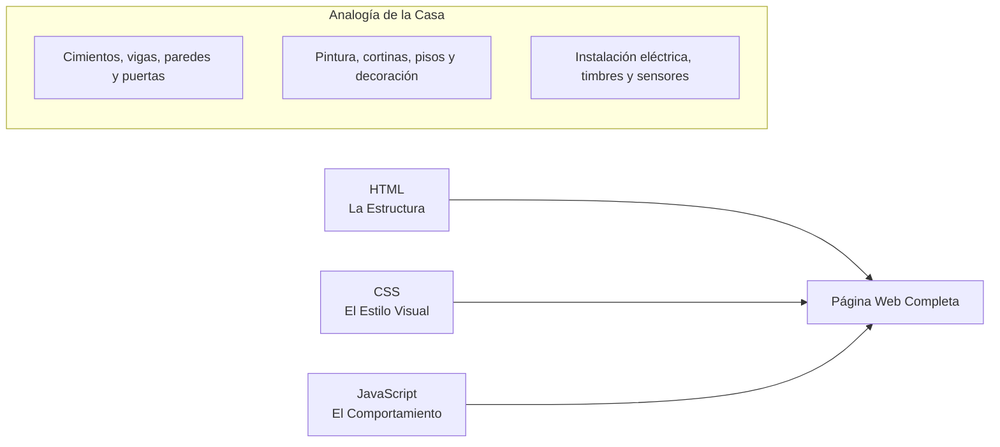
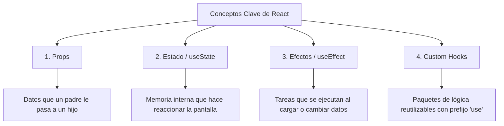

# Capítulo 01: Fundamentos Web y React desde Cero

> **Objetivo del capítulo**: Explicar con analogías del mundo real cómo funciona una aplicación web moderna y los conceptos fundamentales de React 18, para que cuando veas una línea como `const [user, setUser] = useState(null)` o `<ProtectedRoute>` sepas exactamente qué está pasando tras bambalinas.

---

## 1. La Trinidad de la Web: HTML, CSS y JavaScript

Toda página o aplicación que abres en un navegador web (Chrome, Firefox, Safari o Edge) está construida a partir de tres tecnologías fundamentales.

Imagina la construcción de una **casa**:



1. **HTML (HyperText Markup Language)**:
   - Es el esqueleto. Define los elementos: encabezados (`<h1>`), párrafos (`<p>`), botones (`<button>`), listas (`<ul>`) y contenedores divisores (`<div>`).
   - Sin CSS ni JS, un documento HTML luce como un archivo de texto en blanco y negro sin diseño ni interacción.

2. **CSS (Cascading Style Sheets)**:
   - Es la estética. Le dice al navegador de qué color pintar el fondo, qué tamaño de letra usar, cómo alinear los elementos en columnas y qué animación aplicar cuando pasas el cursor sobre un botón.

3. **JavaScript (JS)**:
   - Es el cerebro y la electricidad. Permite que la página "haga cosas" cuando el usuario interactúa: abrir una ventana modal al hacer clic, validar si una contraseña está vacía, calcular el promedio de estrés de un equipo o guardar información en el navegador.

---

## 2. ¿Qué es React y por qué se inventó?

En los inicios de la web, cuando un usuario cambiaba de página o llenaba un formulario, el navegador tenía que solicitarle un archivo HTML completamente nuevo al servidor. La pantalla se quedaba en blanco por un segundo y luego recargaba todo desde cero.

Además, si tenías una interfaz compleja con 20 botones, un menú lateral, 5 gráficas y notificaciones en tiempo real, escribir código para actualizar cada pedacito de pantalla a mano en JavaScript puro se convertía en una pesadilla de mantenimiento (lo que los programadores llaman *código espagueti*).

### La Solución: Componentes como Bloques de LEGO
En 2013, Facebook creó **React**. React introduce un cambio revolucionario: **la interfaz se divide en piezas independientes y reutilizables llamadas componentes**.

Imagina un botón en Pulso360. En lugar de escribir el código del botón en las 30 pantallas del sistema, creas un solo componente:

```jsx
// Definimos el "molde" del botón una sola vez
function ActionButton({ label, onClick, variant }) {
  return (
    <button className={`btn btn-${variant}`} onClick={onClick}>
      {label}
    </button>
  );
}
```

Y luego lo usas en cualquier parte del sistema como si fuera una ficha de Lego:
```jsx
<ActionButton label="Guardar Bitácora" variant="primary" onClick={guardar} />
<ActionButton label="Cancelar" variant="secondary" onClick={cancelar} />
```

---

## 3. ¿Qué es JSX? (JavaScript + XML)

Si miras los archivos dentro de `src/`, notarás que todos terminan en `.jsx`.

En JavaScript tradicional no se puede escribir código HTML directamente. Si intentas escribir `<div>Hola</div>` en un archivo `.js` estándar, el computador marcará un error de sintaxis.

**JSX** es una extensión de sintaxis creada para React que te permite **escribir HTML directamente dentro de tus funciones de JavaScript**.

```jsx
// Esto es JSX: una función de JavaScript que retorna "etiquetas" visuales
export function Bienvenida({ nombre }) {
  const hora = new Date().getHours();
  const saludo = hora < 12 ? "Buenos días" : "Buenas tardes";

  return (
    <div className="tarjeta-saludo">
      <h2>{saludo}, {nombre}!</h2>
      <p>Bienvenido a tu turno en Pulso360.</p>
    </div>
  );
}
```

> **Regla de oro de JSX**: Todo lo que coloques entre llaves `{ }` se interpreta como código JavaScript vivo (variables, cálculos, condiciones o funciones).

---

## 4. Las Cuatro Palabras Mágicas de React

Para entender el 95% del código de Pulso360, solo necesitas comprender estos cuatro conceptos:



### 1. `props` (Propiedades)
Son los parámetros o ingredientes que un componente padre le pasa a un componente hijo. Son de **sólo lectura**; el hijo no puede modificarlos directamente.
- *Ejemplo*: Si tienes un componente `<Card title="Resumen" color="blue" />`, `title` y `color` son sus *props*.

### 2. El Estado (`useState`): La memoria a corto plazo
Los componentes ordinarios son estáticos: se pintan una vez y se olvidan. Pero en una aplicación real, las cosas cambian: el usuario escribe en un campo de texto, selecciona un nivel de cansancio de 1 a 5 o abre un modal.

Para recordar esos valores cambiantes, React proporciona el Hook `useState`:

```jsx
import { useState } from 'react';

export function ContadorPausas() {
  // Declaramos una variable de estado llamada 'pausas' que inicia en 0
  // y una función para actualizarla llamada 'setPausas'
  const [pausas, setPausas] = useState(0);

  function registrarPausa() {
    setPausas(pausas + 1); // Al llamar a setPausas, React redibuja la pantalla con el nuevo número
  }

  return (
    <div>
      <p>Has realizado {pausas} pausas activas hoy.</p>
      <button onClick={registrarPausa}>Hacer Pausa</button>
    </div>
  );
}
```

> **Magia de React**: Cada vez que ejecutas la función `set...` (como `setPausas`), React detecta automáticamente que los datos cambiaron y **vuelve a renderizar (redibujar)** únicamente la parte de la pantalla que depende de ese dato, de forma casi instantánea.

### 3. Efectos Secundarios (`useEffect`): Reacciones al Entorno
Un componente a veces necesita hacer cosas fuera de la pantalla:
- Cargar datos desde el almacenamiento local al abrir la página.
- Configurar un temporizador que cuente los minutos de una pausa activa.
- Cerrar la sesión si el usuario pasa 15 minutos sin mover el mouse.

Para eso existe `useEffect`:
```jsx
import { useEffect } from 'react';

useEffect(() => {
  // Este código se ejecuta cuando el componente aparece en pantalla
  console.log("La pantalla se ha cargado con éxito");

  return () => {
    // Este código de limpieza se ejecuta cuando el usuario se va a otra pantalla
    console.log("El usuario salió de esta pantalla");
  };
}, []); // Los corchetes vacíos [] indican: "ejecutar solo una vez al montar"
```

### 4. Custom Hooks (Hooks Personalizados)
Cuando dos o más componentes necesitan la misma lógica (por ejemplo, cargar la bitácora del agente y validar los límites de palabras), en lugar de copiar y pegar el código en varios archivos, extraemos esa lógica en una función especial cuyo nombre siempre empieza por `use...` (como `useJournal`, `useCheckinWizard` o `useAuth`).

En Pulso360, la carpeta `src/features/<modulo>/hooks/` está repleta de estos hooks. Su trabajo es **orquestar la lógica y dejar que las páginas solo se preocupen por mostrar la información**.

---

## 5. ¿Cómo funciona la Navegación? React Router v7

En un sitio web tradicional, cada enlace te lleva a una nueva dirección web que descarga un archivo HTML distinto.

Pulso360 es una **SPA (Single Page Application - Aplicación de Página Única)**. Solo existe un único archivo HTML real en todo el proyecto: [index.html](file:///c:/Users/brahi/OneDrive/Escritorio/TdeA/4to%20semestre/Construccion3/Pulso360/index.html).

¿Cómo es posible entonces que tengamos rutas como `/login`, `/agente/panel`, `/supervisor/acciones` o `/sst/alertas`?

Gracias a **React Router (versión 7)**:
1. Cuando el usuario hace clic en un enlace de navegación, React Router intercepta el evento e impide que el navegador recargue la página.
2. Cambia el texto de la barra de direcciones (por ejemplo, de `/agente/panel` a `/agente/bitacora`).
3. Busca en su lista de rutas definida en `src/App.jsx`.
4. Desmonta el componente anterior y monta el nuevo componente en milisegundos, dando la sensación de una aplicación de escritorio ultrarrápida.

---

## 6. La Herramienta de Construcción: Vite

Si abres [package.json](file:///c:/Users/brahi/OneDrive/Escritorio/TdeA/4to%20semestre/Construccion3/Pulso360/package.json), verás que en los scripts dice `"dev": "vite"` y `"build": "vite build"`.

**Vite** (palabra francesa que significa "rápido") es el motor de empaquetado del proyecto:
- Mientras programas (`npm run dev`), levanta un servidor de desarrollo local en tu computador (por ejemplo en `http://localhost:5173`).
- Utiliza una tecnología llamada **HMR (Hot Module Replacement)**: cuando cambias una línea de código en un archivo `.jsx` o `.css` y guardas, Vite actualiza únicamente ese módulo en tu navegador al instante, sin necesidad de recargar la página completa ni perder lo que estabas haciendo.
- Cuando vas a publicar la aplicación a producción (`npm run build`), Vite toma todos los archivos de `src/`, optimiza las imágenes, comprime el código CSS y JavaScript y genera una carpeta llamada `dist/` lista para ser alojada en cualquier servidor web.

---

Con estos fundamentos claros, estás listo para adentrarte en el sistema visual y los estilos de Pulso360.

👉 **Siguiente paso**: [Capítulo 02: El Sistema Visual y Tokens CSS](./02_sistema_visual_y_tokens.md)
