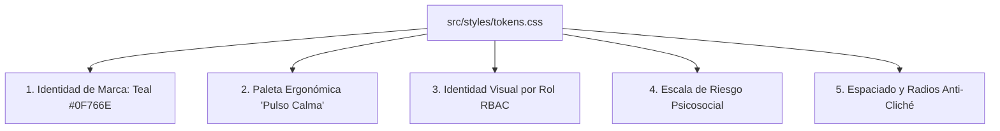

# Capítulo 02: El Sistema Visual y Tokens CSS

> **Objetivo del capítulo**: Desmitificar el diseño visual de Pulso360. Comprender qué es un **Design Token**, cómo funciona el archivo `tokens.css`, por qué cada color tiene un propósito ergonómico y psicológico en un contact center, y cómo se organizan las hojas de estilo sin caer en el caos de clases utilitarias.

---

## 1. ¿Qué es un Token de Diseño y por qué no usamos valores fijos?

En el desarrollo web novato, es muy común ver código como este:
```css
/* ❌ Código frágil y desordenado */
.mi-boton {
  background-color: #0f766e;
  padding: 13px 27px;
  border-radius: 9px;
  font-family: Arial;
}
```

¿Qué pasa si mañana el equipo de diseño decide cambiar el tono de azul o verde corporativo, o ajustar el espaciado? Tendrías que abrir 80 archivos CSS diferentes y cambiar `#0f766e` en cientos de lugares. Si olvidas uno solo, la aplicación lucirá inconsistente y descuidada.

### La Solución: Variables CSS (Tokens)
En Pulso360, **todos los valores visuales provienen de una única fuente de verdad**: el archivo [src/styles/tokens.css](file:///c:/Users/brahi/OneDrive/Escritorio/TdeA/4to%20semestre/Construccion3/Pulso360/src/styles/tokens.css).

Un **Design Token** es una variable centralizada que almacena una decisión de diseño:
```css
/* ✅ Código profesional y mantenible en tokens.css */
:root {
  --c-primario: #0f766e;
  --space-4: 16px;
  --radius-md: 5px;
}

/* En cualquier archivo de componente: */
.mi-boton {
  background-color: var(--c-primario);
  padding: var(--space-4);
  border-radius: var(--radius-md);
}
```

Si se modifica la variable en `tokens.css`, **toda la plataforma se actualiza instantáneamente en perfecta armonía**.

---

## 2. Anatomía de `tokens.css`: La Paleta Ergonómica BPO

En un centro de contacto, los operadores pasan de 8 a 10 horas frente a pantallas de computador, muchas veces en salas con luz artificial fría. Los colores no pueden elegirse por capricho; deben **reducir la fatiga visual y transmitir tranquilidad**.



### 1. El Color Primario: Verde Azulado (Teal `#0F766E`)
- No se usa un azul genérico ni un verde chillón. Se eligió **Teal**, un color asociado en psicología con la concentración, la salud mental y la serenidad.
- El archivo define una rampa completa del 50 al 600:
  - `--c-primario-50`: `#f0fdfa` (fondos de tarjetas activas y estados suaves).
  - `--c-primario`: `#0f766e` (color institucional principal para botones y acentos).
  - `--c-primario-hover`: `#115e59` (oscurecimiento sutil al pasar el cursor).

### 2. La Paleta "Pulso Calma" (Diseño Antipánico)
En las pantallas de desahogo y ejercicios de respiración del agente, los contrastes agresivos pueden detonar ansiedad. Por eso existen los tokens `--c-calma-*`:
- `--c-calma-bg`: `#f4f7f5` (un fondo con tinte verde salvia muy suave que descansa la retina).
- `--c-calma-text`: `#112623` (un tono pizarra profundo que ofrece máxima legibilidad sin la dureza del negro puro `#000000`).

### 3. Código Cromático por Rol (RBAC Contextual)
Para que un usuario sepa inmediatamente en qué entorno se encuentra, cada rol tiene asignado un tono distintivo en la cabecera y acentos:
- **Agente**: `--c-rol-agente` (`#0f766e` Teal / Cuidado personal).
- **Supervisor**: `--c-rol-supervisor` (`#2563eb` Azul Cobalto / Gestión operativa).
- **SST (Salud en el Trabajo)**: `--c-rol-sst` (`#7c3aed` Violeta / Salud ocupacional y clínica).
- **Auditor**: `--c-rol-auditor` (`#475569` Gris Pizarra / Neutralidad e inspección).
- **Administrador**: `--c-rol-admin` (`#d97706` Ámbar / Configuración del sistema).

### 4. La Escala de Calor Psicosocial (Heatmap)
Usada en el módulo de SST para evaluar niveles de riesgo psicosocial en los equipos de trabajo:
- `--hm-bajo`: `#10b981` (Verde esmeralda - Clima saludable).
- `--hm-medio-bajo`: `#84cc16` (Lima).
- `--hm-medio`: `#eab308` (Amarillo ámbar - Atención requerida).
- `--hm-alto`: `#f97316` (Naranja - Sobrecarga operativa).
- `--hm-critico`: `#ef4444` (Rojo - Protocolo de alerta temprana).

---

## 3. Tipografía y Escala de Espaciado

### Tipografía: *Plus Jakarta Sans*
Pulso360 utiliza la fuente tipográfica de Google Fonts **Plus Jakarta Sans** (`--font-family`).
- Es una fuente geométrica contemporánea con excelente legibilidad en tamaños pequeños (12px - 14px) y gran presencia en encabezados.
- Se acompaña de `Newsreader` para citas reflexivas y de `--font-family-mono` para números de auditoría y registros técnicos.

### La Escala Modular de Espaciado (Múltiplos de 4px)
Para evitar que un botón tenga un margen de 13px y otro de 17px, todo el espaciado del sistema sigue una escala armónica:

| Token | Valor en Píxeles | Uso Típico |
| :--- | :--- | :--- |
| `--space-1` | `4px` | Separación mínima entre icono y texto |
| `--space-2` | `8px` | Espacio entre elementos en listas compactas |
| `--space-3` | `12px` | Relleno interno de campos de texto pequeños |
| `--space-4` | `16px` | Relleno base de tarjetas y botones estándar |
| `--space-6` | `24px` | Separación entre secciones dentro de una tarjeta |
| `--space-8` | `32px` | Márgenes entre bloques principales de contenido |
| `--space-12` | `48px` | Separación de secciones de página |

---

## 4. Radios y Sombras: El Mandato Anti-Slop (Anti-Plantilla Genérica)

Muchas plantillas genéricas de internet abusan de bordes excesivamente redondeados (tarjetas con esquinas de 24px) y sombras gigantescas oscuras que parecen flotar sin sentido.

El estándar de diseño de Pulso360 prohíbe estos excesos:
- **Radios sutiles y ergonómicos**:
  - `--radius-sm`: `4px`
  - `--radius-md`: `5px`
  - `--radius-lg`: `6px`
  - `--radius-card`: `8px` (máximo radio para tarjetas institucionales).
- **Sombras por elevación real (Layered Shadows)**:
  - En lugar de una sombra negra opaca, se combinan dos sombras translúcidas diminutas (`rgba(15, 23, 42, 0.04)`) para emular la dispersión natural de la luz en un escritorio.

---

## 5. Accesibilidad Universal y Respeto al Usuario

El archivo `tokens.css` implementa dos mecanismos críticos de accesibilidad:

### 1. Foco Visible para Teclado
```css
:focus-visible {
  outline: 2px solid var(--c-primario);
  outline-offset: 2px;
}
```
Si un operador no puede usar el ratón y navega utilizando la tecla `Tab`, una línea de contorno nítida le mostrará siempre en qué botón o campo se encuentra.

### 2. Soporte para Movimiento Reducido (`prefers-reduced-motion`)
```css
@media (prefers-reduced-motion: reduce) {
  *, *::before, *::after {
    animation-duration: 0.01ms !important;
    transition-duration: 0.01ms !important;
  }
}
```
Si un empleado tiene condiciones vestibulares o migraña fotosensible y tiene configurado en Windows "Reducir animaciones", el sistema apaga automáticamente todas las transiciones y movimientos de pantalla.

---

## 6. La Cascada de Archivos CSS

En lugar de tener un archivo CSS gigante de 5.000 líneas que nadie pueda entender, el código está dividido en tres entradas ordenadas:

1. **[src/styles/styles.css](file:///c:/Users/brahi/OneDrive/Escritorio/TdeA/4to%20semestre/Construccion3/Pulso360/src/styles/styles.css)**: Importa los tokens y los estilos de la cara pública (`landing/` y `academic/`).
2. **[src/styles/components.css](file:///c:/Users/brahi/OneDrive/Escritorio/TdeA/4to%20semestre/Construccion3/Pulso360/src/styles/components.css)**: Importa componentes compartidos (`shared/primitives.css`, `shared/feedback.css`) y controles del agente (`agent/checkin.css`).
3. **[src/styles/layout.css](file:///c:/Users/brahi/OneDrive/Escritorio/TdeA/4to%20semestre/Construccion3/Pulso360/src/styles/layout.css)**: Define el marco maestro de la aplicación (barra lateral, cabecera de usuario y rejilla responsiva para pantallas de 1366px y móviles).

---

Con los tokens y el sistema visual dominados, en el siguiente capítulo entraremos en el corazón palpitante del software: la carpeta `src/core/`.

👉 **Siguiente paso**: [Capítulo 03: El Núcleo del Sistema (Core)](./03_arquitectura_core.md)
