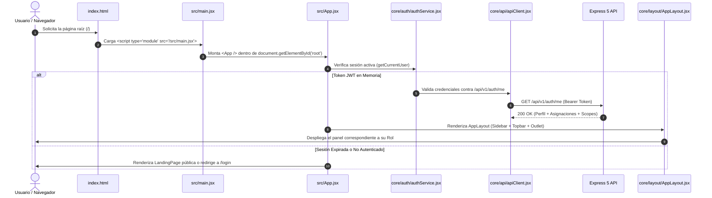
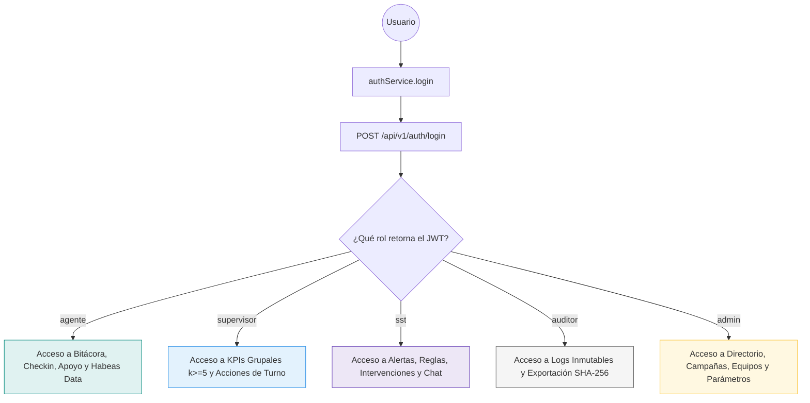
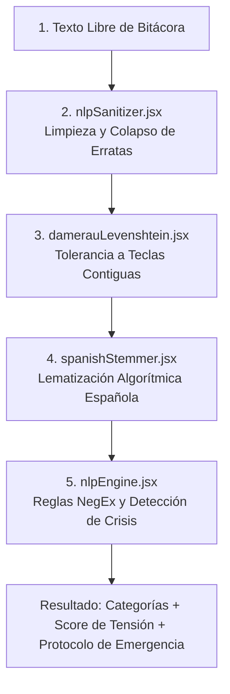

# Capítulo 03: El Núcleo del Sistema (`src/core/`)

> **Objetivo del capítulo**: Analizar en profundidad anatómica el corazón de Pulso360: cómo arranca la aplicación, cómo se enrutan las pantallas, cómo funciona la autenticación por roles (RBAC) con JWT, cómo se comunican el frontend y el backend mediante `apiClient` y WebSockets, cómo opera el motor de lenguaje natural (NLP) en 4 capas y cómo los componentes compartidos garantizan la privacidad.

---

## 1. El Flujo de Arranque: De `index.html` a `App.jsx`

Cuando abres Pulso360 en el navegador, ocurre una secuencia precisa en milisegundos:



### `frontend/src/main.jsx`
Es el punto de entrada de JavaScript en el cliente:
1. Importa `React` y `ReactDOM`.
2. Importa la hoja de estilos global `src/styles/styles.css`.
3. Localiza el elemento `<div id="root">` en el HTML.
4. Ejecuta `ReactDOM.createRoot().render(<App />)` para transferir el control total de la pantalla al motor de React.

### `frontend/src/App.jsx`
Es el **enrutador maestro** de la aplicación. Configura la tabla de rutas utilizando `react-router-dom`:
- **Rutas Públicas**: `/login`, `/recuperar-clave`, `/nueva-clave`, `/contactenos`, `/fundamentacion` y la `/` (Landing Page).
- **Rutas Protegidas bajo AppLayout**: Encapsuladas dentro del componente `<ProtectedRoute>`. Si alguien intenta escribir `/sst/panel` en la barra de direcciones sin tener el rol `sst`, el sistema lo expulsa automáticamente a `/403` (Prohibido) o a su panel correspondiente.
- **RootRedirect**: Inspecciona el usuario conectado y lo envía a su pantalla de inicio natural:
  - Agente ➔ `/agente/panel`
  - Supervisor ➔ `/supervisor/panel`
  - SST ➔ `/sst/panel`
  - Auditor ➔ `/auditor/auditoria`
  - Administrador ➔ `/admin/organizacion`

---

## 2. Configuración Centralizada: `src/core/config/env.jsx`

En proyectos desordenados, los desarrolladores escriben `import.meta.env.VITE_APP_URL` disperso por decenas de archivos. Si una variable cambia de nombre, el código se rompe silenciosamente.

En Pulso360, **el acceso a variables de entorno está centralizado en un único objeto exportado**:
```jsx
export const env = {
  appName: import.meta.env.VITE_APP_NAME || 'Pulso360',
  apiBaseUrl: import.meta.env.VITE_API_URL || 'http://localhost:3000/api/v1',
  socketUrl: import.meta.env.VITE_SOCKET_URL || 'http://localhost:3000',
  inactivityTimeoutMinutes: Number(import.meta.env.VITE_INACTIVITY_MINUTES || 15)
};
```
Cualquier archivo que necesite conectarse a la API o consultar tiempos de inactividad importa `env`, garantizando valores por defecto seguros.

---

## 3. Autenticación y Seguridad RBAC (`src/core/auth/`)

**RBAC** significa *Role-Based Access Control* (Control de Acceso Basado en Roles).



### `src/core/auth/authService.jsx`
Controla el ciclo de vida de la sesión autenticada:
- **`login(email, password)`**:
  - Verifica si el navegador está en bloqueo temporal local por fuerza bruta (`getRemainingLockMs()`).
  - Soporta alias rápidos institucionales para demostración docente (ej. escribir `agente` autocompleta `agente@pulso360.co`).
  - Realiza la petición HTTP a `POST /api/v1/auth/login`.
  - Al recibir una respuesta exitosa, almacena el token JWT de forma segura mediante `setAuthToken(token)`.
  - Normaliza los datos del usuario (*nombres, apellidos, rol, equipo BPO y avatar*) y sincroniza su estado de consentimiento bajo Ley 1581 (`GET /api/v1/agent/consent`).
- **`touchSession(user)`**: Actualiza la marca de tiempo `lastActivity` en `sessionStorage` para el control de inactividad por hardware compartido.
- **`getCurrentUser()`**: Retorna el usuario conectado. Si la sesión fue revocada o el usuario fue suspendido por el administrador en la base de datos, destruye el token y expulsa al usuario al login.
- **`logout()`**: Elimina el token JWT, limpia la sesión y notifica a los escuchadores para redirección limpia.

### `src/core/auth/ProtectedRoute.jsx`
Es el "guardián de la puerta" en el enrutamiento:
1. Invoca `authService.getCurrentUser()`.
2. Si no hay usuario o el token es inválido: Retorna `<Navigate to="/login" replace />`.
3. Si el usuario existe, pero su rol no está en `allowedRoles`: Retorna `<Navigate to="/403" replace />`.
4. Si el rol coincide: Renderiza los componentes autorizados (`<Outlet />`).

---

## 4. Comunicación con el Servidor y Tiempo Real (`src/core/api/` y `src/core/socket/`)

Pulso360 desacopla completamente el cliente de la base de datos mediante dos canales especializados:

### 1. Cliente HTTP REST: `src/core/api/apiClient.jsx`
Es la pasarela central para todas las peticiones asíncronas hacia Express:
- **Inyección Automática de Bearer Token**: Intercepta cada solicitud y añade el encabezado `Authorization: Bearer <jwt>`.
- **Estandarización de Sobres JSON**: Desempaqueta las respuestas canónicas `{ success: true, data: { ... } }`.
- **Manejo Centralizado de Errores (Fail-Fast)**: Si el servidor retorna `401 Unauthorized` o `403 Forbidden`, traduce los códigos de error del dominio (`AUTH_TOKEN_EXPIRED`, `AUTH_FORBIDDEN_ROLE`) y dispara los eventos globales para refrescar la interfaz.

### 2. Mensajería WebSockets: `src/core/socket/socketClient.jsx`
Gestiona el canal de comunicación bidireccional en tiempo real con Socket.IO en `http://localhost:3000`:
- Utilizado exclusivamente para el **Chat de Apoyo Psicosocial (SST & Agente)** y alertas en vivo.
- Implementa reconexión automática resiliente con backoff exponencial.
- Garantiza que al cambiar de cuenta o cerrar sesión, el socket anterior se desconecte completamente antes del nuevo handshake criptográfico.

---

## 5. El Motor de Lenguaje Natural en 4 Capas (`src/core/nlp/`)

A diferencia de sistemas que envían textos privados a nubes externas, Pulso360 ejecuta un pipeline de Procesamiento de Lenguaje Natural **100% determinista, privado y local** en 4 capas secuenciales:



1. **`nlpSanitizer.jsx` (Capa de Sanitización)**:
   - Limpia caracteres parásitos de teclado y colapsa elongaciones típicas de frustración (ej. transforma *"estoy satuuuuraaado"* en *"estoy saturado"*).
   - Preserva la letra `ñ` y las tildes normativas del idioma español.
2. **`damerauLevenshtein.jsx` (Capa de Tolerancia a Erratas)**:
   - Aplica el algoritmo de distancia Damerau-Levenshtein ($d \le 1$) para detectar equivocaciones por dedos rápidos en turnos de alta presión (*fat-finger typos* y transposiciones inmediatas).
3. **`spanishStemmer.jsx` (Capa de Lematización)**:
   - Reduce las formas verbales y flexiones de género y número a su raíz canónica (ej. *"agotada"*, *"agotados"*, *"agotamiento"* ➔ raíz común *"agot"*).
4. **`nlpEngine.jsx` (Orquestador y Reglas NegEx)**:
   - Aplica el algoritmo contextual NegEx: si el texto dice *"no me siento fatigado"*, la partícula de negación anula la activación de la categoría de estrés.
   - Si detecta **frases centinela de crisis aguda** (*"no puedo más"*, *"crisis de angustia"*), activa inmediatamente el modal de apoyo somático con líneas de atención psicológica gratuitas 24/7 sin emitir juicios ni enviar reportes punitivos al supervisor.

---

## 6. La Plantilla Maestra: `src/core/layout/AppLayout.jsx`

`AppLayout` es el contenedor visual que envuelve todas las pantallas privadas:
- **Barra Lateral (Sidebar)**: Muestra el logo institucional, el rol activo y los enlaces permitidos según `roleMenus`. En pantallas móviles se colapsa en un menú drawer accesible.
- **Barra Superior (Topbar)**: Muestra el turno operativo del agente (ej. *"Turno mañana · 08:00 a 16:00"*), la campana de notificaciones con insignia de no leídas y el botón de perfil de usuario.
- **Control de Inactividad Integrado**: Incorpora `<InactivityModal />`. Si el operador deja el puesto por más de 15 minutos (definido en `env.inactivityTimeoutMinutes`), se despliega una cuenta regresiva visual de 60 segundos antes de cerrar la sesión automáticamente para proteger la privacidad en puestos compartidos.
- **El `<Outlet />`**: Etiqueta de React Router donde se proyecta la pantalla específica de la ruta activa.

---

## 7. Componentes Compartidos (`src/core/components/`)

1. **`Icon.jsx`**: Catálogo de más de 40 iconos SVG vectoriales trazados a mano con precisión ergonómica (candado, pulso, alerta, usuario, campana, etc.). Cero librerías pesadas externas.
2. **`TrendLineChart.jsx`**: Generador matemático de gráficas de tendencia en SVG puro. Calcula coordenadas geométricas `(x, y)` para trazar curvas suaves de energía y tensión sin librerías pesadas como Chart.js o D3.
3. **`PrivacyBlockedCard.jsx`**: Componente de protección visual que se renderiza cuando un supervisor intenta consultar métricas grupales por debajo del umbral de k-anonimato ($k < 5$). Explica pedagógicamente la razón del bloqueo.
4. **`InactivityModal.jsx`**: Ventana modal con foco atrapado accesible para avisar sobre el cierre inminente de sesión por inactividad.
5. **`UserProfileModal.jsx`**: Permite al usuario revisar sus datos, cambiar su avatar inclusivo y consultar sus preferencias de accesibilidad.

---

Una vez comprendido el núcleo maestro, en el próximo capítulo estudiaremos cómo un usuario ingresa al sistema y cómo se gestiona su consentimiento informado.

👉 **Siguiente paso**: [Capítulo 04: Módulo de Autenticación y Consentimiento](./04_modulo_autenticacion.md)
