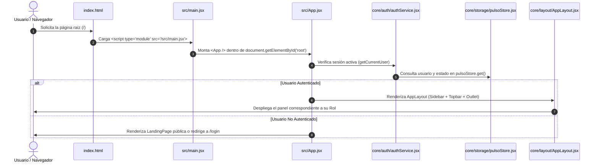
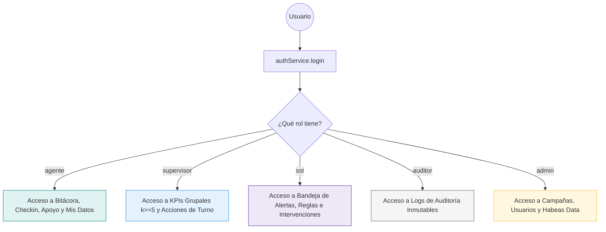
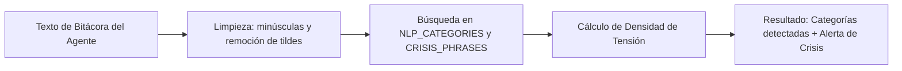

# Capítulo 03: El Núcleo del Sistema (`src/core/`)

> **Objetivo del capítulo**: Analizar en profundidad anatómica el corazón de Pulso360: cómo arranca la aplicación, cómo se enrutan las pantallas, cómo funciona la autenticación por roles (RBAC), cómo se persisten los datos con auditoría inmutable, cómo opera el motor de lenguaje natural (NLP) y cómo los componentes compartidos garantizan la privacidad.

---

## 1. El Flujo de Arranque: De `index.html` a `App.jsx`

Cuando abres Pulso360 en el navegador, ocurre una secuencia precisa en milisegundos:



### [src/main.jsx](file:///c:/Users/brahi/OneDrive/Escritorio/TdeA/4to%20semestre/Construccion3/Pulso360/src/main.jsx)
Es el punto de entrada de JavaScript. Su trabajo es mínimo pero vital:
1. Importa `React` y `ReactDOM`.
2. Importa la hoja de estilos global `src/styles/styles.css`.
3. Localiza el elemento `<div id="root">` en el HTML.
4. Ejecuta `ReactDOM.createRoot().render(<App />)` para transferir el control total de la pantalla al motor de React.

### [src/App.jsx](file:///c:/Users/brahi/OneDrive/Escritorio/TdeA/4to%20semestre/Construccion3/Pulso360/src/App.jsx)
Es el **enrutador maestro** de la aplicación. Configura la tabla de rutas utilizando `react-router-dom`:
- **Rutas Públicas**: `/login`, `/recuperar-clave`, `/nueva-clave`, `/contactenos`, `/fundamentacion` y la `/` (Landing Page).
- **Rutas Protegidas bajo AppLayout**: Encapsuladas dentro del componente `<ProtectedRoute>`. Si alguien intenta escribir `/sst/panel` en la barra de direcciones sin tener el rol `sst`, el sistema lo expulsa automáticamente a `/403` (Prohibido) o a su panel correspondiente.
- **RootRedirect**: La función `RootRedirect()` (línea 55) inspecciona el usuario conectado y lo envía a su pantalla de inicio natural:
  - Agente ➔ `/agente/panel`
  - Supervisor ➔ `/supervisor/panel`
  - SST ➔ `/sst/panel`
  - Auditor ➔ `/auditor/auditoria`
  - Administrador ➔ `/admin/organizacion`

---

## 2. Configuración Centralizada: [src/core/config/env.jsx](file:///c:/Users/brahi/OneDrive/Escritorio/TdeA/4to%20semestre/Construccion3/Pulso360/src/core/config/env.jsx)

En proyectos desordenados, los desarrolladores escriben `import.meta.env.VITE_APP_URL` disperso por decenas de archivos. Si una variable cambia de nombre, el código se rompe silenciosamente.

En Pulso360, **el acceso a variables de entorno está centralizado en un único objeto exportado**:
```jsx
export const env = {
  appName: import.meta.env.VITE_APP_NAME || 'Pulso360',
  storageKey: import.meta.env.VITE_STORAGE_KEY || 'pulso360_db',
  inactivityTimeoutMinutes: Number(import.meta.env.VITE_INACTIVITY_MINUTES || 15)
};
```
Cualquier archivo que necesite saber cómo se llama la base de datos o cuánto dura la sesión importa `env`, garantizando valores por defecto seguros si falta el archivo `.env`.

---

## 3. Autenticación y Seguridad RBAC (`src/core/auth/`)

**RBAC** significa *Role-Based Access Control* (Control de Acceso Basado en Roles).



### [src/core/auth/authService.jsx](file:///c:/Users/brahi/OneDrive/Escritorio/TdeA/4to%20semestre/Construccion3/Pulso360/src/core/auth/authService.jsx)
Este archivo de casi 400 líneas es una obra maestra de ingeniería para simular un backend completo en el navegador:
- **`login(email, password)`**:
  - Verifica si la cuenta está bloqueada temporalmente por intentos fallidos de fuerza bruta (`getRemainingLockMs()`).
  - Busca el usuario en `pulsoStore.get().users`.
  - Soporta alias rápidos de demostración (ej. escribir `agente` autocompleta las credenciales de demo).
  - Valida contraseñas y estado (`Activo` vs `Suspendido`).
  - Si el login falla repetidamente, activa un bloqueo temporal exponencial (15s, 30s, 60s) guardado en `GUARD_KEY`.
  - Registra el evento en la auditoría inmutable (`pulsoStore.audit`).
- **`touchSession(user)`**: Actualiza la marca de tiempo `lastActivity` en `sessionStorage` para el control de inactividad.
- **`getCurrentUser()`**: Retorna el usuario logueado. Si la sesión fue borrada o el usuario fue suspendido por un administrador, destruye la sesión y retorna `null`.
- **`logout()`**: Destruye la clave de sesión en `sessionStorage`, audita la salida y redirige a `/login`.

### [src/core/auth/ProtectedRoute.jsx](file:///c:/Users/brahi/OneDrive/Escritorio/TdeA/4to%20semestre/Construccion3/Pulso360/src/core/auth/ProtectedRoute.jsx)
Es el "guardián de la puerta". Recibe como *props* un arreglo `allowedRoles` (por ejemplo `['sst']`):
1. Invoca `authService.getCurrentUser()`.
2. Si no hay usuario: Retorna `<Navigate to="/login" replace />`.
3. Si hay usuario, pero su rol no está en `allowedRoles`: Retorna `<Navigate to="/403" replace />`.
4. Si el rol coincide: Renderiza los hijos (`children` o el `<Outlet />`).

### [src/core/auth/roleNavigation.jsx](file:///c:/Users/brahi/OneDrive/Escritorio/TdeA/4to%20semestre/Construccion3/Pulso360/src/core/auth/roleNavigation.jsx)
Declara las etiquetas oficiales de cada rol (`roleLabels`) y el menú lateral de opciones (`roleMenus`):
- Agrupa los enlaces en secciones claras (*Operación Diaria*, *Bienestar Personal*, *Gestión de Equipo*, etc.) para evitar fatiga cognitiva en los menús.

### [src/core/auth/AccessDenied.jsx](file:///c:/Users/brahi/OneDrive/Escritorio/TdeA/4to%20semestre/Construccion3/Pulso360/src/core/auth/AccessDenied.jsx)
Vista accesible del error HTTP 403. Explica claramente al usuario por qué no puede ver esa pantalla y le ofrece un botón accesible para regresar a su panel asignado.

---

## 4. Persistencia y Almacenamiento Seguro (`src/core/storage/`)

### [src/core/storage/browserStorage.jsx](file:///c:/Users/brahi/OneDrive/Escritorio/TdeA/4to%20semestre/Construccion3/Pulso360/src/core/storage/browserStorage.jsx)
**Regla inquebrantable**: Ningún componente de la aplicación puede llamar a `window.localStorage` directamente.
- Este archivo proporciona los adaptadores `localData` y `sessionData`.
- Envuelve cada lectura y escritura en bloques `try / catch` para proteger la aplicación si el usuario navega en Modo Incógnito estricto o si la cuota de disco del navegador se llena.

### [src/core/storage/pulsoStore.jsx](file:///c:/Users/brahi/OneDrive/Escritorio/TdeA/4to%20semestre/Construccion3/Pulso360/src/core/storage/pulsoStore.jsx)
Es el **repositorio de datos central**. Funciona como una base de datos local:
- **`get()`**: Lee el JSON de almacenamiento. Si está vacío o corrupto, clona la semilla inicial (`seed.jsx`), la normaliza con `normalizeStoredData.jsx`, ejecuta migraciones de esquema (`migrations.jsx`) y la guarda.
- **`save(data)`**: Serializa y almacena el estado completo.
- **`reset()`**: Devuelve el sistema a su estado de fábrica.
- **`audit({ actor, action, target, status })`**: Implementa una **cadena criptográfica de bloques (Hash Chain)**:
  ```javascript
  const previous = data.auditLogs[0];
  const prevHash = previous?.hash || 'GENESIS';
  const hash = `${id}-${prevHash}`;
  ```
  Cada registro de auditoría queda encadenado matemáticamente al anterior. Si alguien intentara manipular un registro en la consola del navegador, la cadena de hashes se rompería, evidenciando la alteración.

### [src/core/storage/seed.jsx](file:///c:/Users/brahi/OneDrive/Escritorio/TdeA/4to%20semestre/Construccion3/Pulso360/src/core/storage/seed.jsx)
Contiene más de 9 KB de datos de prueba hiperrealistas para entornos BPO:
- 5 usuarios de prueba (un agente, un supervisor, un profesional SST, un auditor y un admin).
- Campañas de operación reales ("Soporte Telecom", "Ventas Banca Móvil").
- Registros históricos de check-ins con distintas dimensiones de agotamiento.
- Reglas de alerta temprana preconfiguradas.

---

## 5. El Motor de Lenguaje Natural: [src/core/nlp/nlpEngine.jsx](file:///c:/Users/brahi/OneDrive/Escritorio/TdeA/4to%20semestre/Construccion3/Pulso360/src/core/nlp/nlpEngine.jsx)

Pulso360 cuenta con un motor de Procesamiento de Lenguaje Natural **100% determinista, privado y local**.



### Categorías de Análisis Psicosocial:
1. `Sobrecarga percibida`: Palabras como *"saturado"*, *"cola"*, *"presión"*, *"sin parar"*.
2. `Recuperación insuficiente`: Palabras como *"agotada"*, *"dormí mal"*, *"fatiga"*, *"sin descansar"*.
3. `Exigencia emocional`: Palabras como *"insultos"*, *"gritos"*, *"cliente agresivo"*, *"angustia"*.
4. `Frustración por métricas operativas`: Términos BPO como *"aht"*, *"fcr"*, *"csat"*, *"meta imposible"*.
5. `Crisis aguda`: Frases centinela críticas como *"no puedo más"*, *"quiero desaparecer"*, *"crisis de pánico"*. Si se detectan, el sistema no juzga ni envía al agente a RRHH: **abre de inmediato el modal de apoyo psicológico de emergencia con líneas telefónicas gratuitas 24/7**.

---

## 6. La Plantilla Maestra: [src/core/layout/AppLayout.jsx](file:///c:/Users/brahi/OneDrive/Escritorio/TdeA/4to%20semestre/Construccion3/Pulso360/src/core/layout/AppLayout.jsx)

`AppLayout` es el contenedor visual que envuelve todas las pantallas privadas:
- **Barra Lateral (Sidebar)**: Muestra el logo, el rol actual y los enlaces permitidos según `authService.getMenuItems(user)`. En pantallas móviles se colapsa en un menú hamburguesa accesible.
- **Barra Superior (Topbar)**: Muestra el turno operativo del agente (ej. *"Turno mañana · 08:00 a 16:00"*), la campana de notificaciones con insignia de no leídas y el botón de perfil de usuario.
- **Control de Inactividad Integrado**: Incorpora `<InactivityModal />`. Si el operador deja el puesto por más de 15 minutos (definido en `env.inactivityTimeoutMinutes`), se despliega una cuenta regresiva visual de 60 segundos antes de cerrar la sesión automáticamente para evitar que otra persona use su terminal.
- **El `<Outlet />`**: Es la etiqueta de React Router donde se proyecta la página específica que el usuario está visitando.

---

## 7. Componentes Compartidos (`src/core/components/`)

1. **[Icon.jsx](file:///c:/Users/brahi/OneDrive/Escritorio/TdeA/4to%20semestre/Construccion3/Pulso360/src/core/components/Icon.jsx)**: Diccionario de más de 40 iconos SVG vectoriales trazados con precisión (candado, corazón, pulso, alerta, usuario, campana, etc.). No requiere descargar librerías pesadas como FontAwesome.
2. **[TrendLineChart.jsx](file:///c:/Users/brahi/OneDrive/Escritorio/TdeA/4to%20semestre/Construccion3/Pulso360/src/core/components/TrendLineChart.jsx)**: Generador matemático de gráficas de tendencia en SVG puro. Calcula coordenadas geométricas `(x, y)` para trazar curvas suaves de energía y tensión a lo largo de los días sin necesidad de Chart.js o D3.
3. **[PrivacyBlockedCard.jsx](file:///c:/Users/brahi/OneDrive/Escritorio/TdeA/4to%20semestre/Construccion3/Pulso360/src/core/components/PrivacyBlockedCard.jsx)**: Componente que se dibuja cuando un supervisor intenta ver métricas de un equipo con menos agentes que el umbral de k-anonimato. Explica pedagógicamente la razón del bloqueo.
4. **[InactivityModal.jsx](file:///c:/Users/brahi/OneDrive/Escritorio/TdeA/4to%20semestre/Construccion3/Pulso360/src/core/components/InactivityModal.jsx)**: Ventana flotante con foco atrapado accesible para avisar sobre el cierre inminente de sesión.
5. **[StorageNotice.jsx](file:///c:/Users/brahi/OneDrive/Escritorio/TdeA/4to%20semestre/Construccion3/Pulso360/src/core/components/StorageNotice.jsx)**: Aviso sutil que informa al usuario que sus datos se conservan en el almacenamiento local de su navegador.
6. **[DownloadLink.jsx](file:///c:/Users/brahi/OneDrive/Escritorio/TdeA/4to%20semestre/Construccion3/Pulso360/src/core/components/DownloadLink.jsx)**: Utilidad accesible para descargar datos en formato JSON o CSV simulando una exportación real.

---

Una vez comprendido el núcleo maestro, en el próximo capítulo estudiaremos cómo un usuario ingresa al sistema y cómo se gestiona su consentimiento informado.

👉 **Siguiente paso**: [Capítulo 04: Módulo de Autenticación y Consentimiento](./04_modulo_autenticacion.md)
