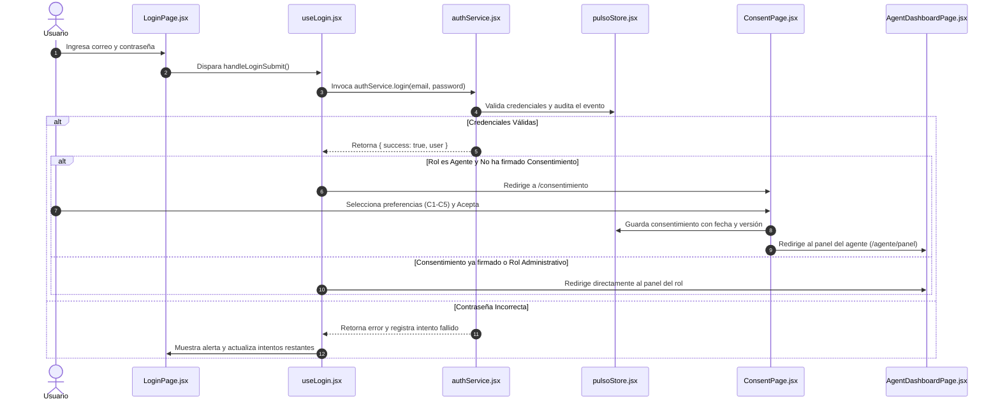

# Capítulo 04: Módulo de Autenticación y Consentimiento (`src/features/auth/`)

> **Objetivo del capítulo**: Analizar el portal de entrada a Pulso360: cómo se autentican los usuarios, cómo se previene la fuerza bruta, cómo funciona el selector de cuentas de demostración y, muy especialmente, cómo se gestiona el **Consentimiento Informado Granular (C1 a C5)**, la piedra angular ética del sistema.

---

## 1. El Flujo de Entrada y la Puerta de Consentimiento

El proceso de autenticación en Pulso360 no solo comprueba un correo y una clave: verifica si el usuario es un agente que ingresa por primera vez para exigir la aceptación de la política de tratamiento de datos antes de permitirle ver cualquier pantalla de trabajo.

---

## 2. Anatomía de Páginas (`src/features/auth/pages/`)

### [LoginPage.jsx](file:///c:/Users/brahi/OneDrive/Escritorio/TdeA/4to%20semestre/Construccion3/Pulso360/src/features/auth/pages/LoginPage.jsx)
Implementa un diseño moderno de **Pantalla Dividida (Split-Screen)**:
- **Panel Izquierdo**: Muestra el `LoginManifesto.jsx`, una declaración institucional que explica al trabajador que este sistema no es para vigilarlo ni para despedirlo, sino para proteger su salud mental.
- **Panel Derecho**: Contenedor dinámico controlado por el hook `useLogin`. Según el modo activo (`login`, `recovery`, `reset`), intercambia sin recargar la página:
  1. `LoginForm.jsx`: Formulario estándar de acceso.
  2. `DemoAccountsCard.jsx`: Selector de perfiles de demostración para pruebas rápidas.
  3. `ForgotPasswordForm.jsx`: Envío de enlace simulado de recuperación.
  4. `ResetPasswordForm.jsx`: Formulario con medidor visual de fortaleza de contraseña.

### [ConsentPage.jsx](file:///c:/Users/brahi/OneDrive/Escritorio/TdeA/4to%20semestre/Construccion3/Pulso360/src/features/auth/pages/ConsentPage.jsx)
Es la pantalla de **Consentimiento Informado del Agente**.
- En lugar de ser un simple botón de *"Acepto términos y condiciones"*, presenta un diseño editorial sobrio donde el agente decide con plena autonomía qué herramientas de bienestar habilita en su terminal.
- Coordina tres subcomponentes:
  - `ConsentPreferences.jsx`: La matriz de selección de las finalidades C1 a C5.
  - `ConsentHistory.jsx`: Registro histórico inmutable de cuándo otorgó o revocó cada permiso.
  - `ConsentPolicyModal.jsx`: Modal accesible con el texto legal completo de la política de datos.

### Páginas Secundarias de Soporte
- **[ForgotPasswordPage.jsx](file:///c:/Users/brahi/OneDrive/Escritorio/TdeA/4to%20semestre/Construccion3/Pulso360/src/features/auth/pages/ForgotPasswordPage.jsx)**: Envuelve a `LoginPage` pasándole `initialMode="recovery"`.
- **[ResetPasswordPage.jsx](file:///c:/Users/brahi/OneDrive/Escritorio/TdeA/4to%20semestre/Construccion3/Pulso360/src/features/auth/pages/ResetPasswordPage.jsx)**: Envuelve a `LoginPage` pasándole `initialMode="reset"`.
- **[ForbiddenPage.jsx](file:///c:/Users/brahi/OneDrive/Escritorio/TdeA/4to%20semestre/Construccion3/Pulso360/src/features/auth/pages/ForbiddenPage.jsx)**: Renderiza el componente transversal `AccessDenied.jsx` cuando se intenta violar una barrera RBAC.

---

## 3. Los Cinco Niveles de Consentimiento Granular (C1 a C5)

Pulso360 aplica el principio de **Minimización de Datos**. El agente puede encender o apagar de forma independiente cinco tratamientos de datos:

| Código | Finalidad del Tratamiento | ¿Qué ocurre si el agente lo desactiva? |
| :--- | :--- | :--- |
| **C1** | **Registro Emocional y Bitácora** | Puede seguir usando el sistema, pero su bitácora personal se deshabilita para evitar guardar texto íntimo. |
| **C2** | **Agregación en Estadísticas Grupales** | Sus respuestas de check-in se excluyen de los promedios del equipo que ve el supervisor. |
| **C3** | **Pausas Activas Guiadas y Respiración** | Oculta los recordatorios automáticos de estiramiento y relajación. |
| **C4** | **Canal de Apoyo y Contacto con SST** | Desactiva el buzón directo para que el equipo médico no pueda contactarle proactivamente. |
| **C5** | **Encuestas de Clima y Batería Psicosocial** | Excluye al agente de los cuestionarios institucionales periódicos de riesgo psicosocial. |

---

## 4. Componentes Especializados (`src/features/auth/components/`)

1. **[LoginForm.jsx](file:///c:/Users/brahi/OneDrive/Escritorio/TdeA/4to%20semestre/Construccion3/Pulso360/src/features/auth/components/LoginForm.jsx)**:
   - Controla los campos de correo y contraseña con visibilidad alternable (botón de ver/ocultar contraseña).
   - Checkbox "Recordar mi correo" que guarda el email en `localStorage` mediante `authService.rememberEmail`.
   - Manejo de estados: botón deshabilitado mientras `loading` es verdadero y aviso de bloqueo temporal si se exceden los intentos.
2. **[DemoAccountsCard.jsx](file:///c:/Users/brahi/OneDrive/Escritorio/TdeA/4to%20semestre/Construccion3/Pulso360/src/features/auth/components/DemoAccountsCard.jsx)**:
   - Tarjeta interactiva con 5 botones (uno por rol: Agente, Supervisor, SST, Auditor, Admin).
   - Al hacer clic en cualquiera, llena automáticamente el formulario de login y permite probar los diferentes permisos del sistema sin tener que memorizar contraseñas.
3. **[ResetPasswordForm.jsx](file:///c:/Users/brahi/OneDrive/Escritorio/TdeA/4to%20semestre/Construccion3/Pulso360/src/features/auth/components/ResetPasswordForm.jsx)**:
   - Evalúa en vivo la solidez de la nueva clave mediante cuatro reglas: longitud mínima de 8 caracteres, mayúsculas y minúsculas combinadas, al menos un número y coincidencia de confirmación.
   - Pinta una barra dinámica de fortaleza (`Débil`, `Aceptable`, `Fuerte`).
4. **[ConsentPreferences.jsx](file:///c:/Users/brahi/OneDrive/Escritorio/TdeA/4to%20semestre/Construccion3/Pulso360/src/features/auth/components/ConsentPreferences.jsx)**:
   - Renderiza las 5 casillas de verificación de C1 a C5 con explicaciones comprensibles sin jerga jurídica confusa.
5. **[ConsentHistory.jsx](file:///c:/Users/brahi/OneDrive/Escritorio/TdeA/4to%20semestre/Construccion3/Pulso360/src/features/auth/components/ConsentHistory.jsx)**:
   - Tabla cronológica que registra cada cambio de opinión del agente: *"2026-09-23 08:30 · Revocó finalidad C4 (Apoyo SST)"*. Sirve como prueba jurídica de no coacción.

---

## 5. Hooks de Autenticación (`src/features/auth/hooks/`)

### [useLogin.jsx](file:///c:/Users/brahi/OneDrive/Escritorio/TdeA/4to%20semestre/Construccion3/Pulso360/src/features/auth/hooks/useLogin.jsx)
Es el orquestador maestro de la experiencia de login:
- Centraliza los estados de modo (`login`, `recovery`, `reset`).
- Maneja la cuenta regresiva en segundos cuando el usuario es bloqueado por fuerza bruta (`lockedRemainingMs`).
- Conecta con `authService.login()` y maneja la navegación reactiva según el estado de consentimiento del usuario.

### [useConsent.jsx](file:///c:/Users/brahi/OneDrive/Escritorio/TdeA/4to%20semestre/Construccion3/Pulso360/src/features/auth/hooks/useConsent.jsx)
Controla la gestión de consentimientos:
- Lee los consentimientos actuales del usuario conectado desde `pulsoStore`.
- Si el usuario modifica los checkboxes y hace clic en "Guardar Preferencias", genera un nuevo evento en el historial, actualiza el objeto de usuario y registra la firma con la fecha ISO exacta y la versión vigente de la política.

---

## 6. Estilos Visuales del Módulo

- **[src/styles/auth.css](file:///c:/Users/brahi/OneDrive/Escritorio/TdeA/4to%20semestre/Construccion3/Pulso360/src/styles/auth.css)**:
  - Estructura la rejilla dividida: en pantallas mayores a 1024px divide la pantalla en dos columnas (`50% / 50%`); en pantallas móviles o portátiles pequeños (`1366x768`) apila los elementos verticalmente garantizando que el formulario siempre tenga prioridad visual.
  - Implementa los estilos de los botones de demo y las alertas semánticas de error.
- **[src/styles/consentimiento.css](file:///c:/Users/brahi/OneDrive/Escritorio/TdeA/4to%20semestre/Construccion3/Pulso360/src/styles/consentimiento.css)**:
  - Diseñado bajo una estética editorial limpia: fondos blancos, bordes suaves de 1px y tipografía amplia que facilita la lectura de textos legales extensos sin agotar la vista.

---

Una vez autenticado el agente y aceptado su consentimiento, ingresa a su espacio de trabajo diario. En el siguiente capítulo exploraremos en detalle el módulo más extenso y sensible de Pulso360: el Módulo del Agente.

👉 **Siguiente paso**: [Capítulo 05: Módulo del Agente de Contact Center](./05_modulo_agente.md)
