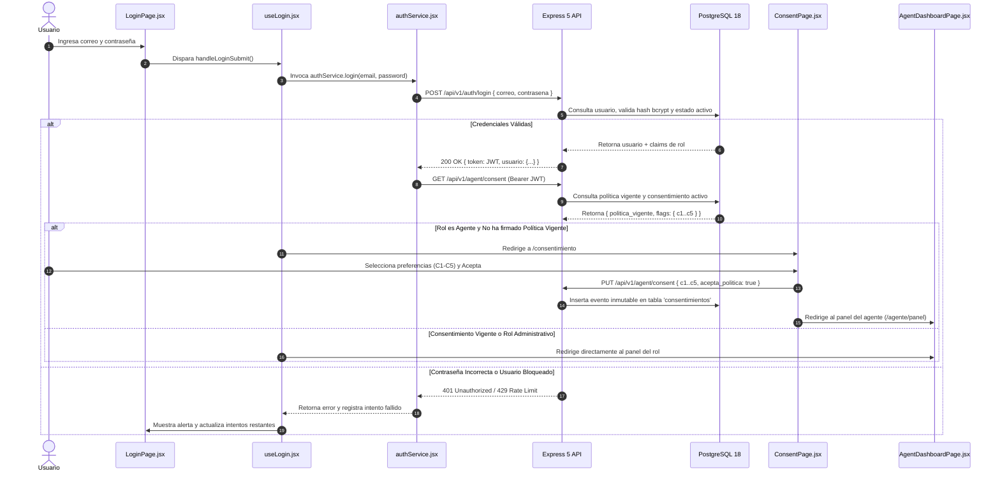

# Capítulo 04: Módulo de Autenticación y Consentimiento (`src/features/auth/`)

> **Objetivo del capítulo**: Analizar el portal de entrada a Pulso360: cómo se autentican los usuarios contra la API REST, cómo se firman y validan los tokens JWT, cómo opera el selector de cuentas institucionales y, muy especialmente, cómo se gestiona el **Consentimiento Informado Granular (C1 a C5)** bajo la Ley 1581 de 2012.

---

## 1. El Flujo de Entrada y la Puerta de Consentimiento

El proceso de autenticación en Pulso360 no solo comprueba un correo y una contraseña: verifica si el usuario es un agente que ingresa por primera vez o si la empresa publicó una nueva política de privacidad para exigir su aceptación informada antes de permitirle acceder a las herramientas de trabajo.

---

## 2. Anatomía de Páginas (`src/features/auth/pages/`)

### `LoginPage.jsx`
Implementa un diseño moderno de **Pantalla Dividida (Split-Screen)** adaptado a centros de contacto:
- **Panel Izquierdo**: Muestra el `LoginManifesto.jsx`, una declaración institucional que explica al trabajador que este sistema no es para vigilarlo ni para sancionarlo, sino para proteger su salud psicológica y ergonomía.
- **Panel Derecho**: Contenedor dinámico controlado por el hook `useLogin`. Según el modo activo (`login`, `recovery`, `reset`), intercambia sin recargar la página:
  1. `LoginForm.jsx`: Formulario estándar de acceso institucional.
  2. `DemoAccountsCard.jsx`: Selector de perfiles de demostración para evaluación docente rápida.
  3. `ForgotPasswordForm.jsx`: Solicitud formal de reseteo (`POST /api/v1/auth/password-reset/request`).
  4. `ResetPasswordForm.jsx`: Formulario con medidor visual de solidez de contraseña y validación en vivo.

### `ConsentPage.jsx`
Es la pantalla de **Consentimiento Informado del Agente (Ley 1581 de 2012)**.
- En lugar de ser un simple botón de *"Acepto términos y condiciones"*, presenta un diseño editorial sobrio donde el agente decide con plena autonomía qué tratamientos de bienestar habilita en su puesto de trabajo.
- Coordina tres subcomponentes:
  - `ConsentPreferences.jsx`: La matriz de selección de las finalidades C1 a C5.
  - `ConsentHistory.jsx`: Registro histórico inmutable de cuándo otorgó o revocó cada permiso.
  - `ConsentPolicyModal.jsx`: Modal accesible con el texto legal completo de la política de datos publicada en la base de datos.

### Páginas Secundarias de Soporte
- **`ForgotPasswordPage.jsx`**: Envuelve a `LoginPage` pasándole `initialMode="recovery"`.
- **`ResetPasswordPage.jsx`**: Envuelve a `LoginPage` pasándole `initialMode="reset"`.
- **`ForbiddenPage.jsx`**: Renderiza el componente transversal `AccessDenied.jsx` cuando un usuario intenta violar una barrera RBAC (HTTP 403).

---

## 3. Las Cinco Cláusulas de Consentimiento Granular (C1 a C5)

Pulso360 aplica el principio de **Minimización de Datos**. En la base de datos PostgreSQL (`tabla consentimientos`), cada consentimiento se descompone en 5 banderas booleanas independientes:

| Cláusula | Columna en BD | Finalidad del Tratamiento | ¿Qué ocurre si el agente lo desactiva? |
| :---: | :---: | :--- | :--- |
| **C1** | `c1_checkin` | **Check-in Diario de 6 Dimensiones** | El agente puede usar el sistema, pero el registro somático diario queda bloqueado con error `CONSENT_C1_REQUIRED`. |
| **C2** | `c2_bitacora` | **Desahogo Emocional en Bitácora Privada** | Deshabilita la creación de entradas de diario para garantizar que no se almacene texto personal íntimo. |
| **C3** | `c3_apoyo` | **Canal de Apoyo Psicosocial y Chat SST** | Impide radicar solicitudes de acompañamiento y bloquea la activación de salas de chat con SST (`CONSENT_C3_REQUIRED`). |
| **C4** | `c4_analitica` | **Inclusión en Analítica Grupal k-anónima** | Los datos del agente se excluyen automáticamente de las métricas agregadas del equipo que visualiza el supervisor. |
| **C5** | `c5_contacto` | **Contacto Preventivo por Salud Ocupacional** | El equipo de SST no puede iniciar comunicaciones proactivas de seguimiento hacia este agente. |

---

## 4. Componentes Especializados (`src/features/auth/components/`)

1. **`LoginForm.jsx`**:
   - Controla los campos de correo y contraseña con visibilidad alternable (botón de ver/ocultar contraseña).
   - Checkbox "Recordar mi correo" que guarda el email en almacenamiento local mediante `authService.rememberEmail`.
   - Manejo de estados: botón deshabilitado mientras `loading` es verdadero y aviso de bloqueo temporal si se exceden los intentos.
2. **`DemoAccountsCard.jsx`**:
   - Tarjeta interactiva con 5 accesos directos (uno por rol: Agente, Supervisor, SST, Auditor, Admin).
   - Al hacer clic en cualquiera, llena automáticamente el formulario con las credenciales institucionales (`correo` y `contrasena`) para facilitar la sustentación ante el docente.
3. **`ResetPasswordForm.jsx`**:
   - Evalúa en vivo la solidez de la nueva clave mediante cuatro reglas: longitud mínima de 8 caracteres, mayúsculas y minúsculas combinadas, al menos un número y coincidencia de confirmación.
   - Pinta una barra dinámica de fortaleza (`Débil`, `Aceptable`, `Fuerte`).
4. **`ConsentPreferences.jsx`**:
   - Renderiza las 5 casillas de verificación de C1 a C5 con explicaciones comprensibles sin tecnicismos jurídicos oscuros.
5. **`ConsentHistory.jsx`**:
   - Tabla cronológica recuperada del servidor (`GET /api/v1/agent/consent`) que registra cada cambio de opinión del agente con timestamp e IP de origen: *"2026-10-28 08:30 · ACTUALIZACION · Política v3.999.0"*. Sirve como prueba de auditoría ante la Superintendencia de Industria y Comercio (SIC).

---

Comprendido el acceso y la protección ética de los datos, en el siguiente capítulo nos adentraremos en el espacio más humano del software: el módulo del operador de contact center.

👉 **Siguiente paso**: [Capítulo 05: Módulo del Agente de Contact Center](./05_modulo_agente.md)
