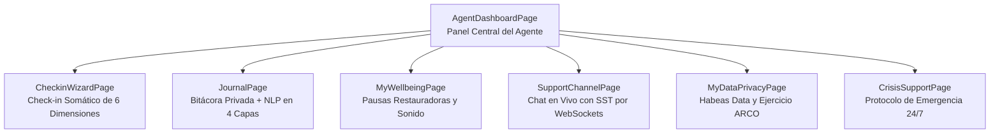
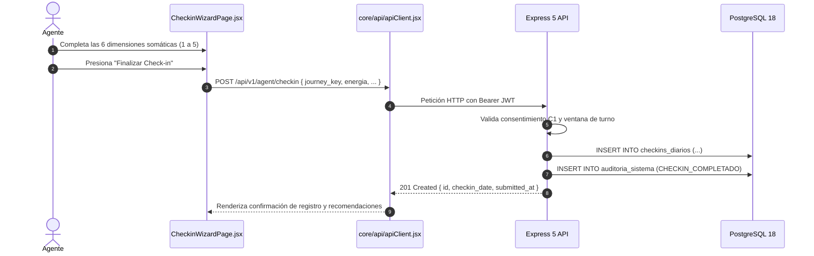

# Capítulo 05: Módulo del Agente de Contact Center (`src/features/agent/`)

> **Objetivo del capítulo**: Explorar el módulo más humano y sensible de Pulso360: el espacio personal del agente de operaciones. Analizaremos cómo se diseñó para brindar restauración somática, cómo funciona el Check-in diario de 6 dimensiones, el diario de desahogo privado con el pipeline NLP en 4 capas, la sala de chat en tiempo real con SST por WebSockets y los protocolos de emergencia ante crisis de ansiedad.

---

## 1. El Viaje del Agente: Arquitectura Centrada en la Restauración

Un agente de contact center atiende llamadas en intervalos de segundos. Por ello, la interfaz de este módulo sigue tres principios de diseño ergonómico:
1. **Fricción Cero**: Los check-ins son rápidos (menos de 60 segundos) para no perjudicar sus métricas de descanso.
2. **Privacidad Radical**: El agente tiene la certeza visual y técnica de que su supervisor jamás podrá leer el texto de su bitácora ni espiar sus conversaciones con SST.
3. **Restauración Somática Activa**: No solo mide el estrés, sino que ofrece herramientas físicas inmediatas (pausas respiratorias, técnica 5-4-3-2-1 y sonido ambiental) para regular el sistema nervioso tras una llamada agresiva.

---

## 2. Anatomía de Páginas (`src/features/agent/pages/`)

### 1. `AgentDashboardPage.jsx`
Es la central de operaciones del agente:
- Consulta el turno actual (`turno mañana / tarde / noche`) y la campaña asignada desde el backend (`GET /api/v1/auth/me`).
- **Indicador Somático de Entrada**: Si el agente no ha completado su pulso en la jornada actual (`GET /api/v1/agent/checkin/today`), una tarjeta destacada le invita a registrarlo con un solo clic.
- **Botón de Reset Rápido (BPO Reset)**: Abre un modal de 2 minutos para desacelerar el ritmo cardíaco entre llamadas de alta fricción.
- Muestra el historial reciente de energía y las recomendaciones de pausas activas.

### 2. `CheckinWizardPage.jsx`
Un asistente interactivo que evalúa las **6 dimensiones psicosociales normativas del modelo BPO**:
- **Dimensión 1 (Energía)**: Nivel de vigor físico frente al cansancio postural y visual.
- **Dimensión 2 (Carga Emocional)**: Presión experimentada por interacciones hostiles o colas saturadas.
- **Dimensión 3 (Recuperación)**: Calidad del descanso previo entre turnos rotativos.
- **Dimensión 4 (Apoyo)**: Percepción de soporte por parte de sus compañeros y líderes de piso.
- **Dimensión 5 (Distanciamiento)**: Desconexión o cinismo defensivo ante el usuario.
- **Dimensión 6 (Ineficacia)**: Sensación de saturación que impide resolver las llamadas con agilidad.
- **Sincronización de Jornada (Bogotá)**: El backend valida que el check-in corresponda a la ventana horaria del turno activo (`START_SHIFT`, `MID_SHIFT`, `END_SHIFT`).

### 3. `JournalPage.jsx`
La **Bitácora Emocional Privada**:
- Permite escribir libremente sobre lo ocurrido en el turno (*"El cliente me gritó porque la plataforma bancaria se cayó"*).
- Al escribir, el componente `NlpAnalysisPanel.jsx` ejecuta localmente el motor de lenguaje natural en 4 capas para resaltar palabras clave de sobrecarga o tensión.
- **Modal de Corrección Humana (`NlpCorrectionModal.jsx`)**: Si el motor detecta una palabra como negativa pero el agente la usó con sarcasmo o en otro contexto, el usuario puede marcar la corrección (`POST /api/v1/agent/journal/:id/corrections`), garantizando su soberanía interpretativa.

### 4. `MyWellbeingPage.jsx`
Gimnasio sensorial y de autorregulación:
- **Pausas Respiratorias Guiadas**: Ciclos de inhalación (4s), retención (4s) y exhalación (6s) con animaciones sincronizadas.
- Integra el servicio de sonido ambiente sintetizado en tiempo real.

### 5. `SupportChannelPage.jsx`
Canal de orientación psicosocial y **Chat en Vivo con SST**:
- Permite radicar solicitudes formales de apoyo preventivo (`POST /api/v1/sst/support-requests`) en modo **identificado** o **confidencial (anónimo)**.
- Una vez el profesional de SST activa la sala, se habilita una **sala de chat en tiempo real mediante WebSockets (`socketClient.jsx`)**.
- En modo anónimo, la identidad del agente se oculta automáticamente como `"Agente Confidencial"`.
- Los supervisores tienen **prohibido el acceso (HTTP 403)**, garantizando que el trabajador pueda expresarse sin temor a represalias laborales.

### 6. `MyDataPrivacyPage.jsx`
Portal de transparencia de Habeas Data (Ley 1581 de 2012):
- Consulta directamente en PostgreSQL cuántos check-ins y registros de bitácora existen asociados a su cuenta.
- Permite radicar solicitudes formales ARCO (`POST /api/v1/agent/habeas-data`): *Consulta, Portabilidad, Rectificación o Supresión*.

### 7. `CrisisSupportPage.jsx`
Espacio de auxilio inmediato y desescalamiento:
- Proporciona acceso a las líneas oficiales de asistencia psicológica en crisis (Línea 106 de salud mental, Línea 192 del Ministerio de Salud y Línea Púrpura).
- Ofrece ejercicios de estabilización inmediata en un clic.

---

## 3. Innovación Sonora: `ambientSound.jsx`

Una de las particularidades técnicas de Pulso360 es su generador de sonido ambiental para pausas activas:
- **Sin archivos MP3 pesados**: En lugar de descargar archivos de audio de internet (que consumen ancho de banda corporativo), genera el sonido **en tiempo real utilizando la Web Audio API nativa del navegador**.
- **Ruido Rosa Físico**: Implementa el algoritmo de Paul Kellet para filtrar ruido blanco aleatorio y convertirlo en ruido rosa, emulando el sonido suave del viento o el mar.
- **Drone Armónico de Quinta Abierta (110 Hz y 164.81 Hz)**: Añade dos frecuencias fundamentales cálidas (notas La2 y Mi3) que inducen al cerebro hacia estados alfa de relajación.
- **Sincronización Respiratoria**: Al inhalar, el filtro se abre a 900 Hz (aire brillante); al exhalar, desciende a 320 Hz (tono profundo), guiando el ritmo respiratorio a través del oído.

---

## 4. Ejercicios Restauradores: La Técnica Grounding 5-4-3-2-1

Cuando un cliente insulta gravemente a un agente o se vive un momento de estrés por caída del sistema, la persona puede experimentar un episodio de despersonalización o bloqueo mental.

El componente `GroundingExercise.jsx` guía al agente paso a paso para regresar al momento presente utilizando sus cinco sentidos:
1. **5 cosas que puedes ver**: Identificar objetos concretos en su estación de trabajo.
2. **4 cosas que puedes tocar**: Notar el tacto de su ropa, la mesa o la diadema.
3. **3 cosas que puedes oír**: Reconocer sonidos lejanos en la sala de operaciones.
4. **2 cosas que puedes oler**: El aroma del café o el ambiente.
5. **1 cosa que puedes saborear**: Un sorbo de agua fresca.

Este ejercicio dura 3 minutos y permite que el sistema nervioso parasimpático retome el control antes de atender una nueva interacción.

---

## 5. El Flujo de Datos del Check-in

---

Conocida la perspectiva individual del trabajador, pasaremos a estudiar cómo el supervisor gestiona a sus equipos sin violar la privacidad de sus agentes.

👉 **Siguiente paso**: [Capítulo 06: Módulo del Supervisor Operativo](./06_modulo_supervisor.md)
