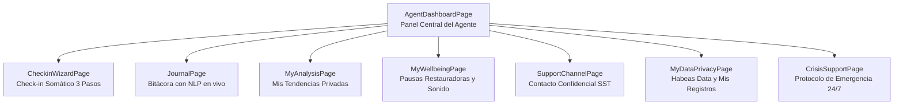
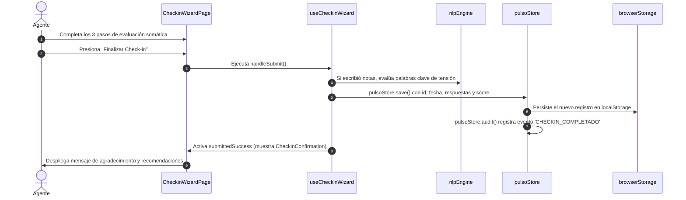

# Capítulo 05: Módulo del Agente de Contact Center (`src/features/agent/`)

> **Objetivo del capítulo**: Explorar el módulo más humano y sensible de Pulso360: el espacio personal del agente de operaciones. Analizaremos cómo se diseñó para brindar restauración somática, cómo funciona el Check-in en 3 pasos, el diario de desahogo privado con NLP en tiempo real, el sintetizador de sonido ambiental y los protocolos de emergencia ante crisis de ansiedad.

---

## 1. El Viaje del Agente: Arquitectura Centrada en la Restauración

Un agente de contact center atiende llamadas en intervalos de segundos. Por ello, la interfaz de este módulo sigue tres principios de diseño ergonómico:
1. **Fricción Cero**: Los check-ins son rápidos (menos de 60 segundos) para no perjudicar sus métricas de descanso.
2. **Privacidad Radical**: El agente tiene la certeza visual y técnica de que su supervisor jamás podrá leer el texto de su bitácora.
3. **Restauración Somática Activa**: No solo mide el estrés, sino que ofrece herramientas físicas inmediatas (pausas respiratorias, técnica 5-4-3-2-1 y sonido ambiental) para regular el sistema nervioso tras una llamada agresiva.

---

## 2. Anatomía de Páginas (`src/features/agent/pages/`)

### 1. [AgentDashboardPage.jsx](file:///c:/Users/brahi/OneDrive/Escritorio/TdeA/4to%20semestre/Construccion3/Pulso360/src/features/agent/pages/AgentDashboardPage.jsx)
Es la central de operaciones del agente:
- Consulta el turno actual (`turno mañana / tarde / noche`) y la campaña asignada.
- **Indicador Somático de Entrada**: Si el agente no ha realizado su check-in diario, una tarjeta destacada le invita a completarlo con una sola pulsación.
- **Botón de Reset Rápido (BPO Reset)**: Abre un modal de 2 minutos para desacelerar el ritmo cardíaco entre llamadas difíciles.
- Muestra el historial reciente de energía y las recomendaciones personalizadas de pausas.

### 2. [CheckinWizardPage.jsx](file:///c:/Users/brahi/OneDrive/Escritorio/TdeA/4to%20semestre/Construccion3/Pulso360/src/features/agent/pages/CheckinWizardPage.jsx)
Un asistente paso a paso (Wizard) de 3 etapas que previene la fatiga por cuestionarios largos:
- **Paso 1: Nivel de Energía y Cuerpo**: Mide la fatiga física (dolor de cuello por diadema, cansancio visual o sequedad vocal).
- **Paso 2: Carga Cognitiva y Emocional**: Evalúa la presión del turno (complejidad de los casos, volumen de colas e interacciones hostiles).
- **Paso 3: Recursos y Recuperación**: Evalúa si el agente siente que cuenta con herramientas para resolver las dudas de los usuarios y si pudo descansar en su jornada anterior.
- **Autoguardado de Borradores**: Si entra una llamada imprevista y el agente debe cerrar la pestaña, el hook `useCheckinWizard` guarda el progreso automáticamente en el almacenamiento local para que no pierda lo respondido.

### 3. [JournalPage.jsx](file:///c:/Users/brahi/OneDrive/Escritorio/TdeA/4to%20semestre/Construccion3/Pulso360/src/features/agent/pages/JournalPage.jsx)
La **Bitácora Emocional Privada**:
- Permite escribir libremente sobre lo ocurrido en el turno ("El cliente me gritó porque la plataforma del banco se cayó").
- Al escribir, el componente `NlpAnalysisPanel.jsx` ejecuta localmente el motor `nlpEngine.jsx` y resalta palabras clave de sobrecarga o tensión.
- **Modal de Corrección Humana (`NlpCorrectionModal.jsx`)**: Si el motor detecta una palabra como negativa pero el agente la usó con sarcasmo o en otro contexto, el usuario puede marcar la detección como incorrecta, enseñando al sistema y respetando su autonomía.

### 4. [MyAnalysisPage.jsx](file:///c:/Users/brahi/OneDrive/Escritorio/TdeA/4to%20semestre/Construccion3/Pulso360/src/features/agent/pages/MyAnalysisPage.jsx)
Panel de autoconocimiento:
- Utiliza `<TrendLineChart />` para trazar gráficas que muestran qué días de la semana el agente experimenta picos de agotamiento (por ejemplo, los lunes de quincena).
- **Aislamiento Total**: Esta pantalla solo existe en el perfil del agente; ningún supervisor ni administrador tiene acceso a estas métricas individuales.

### 5. [MyWellbeingPage.jsx](file:///c:/Users/brahi/OneDrive/Escritorio/TdeA/4to%20semestre/Construccion3/Pulso360/src/features/agent/pages/MyWellbeingPage.jsx)
Gimnasio mental y sensorial:
- **Pausas Respiratorias Guiadas**: Ciclos de inhalación (4s), retención (4s) y exhalación (6s) con animaciones visuales sincronizadas.
- Conecta directamente con el servicio de sonido ambiente sintetizado.

### 6. [SupportChannelPage.jsx](file:///c:/Users/brahi/OneDrive/Escritorio/TdeA/4to%20semestre/Construccion3/Pulso360/src/features/agent/pages/SupportChannelPage.jsx)
Canal protegido de comunicación con el equipo de Salud Ocupacional (SST):
- Permite solicitar una consulta psicológica confidencial o reportar acoso laboral sin que el supervisor operativo se entere ni deba dar autorización.

### 7. [MyDataPrivacyPage.jsx](file:///c:/Users/brahi/OneDrive/Escritorio/TdeA/4to%20semestre/Construccion3/Pulso360/src/features/agent/pages/MyDataPrivacyPage.jsx)
El portal de transparencia de Habeas Data:
- Muestra el número exacto de check-ins y registros de bitácora almacenados en el sistema.
- Permite **Descargar una copia completa de mis datos en JSON** mediante `<DownloadLink />`.
- Permite radicar solicitudes formales de rectificación o eliminación total de sus datos personales.

### 8. [CrisisSupportPage.jsx](file:///c:/Users/brahi/OneDrive/Escritorio/TdeA/4to%20semestre/Construccion3/Pulso360/src/features/agent/pages/CrisisSupportPage.jsx)
Espacio de auxilio inmediato:
- Proporciona acceso a las líneas oficiales de asistencia psicológica en crisis (Línea 106 de atención en salud mental, Línea 192 del Ministerio de Salud y Línea Púrpura).
- Ofrece ejercicios de estabilización inmediata en un clic.

---

## 3. Innovación Sonora: [ambientSound.jsx](file:///c:/Users/brahi/OneDrive/Escritorio/TdeA/4to%20semestre/Construccion3/Pulso360/src/features/agent/services/ambientSound.jsx)

Una de las joyas técnicas de Pulso360 es su generador de sonido ambiental para pausas activas:
- **Sin archivos MP3 pesados**: En lugar de descargar archivos de audio de internet (que consumen ancho de banda corporativo y exigen licencias de autor), el archivo genera el sonido **en tiempo real utilizando la Web Audio API nativa del navegador**.
- **Ruido Rosa Físico**: Implementa el algoritmo de Paul Kellet (líneas 26-43) para filtrar ruido blanco aleatorio y convertirlo en ruido rosa, emulando el sonido suave del viento o el mar.
- **Drone Armónico de Quinta Abierta (110 Hz y 164.81 Hz)**: Añade dos frecuencias fundamentales cálidas (notas musicales La2 y Mi3) que reducen la frecuencia de las ondas cerebrales hacia estados alfa de relajación.
- **Sincronización Respiratoria**: Al inhalar, el filtro se abre a 900 Hz (aire brillante); al exhalar, desciende a 320 Hz (tono cálido y profundo), guiando el ritmo respiratorio a través del oído.

---

## 4. Ejercicios Restauradores: La Técnica Grounding 5-4-3-2-1

Cuando un cliente insulta gravemente a un agente o se vive un momento de pánico por caída de los sistemas, la persona puede experimentar un episodio de despersonalización o disociación.

El componente [GroundingExercise.jsx](file:///c:/Users/brahi/OneDrive/Escritorio/TdeA/4to%20semestre/Construccion3/Pulso360/src/features/agent/components/GroundingExercise.jsx) guía al agente paso a paso para regresar al momento presente utilizando sus cinco sentidos:
1. **5 cosas que puedes ver**: Identificar objetos concretos en su estación de trabajo.
2. **4 cosas que puedes tocar**: Notar el tacto de su ropa, la mesa o la diadema.
3. **3 cosas que puedes oír**: Reconocer sonidos lejanos en la sala de operaciones.
4. **2 cosas que puedes oler**: El aroma del café o el ambiente.
5. **1 cosa que puedes saborear**: Un sorbo de agua fresca.

Este ejercicio dura 3 minutos y permite que el sistema nervioso parasimpático retome el control antes de que el agente atienda una nueva llamada.

---

## 5. El Flujo de Datos del Check-in

---

## 6. Hojas de Estilo del Módulo del Agente

- **`agent.css`**: Entrada maestra que regula la disposición de la rejilla de tarjetas y encabezados de página.
- **`bitacora.css`**: Estiliza el área de texto expandible con contador de palabras y tarjetas de historial cronológico.
- **`analisis.css`**: Formatea las tarjetas de métricas, los ejes de las gráficas SVG y las leyendas de colores.
- **`crisis.css`**: Fondo calmante con acentos suaves que elimina cualquier distracción visual durante un protocolo de emergencia.
- **`src/styles/agent/immersive-pause.css`**: Animaciones CSS de expansión y contracción para el círculo de respiración guiada.

---

Conocida la perspectiva individual del trabajador, pasaremos a estudiar cómo el supervisor gestiona a sus equipos sin violar la privacidad de sus agentes.

👉 **Siguiente paso**: [Capítulo 06: Módulo del Supervisor Operativo](./06_modulo_supervisor.md)
