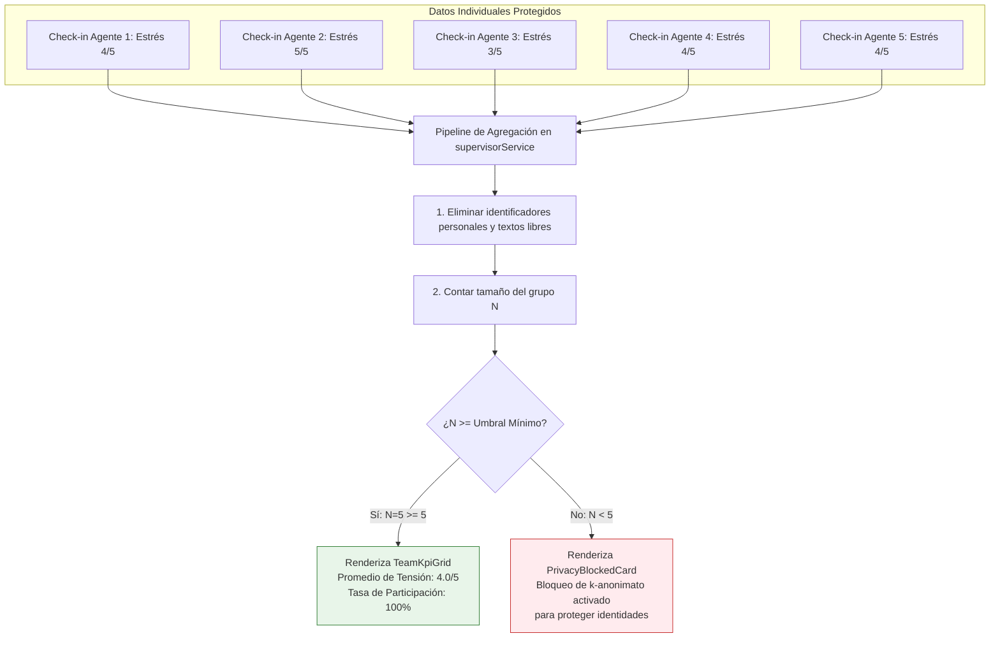

# Capítulo 06: Módulo del Supervisor Operativo (`src/features/supervisor/`)

> **Objetivo del capítulo**: Analizar cómo un supervisor de operaciones lidera sus turnos, monitorea la salud colectiva de su equipo y ejecuta planes de acción preventivos sin invadir la intimidad de los trabajadores ni violar el k-anonimato.

---

## 1. El Dilema del Supervisor: Entre la Meta Operativa y el Agotamiento

En un contact center, el **Supervisor de Turno** se encuentra atrapado entre dos fuegos:
1. **La Gerencia de Operaciones**, que le exige cumplir metas de llamadas por hora, nivel de servicio (SLA) y adherencia a los turnos.
2. **Los Agentes a su cargo**, que sufren estrés, desgaste vocal y desmotivación por la intensidad de la labor.

Si un sistema le dice al supervisor: *"El agente Juan Pérez reportó hoy que está al borde del llanto"*, el supervisor podría usar esa información de forma punitiva (reprender a Juan, asignarle más llamadas para que "aprenda" o calificarlo mal).

Por esta razón, la arquitectura de Pulso360 impone un **Muro Técnico Infranqueable**:
> **El supervisor NUNCA ve nombres individuales, ni textos de bitácoras, ni resultados de check-in persona por persona. Solo ve promedios consolidados de equipo cuando el grupo cumple las reglas de k-anonimato.**

---

## 2. El Pipeline de Agregación y k-Anonimato



---

## 3. Anatomía de Páginas (`src/features/supervisor/pages/`)

### [TeamDashboardPage.jsx](file:///c:/Users/brahi/OneDrive/Escritorio/TdeA/4to%20semestre/Construccion3/Pulso360/src/features/supervisor/pages/TeamDashboardPage.jsx)
Es el panel de mando del supervisor:
- **Barra de Filtros Contextuales**: Permite alternar entre equipos (ej. *Equipo Alpha 1 con N=14* vs *Célula Piloto con N=3*).
- **Control de Bloqueo por Privacidad (`isBlocked`)**: Si el supervisor selecciona un grupo pequeño donde $N < 5$, el panel oculta automáticamente todas las gráficas y KPIs, mostrando en su lugar el componente `<PrivacyBlockedCard />`.
- **Auditoría Transparente de Consultas**: Cada vez que el supervisor cambia los filtros para consultar un equipo, el `useEffect` (líneas 27-34) dispara una auditoría inmutable en `pulsoStore`:
  ```javascript
  pulsoStore.audit({
    actor: `${user.name} (${user.role})`,
    action: 'CONSULTA_AGREGADA',
    target: `ámbito=${scopeFilter}; período=${periodFilter}`
  });
  ```
  Esto garantiza que si alguien intenta cruzar filtros para deducir identidades, queda un registro indeleble para el Auditor del sistema.

### [ActionsPage.jsx](file:///c:/Users/brahi/OneDrive/Escritorio/TdeA/4to%20semestre/Construccion3/Pulso360/src/features/supervisor/pages/ActionsPage.jsx)
Es la pantalla de **Corresponsabilidad Preventiva**:
- Muestra los planes de acción colectivos asignados por el área de SST para ese equipo (por ejemplo: *"Rotación anticipada de colas difíciles"*, *"Pausa activa de descompresión cervical a las 15:00"*).
- Permite abrir el modal `ActionFollowupModal.jsx` para registrar observaciones del avance operativo: *"Se ejecutó la pausa colectiva con 12 agentes; se observó mejoría en la disposición del turno"*.

---

## 4. Componentes Especializados (`src/features/supervisor/components/`)

### 1. [TeamKpiGrid.jsx](file:///c:/Users/brahi/OneDrive/Escritorio/TdeA/4to%20semestre/Construccion3/Pulso360/src/features/supervisor/components/TeamKpiGrid.jsx)
Despliega cuatro tarjetas métricas fundamentales del equipo:
- **Índice de Energía del Turno**: Promedio grupal de vitalidad de 1 a 5.
- **Tensión Operativa Acumulada**: Nivel de estrés reportado en las llamadas.
- **Balance de Recuperación**: Porcentaje de agentes que reportaron haber tenido un descanso adecuado antes de iniciar el turno.
- **Tasa de Participación Voluntaria**: Qué porcentaje del equipo decidió completar el check-in (respetando que no es obligatorio).

### 2. [TeamFactorsTable.jsx](file:///c:/Users/brahi/OneDrive/Escritorio/TdeA/4to%20semestre/Construccion3/Pulso360/src/features/supervisor/components/TeamFactorsTable.jsx)
Una tabla analítica que categoriza las **causas objetivas del desgaste**:
- Muestra factores como *"Llamadas consecutivas sin respiro"*, *"Fallas en el CRM"* o *"Exigencia por tiempo de atención (AHT)"*.
- Esto orienta al supervisor hacia **soluciones de proceso**, evitando que culpe a los individuos por problemas derivados de la carga de trabajo.

### 3. [ActionFollowupModal.jsx](file:///c:/Users/brahi/OneDrive/Escritorio/TdeA/4to%20semestre/Construccion3/Pulso360/src/features/supervisor/components/ActionFollowupModal.jsx)
Ventana flotante con foco accesible para registrar notas de seguimiento a las intervenciones, cambiando estados entre `Pendiente`, `En progreso` y `Completada`.

---

## 5. Prevención de Ataques de Re-identificación

¿Qué ocurre si un supervisor filtra por *"Turno Mañana"* y luego por *"Campaña Telecom"* y luego por *"Agentes contratados en 2026"* hasta que solo quede una persona?

Pulso360 previene esto mediante dos salvaguardas:
1. **Límite de dos dimensiones simultáneas**: El sistema no permite combinaciones infinitas de filtros anidados.
2. **Evaluación dinámica del umbral $N$**: Si cualquier combinación de filtros arroja un resultado con menos de 5 registros activos, la vista se bloquea inmediatamente.

---

## 6. Estilos del Módulo de Supervisión

- **[src/styles/supervisor.css](file:///c:/Users/brahi/OneDrive/Escritorio/TdeA/4to%20semestre/Construccion3/Pulso360/src/styles/supervisor.css)**:
  - Aplica los acentos en **Azul Cobalto** (`--c-rol-supervisor`: `#2563eb`), diferenciando claramente el entorno de gestión del entorno de autocuidado del agente.
  - Diseña la rejilla de tarjetas KPI y la tabla de intervenciones con bordes nítidos de 1px y estados de insignias (badges) para seguimiento rápido.
- **[src/styles/umbral.css](file:///c:/Users/brahi/OneDrive/Escritorio/TdeA/4to%20semestre/Construccion3/Pulso360/src/styles/umbral.css)**:
  - Estiliza la tarjeta de advertencia de k-anonimato con un diseño pedagógico que no asusta al supervisor, sino que le explica la razón ética de la protección de datos.

---

Habiendo explorado la gestión operativa del supervisor, en el siguiente capítulo ingresaremos al área médica e institucional de la empresa: el Módulo de Seguridad y Salud en el Trabajo (SST).

👉 **Siguiente paso**: [Capítulo 07: Módulo SST (Salud y Seguridad en el Trabajo)](./07_modulo_sst.md)
