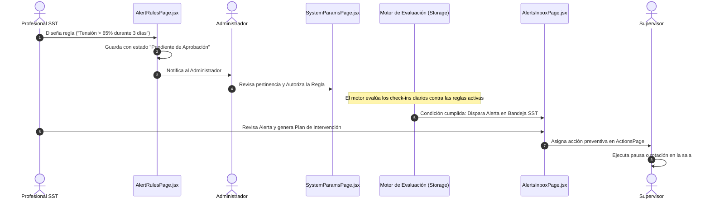

# Capítulo 07: Módulo SST - Salud y Seguridad en el Trabajo (`src/features/sst/`)

> **Objetivo del capítulo**: Analizar el módulo clínico y de salud ocupacional de Pulso360. Comprender cómo los profesionales de Seguridad y Salud en el Trabajo (SST) monitorean la salud psicosocial de miles de trabajadores a través de mapas de calor epidemiológicos, cómo proponen reglas de alerta temprana con separación de funciones y cómo gestionan intervenciones preventivas.

---

## 1. El Rol de SST y el Marco Normativo Colombiano

En una empresa de Contact Center / BPO, el área de **Seguridad y Salud en el Trabajo (SST)** tiene la responsabilidad legal y ética de proteger la integridad física y mental de los colaboradores.

Bajo la **Resolución 2764 de 2022 del Ministerio del Trabajo de Colombia**, los empleadores están obligados a evaluar e intervenir los factores de riesgo psicosocial (estrés, burnout, exigencias emocionales y fatiga). 

### La Regla de Oro de Pulso360 en SST
Pulso360 es un **sistema centinela de alerta temprana**, no un sustituto de la evaluación clínica:
- **No emite diagnósticos médicos automáticos**: El software jamás concluye que un agente tiene una patología psiquiátrica.
- **Vigilancia Epidemiológica Colectiva**: SST analiza tendencias estadísticas globales para identificar qué campañas, pisos de operación o turnos horarios están sufriendo sobrecarga sistémica, interviniendo la causa raíz antes de que ocurran crisis graves o incapacidades médicas.

---

## 2. El Ciclo de Vida de las Alertas Preventivas: Separación de Funciones

Una de las decisiones arquitectónicas más sofisticadas de Pulso360 es el principio de **Gobernanza y Separación de Funciones (Separation of Duties)**:
> Un profesional de SST no puede activar reglas de alerta que impacten la operación de forma unilateral, ni la gerencia administrativa puede inventar umbrales clínicos sin el aval de SST.

---

## 3. Anatomía de Páginas (`src/features/sst/pages/`)

### 1. [SstDashboardPage.jsx](file:///c:/Users/brahi/OneDrive/Escritorio/TdeA/4to%20semestre/Construccion3/Pulso360/src/features/sst/pages/SstDashboardPage.jsx)
La cabina epidemiológica principal:
- **Índice Agregado de Bienestar**: Muestra la salud general de la organización en una escala de 0 a 100 (ej. `64.2 / 100 - En observación preventiva`).
- **Campañas con Datos Publicables**: Muestra cuántas campañas cumplen el umbral de k-anonimato ($N \ge 5$) para ser analizadas de forma segura.
- **Matriz de Calor Psicosocial (`<HeatmapGrid />`)**: Cruza las distintas campañas contra las dimensiones de riesgo (Carga mental, Demanda emocional, Fatiga física).

### 2. [AlertsInboxPage.jsx](file:///c:/Users/brahi/OneDrive/Escritorio/TdeA/4to%20semestre/Construccion3/Pulso360/src/features/sst/pages/AlertsInboxPage.jsx)
La **Bandeja de Entrada de Alertas Activas**:
- Lista todas las alertas disparadas por el motor estadístico clasificadas por severidad: `Moderada`, `Alta` o `Crítica`.
- Cada tarjeta (`AlertCard.jsx`) desglosa la evidencia matemática (ej. *"Campaña Soporte Alpha: 72% de los agentes reportaron fatiga vocal severa esta semana"*).
- Permite descartar una alerta con justificación obligatoria (`DismissAlertModal.jsx`) o convertirla inmediatamente en una intervención.

### 3. [AlertRulesPage.jsx](file:///c:/Users/brahi/OneDrive/Escritorio/TdeA/4to%20semestre/Construccion3/Pulso360/src/features/sst/pages/AlertRulesPage.jsx)
El configurador de umbrales preventivos:
- Permite construir reglas estadísticas mediante un constructor visual:
  - *Métrica*: Nivel de Tensión, Índice de Recuperación, Exigencia Emocional.
  - *Operador*: Mayor que (`>`), Menor que (`<`).
  - *Umbral porcentual*: `60%`, `70%`, `80%`.
  - *Mínimo de muestra*: Garantiza que la regla no se dispare por un solo agente atípico.

### 4. [InterventionsPage.jsx](file:///c:/Users/brahi/OneDrive/Escritorio/TdeA/4to%20semestre/Construccion3/Pulso360/src/features/sst/pages/InterventionsPage.jsx)
Seguimiento a planes de salud ocupacional:
- Muestra el catálogo de intervenciones activas categorizadas por tipo: *Ergonómica*, *Psicosocial*, *Organizacional de Turnos*.
- Formulario de creación (`NewInterventionForm.jsx`) donde se describe la justificación médica, los responsables y las fechas de control.

### 5. [SupportInboxPage.jsx](file:///c:/Users/brahi/OneDrive/Escritorio/TdeA/4to%20semestre/Construccion3/Pulso360/src/features/sst/pages/SupportInboxPage.jsx)
El **Buzón Confidencial de Solicitudes Individuales**:
- Cuando un agente solicita ayuda desde su `SupportChannelPage`, la solicitud llega **exclusivamente a esta bandeja**.
- Ni el supervisor ni el administrador pueden ver esta lista, salvaguardando el secreto profesional en salud laboral.

---

## 4. Componentes Especializados (`src/features/sst/components/`)

### 1. [HeatmapGrid.jsx](file:///c:/Users/brahi/OneDrive/Escritorio/TdeA/4to%20semestre/Construccion3/Pulso360/src/features/sst/components/HeatmapGrid.jsx)
Matriz visual bidimensional:
- Las filas representan las **Campañas de Operación** (Banca, Telecom, Seguros).
- Las columnas representan los **Factores de Riesgo** (Tensión, Fatiga, Colas, Clima).
- Cada celda se colorea dinámicamente utilizando los tokens de calor psicosocial:
  - `--hm-bajo` (Verde esmeralda): Riesgo controlado.
  - `--hm-medio` (Amarillo): Atención preventiva.
  - `--hm-critico` (Rojo): Intervención prioritaria.

### 2. [DismissAlertModal.jsx](file:///c:/Users/brahi/OneDrive/Escritorio/TdeA/4to%20semestre/Construccion3/Pulso360/src/features/sst/components/DismissAlertModal.jsx)
En auditoría clínica, **descartar una alerta sin motivo es una falta grave**.
- Este modal obliga al profesional de SST a seleccionar una razón fundamentada (*"Falso positivo por evento extraordinario en sistemas"*, *"Ya se encuentra bajo plan de mitigación en curso"*) y escribir una justificación obligatoria que queda sellada en el log de auditoría.

### 3. [NewInterventionForm.jsx](file:///c:/Users/brahi/OneDrive/Escritorio/TdeA/4to%20semestre/Construccion3/Pulso360/src/features/sst/components/NewInterventionForm.jsx)
Formulario exhaustivo de 10 KB que estructura las intervenciones bajo los estándares técnicos de la batería de riesgo psicosocial:
- Objetivo preventivo.
- Equipo o campaña destinataria.
- Supervisor responsable del seguimiento en sala.
- Fechas de inicio, revisión intermedia y cierre.

---

## 5. Estilos Visuales del Módulo SST

- **[src/styles/sst.css](file:///c:/Users/brahi/OneDrive/Escritorio/TdeA/4to%20semestre/Construccion3/Pulso360/src/styles/sst.css)**:
  - Identidad en color **Violeta** (`--c-rol-sst`: `#7c3aed`), que simboliza la autoridad médica, el cuidado clínico y la dignidad ocupacional.
  - Maquetación de la matriz de calor (`HeatmapGrid`) con bordes limpios, contraste tipográfico y estados interactivos accesibles para personas con daltonismo.

---

En el siguiente capítulo analizaremos los dos roles que velan por el control y la integridad del sistema: el Módulo del Auditor y el Módulo del Administrador.

👉 **Siguiente paso**: [Capítulo 08: Módulos de Auditoría y Administración](./08_auditoria_y_administracion.md)
