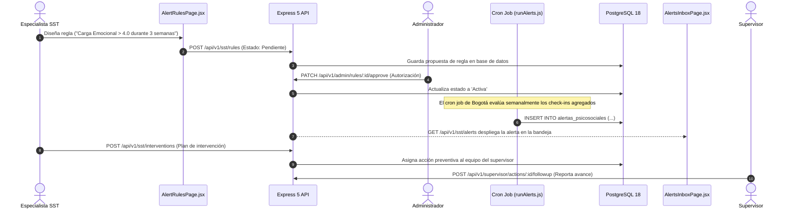

# Capítulo 07: Módulo SST - Salud y Seguridad en el Trabajo (`src/features/sst/`)

> **Objetivo del capítulo**: Analizar el módulo clínico y de salud ocupacional de Pulso360. Comprender cómo los profesionales de Seguridad y Salud en el Trabajo (SST) monitorean la salud psicosocial de cientos de operadores a través de matrices de calor epidemiológicas, cómo proponen reglas de alerta temprana con separación de funciones, cómo activan salas de chat preventivo y cómo gestionan planes de intervención estratégica.

---

## 1. El Rol de SST y el Marco Normativo Colombiano

En una empresa de Contact Center / BPO, el área de **Seguridad y Salud en el Trabajo (SST)** tiene la responsabilidad legal y ética de proteger la integridad física y mental de los colaboradores.

Bajo la **Resolución 2646 de 2008 y Resolución 2764 de 2022 del Ministerio del Trabajo de Colombia**, los empleadores están obligados a evaluar e intervenir los factores de riesgo psicosocial (estrés, burnout, exigencias emocionales y fatiga). 

### La Regla de Oro de Pulso360 en SST
Pulso360 es un **sistema centinela de alerta temprana**, no un sustituto de la evaluación clínica:
- **No emite diagnósticos médicos automáticos**: El software jamás concluye que un agente tiene una patología psiquiátrica ni genera prescripciones.
- **Vigilancia Epidemiológica Colectiva**: SST analiza tendencias estadísticas agregadas para identificar qué campañas, pisos de operación o franjas horarias están sufriendo sobrecarga sistémica, interviniendo la causa raíz antes de que ocurran crisis agudas o incapacidades laborales.

---

## 2. El Ciclo de Vida de las Alertas Preventivas: Separación de Funciones

Una de las decisiones arquitectónicas más sólidas de Pulso360 es el principio de **Gobernanza y Separación de Funciones (Separation of Duties)**:
> Un profesional de SST propone reglas clínicas de alerta, pero únicamente el Administrador del sistema puede activarlas para evitar distorsiones operativas unilaterales.

---

## 3. Anatomía de Páginas (`src/features/sst/pages/`)

### 1. `SstDashboardPage.jsx`
La cabina epidemiológica principal del especialista:
- **Índice Agregado de Bienestar**: Muestra la salud general de la organización calculada en servidor en una escala de 0 a 100 (`GET /api/v1/sst/metrics`).
- **Campañas con Datos Publicables**: Muestra cuántas campañas cumplen el umbral de k-anonimato ($N \ge 5$) para ser analizadas de forma segura.
- **Matriz de Calor Psicosocial (`<HeatmapGrid />`)**: Cruza las distintas campañas contra las dimensiones de riesgo (Carga emocional, Fatiga física, Recuperación).

### 2. `AlertsInboxPage.jsx`
La **Bandeja de Entrada de Alertas Activas**:
- Lista todas las alertas disparadas por el motor analítico del servidor clasificadas por severidad: `Moderada`, `Alta` o `Crítica`.
- Cada tarjeta (`AlertCard.jsx`) desglosa la evidencia matemática (ej. *"Campaña Retención VIP: 72% de los agentes reportaron fatiga emocional severa esta semana"*).
- Permite descartar una alerta con justificación obligatoria (`DismissAlertModal.jsx`) o convertirla inmediatamente en un plan de intervención estratégica.

### 3. `AlertRulesPage.jsx`
El configurador de umbrales preventivos:
- Permite construir reglas estadísticas mediante un constructor visual:
  - *Métrica*: Nivel de Tensión, Índice de Recuperación, Exigencia Emocional.
  - *Operador*: Mayor que (`>`), Menor que (`<`).
  - *Umbral numérico*: `3.5`, `4.0`, etc.
  - *Ámbito*: Por Campaña u Organizacional global.

### 4. `InterventionsPage.jsx`
Seguimiento a planes de salud ocupacional:
- Catálogo de intervenciones activas categorizadas por tipo: *Ergonómica*, *Psicosocial*, *Organizacional de Turnos*.
- Formulario de creación (`NewInterventionForm.jsx`) donde se describe la justificación médica, los responsables y las fechas de control (`POST /api/v1/sst/interventions`).

### 5. `SupportInboxPage.jsx`
El **Buzón Confidencial de Solicitudes y Activación de Chat**:
- Cuando un agente solicita ayuda desde su panel, la solicitud llega **exclusivamente a esta bandeja** (`GET /api/v1/sst/support-requests`).
- **Activación de Chat en Vivo**: Al presionar *"Iniciar Orientación"*, el SST invoca `POST /api/v1/chat/requests/:requestId/activate`, lo que abre una sala de chat bidireccional por WebSockets con el trabajador.
- **Modo Anónimo Respetado**: Si el trabajador solicitó apoyo confidencial, el nombre y correo del agente se ocultan como `"Agente Confidencial"`.
- Al concluir la sesión, el SST registra notas confidenciales y cierra la sala mediante `POST /api/v1/chat/sessions/:sessionId/close`.

---

## 4. Componentes Especializados (`src/features/sst/components/`)

### 1. `HeatmapGrid.jsx`
Matriz visual bidimensional:
- Las filas representan las **Campañas de Operación** (Banca, Telecom, Seguros).
- Las columnas representan los **Factores de Riesgo** (Tensión, Fatiga, Colas, Clima).
- Cada celda se colorea dinámicamente utilizando los tokens de calor psicosocial:
  - `--hm-bajo` (Verde esmeralda): Riesgo controlado.
  - `--hm-medio` (Amarillo): Atención preventiva.
  - `--hm-critico` (Rojo): Intervención prioritaria.

### 2. `DismissAlertModal.jsx`
En auditoría clínica, **descartar una alerta sin motivo es una falta grave**:
- Este modal obliga al profesional de SST a seleccionar una razón fundamentada (*"Falso positivo por evento extraordinario en sistemas"*, *"Ya se encuentra bajo plan de mitigación en curso"*) y escribir una justificación obligatoria que queda sellada en el log de auditoría inmutable de PostgreSQL (`auditoria_sistema`).

### 3. `NewInterventionForm.jsx`
Estructura las intervenciones bajo los estándares técnicos de la batería de riesgo psicosocial: objetivo preventivo, población objetivo, campaña asignada y cronograma de seguimiento.

---

En el siguiente capítulo revisaremos los dos roles de mayor jerarquía institucional: la Auditoría de Cumplimiento (Ley 1581) y la Administración del Sistema.

👉 **Siguiente paso**: [Capítulo 08: Módulos de Auditoría y Administración](./08_auditoria_y_administracion.md)
