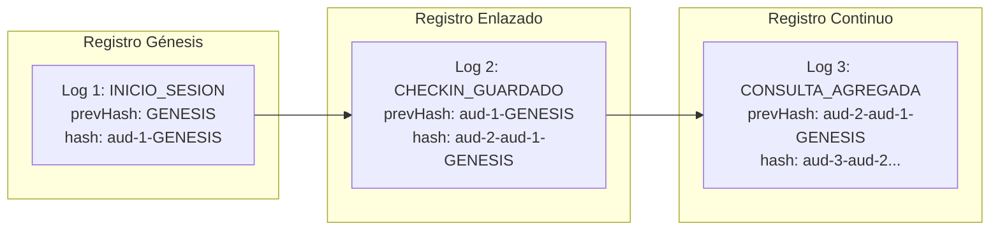

# Capítulo 08: Módulos de Auditoría y Administración (`src/features/auditor/` y `admin/`)

> **Objetivo del capítulo**: Analizar las dos áreas de máxima responsabilidad institucional en Pulso360: el **Auditor de Cumplimiento** (que verifica la inmutabilidad criptográfica de las operaciones) y el **Administrador del Sistema** (que gobierna usuarios, campañas, parámetros globales y el cumplimiento legal de Habeas Data).

---

## 1. Módulo del Auditor: Trazabilidad e Inmutabilidad Criptográfica

En sistemas empresariales, un administrador malintencionado con acceso a la base de datos podría intentar borrar registros para ocultar negligencias. 

Para evitar esto, Pulso360 implementa un modelo de **Registro de Solo Adición (Append-Only Log)** con una **Cadena Criptográfica de Hashes (Hash Chain)** inspirada en los principios de blockchain:

Si alguien altera un solo carácter de un registro intermedio, **toda la cadena posterior queda rota**, lo que permite al auditor detectar el fraude de inmediato.

### Anatomía de Archivos del Auditor
1. **[src/features/auditor/pages/AuditLogPage.jsx](file:///c:/Users/brahi/OneDrive/Escritorio/TdeA/4to%20semestre/Construccion3/Pulso360/src/features/auditor/pages/AuditLogPage.jsx)**:
   - **Botón "Verificar Integridad"**: Ejecuta un algoritmo en el hook `useAuditLog.jsx` que recorre todos los logs desde el origen hasta el presente recalculando los hashes. Si coinciden, despliega una insignia verde: *"Cadena de auditoría 100% íntegra y verificada"*.
   - **Botón "Exportar Registro Auditado"**: Descarga un archivo JSON firmado mediante `<DownloadLink />` para inspecciones de entidades reguladoras externas (Ministerio del Trabajo).
2. **[src/features/auditor/components/AuditLogTable.jsx](file:///c:/Users/brahi/OneDrive/Escritorio/TdeA/4to%20semestre/Construccion3/Pulso360/src/features/auditor/components/AuditLogTable.jsx)**:
   - Tabla interactiva con búsqueda por texto y filtros por estado (`ÉXITO`, `FALLA`, `BLOQUEO`).
   - Muestra la marca de tiempo exacta, el actor, la acción, la IP de origen y el hash de enlace.
3. **[src/styles/auditor.css](file:///c:/Users/brahi/OneDrive/Escritorio/TdeA/4to%20semestre/Construccion3/Pulso360/src/styles/auditor.css)**:
   - Utiliza el color **Gris Pizarra** (`--c-rol-auditor`: `#475569`), comunicando neutralidad, frialdad técnica e inspección forense.

---

## 2. Módulo de Administración: Gobernanza del Sistema (`src/features/admin/`)

El Administrador es el custodio de las reglas del juego. Su labor no es leer métricas de estrés, sino **mantener la infraestructura organizativa en funcionamiento armónico**.

### 1. [OrganizationPage.jsx](file:///c:/Users/brahi/OneDrive/Escritorio/TdeA/4to%20semestre/Construccion3/Pulso360/src/features/admin/pages/OrganizationPage.jsx)
Permite modelar la estructura real de la empresa:
- **Campañas**: Crea líneas de servicio (ej. *"Campaña Telecom Bilingüe"*, *"Banca Preferencial"*).
- **Equipos de Trabajo**: Agrupa agentes bajo la tutela de un supervisor específico.
- **Configuración de Turnos**: Define las horas de inicio de los turnos de mañana, tarde y noche para sincronizar los check-ins automáticos.

### 2. [UsersRolesPage.jsx](file:///c:/Users/brahi/OneDrive/Escritorio/TdeA/4to%20semestre/Construccion3/Pulso360/src/features/admin/pages/UsersRolesPage.jsx)
Gestión del ciclo de vida de los empleados:
- **`CreateUserModal.jsx`**: Creación de nuevos usuarios asignándoles correo, campaña y rol (`agente`, `supervisor`, `sst`, `auditor`, `admin`).
- **Suspensión de Cuentas**: Al cambiar el estado de un usuario a `Suspendido`, `authService` invalida su sesión inmediatamente, expulsándolo de la aplicación si estuviera navegando.
- **Asignación de Supervisores**: Vincula qué supervisor responde por qué grupo de agentes.

### 3. [SystemParamsPage.jsx](file:///c:/Users/brahi/OneDrive/Escritorio/TdeA/4to%20semestre/Construccion3/Pulso360/src/features/admin/pages/SystemParamsPage.jsx)
El tablero de control de políticas institucionales:
- **Aprobación de Reglas SST (`<PendingAlertRules />`)**: Como vimos en el capítulo anterior, aquí el administrador revisa y autoriza las reglas de alerta propuestas por SST.
- **Umbral Global de k-Anonimato**: Ajusta el valor mínimo de $N$ (por defecto 5) necesario para mostrar métricas agregadas en toda la plataforma.
- **Temporizador de Inactividad**: Configura cuántos minutos de inactividad se permiten antes de desplegar el modal de bloqueo (15 minutos por defecto).

### 4. [CsvImportPage.jsx](file:///c:/Users/brahi/OneDrive/Escritorio/TdeA/4to%20semestre/Construccion3/Pulso360/src/features/admin/pages/CsvImportPage.jsx)
En un call center pueden ingresar 200 agentes nuevos en una sola semana. Crearlos uno a uno sería ineficiente:
- Permite arrastrar un archivo `.csv` con las columnas `nombre,email,rol,campaña,turno`.
- El servicio `useCsvImport.jsx` valida cada fila: descarta correos duplicados, verifica que la campaña exista y reporta inconsistencias con número de línea antes de insertar los registros en `pulsoStore`.

### 5. [HabeasDataPage.jsx](file:///c:/Users/brahi/OneDrive/Escritorio/TdeA/4to%20semestre/Construccion3/Pulso360/src/features/admin/pages/HabeasDataPage.jsx)
Atención de derechos fundamentales bajo la **Ley 1581 de 2012 de Colombia**:
- **Bandeja de Solicitudes ARCO** (Acceso, Rectificación, Cancelación y Oposición).
- **Flujo de Estados Legal**: Cada solicitud pasa por un ciclo formal:
  1. `Radicada`: El agente la envía desde su panel. El sistema calcula automáticamente el plazo legal máximo de respuesta en días hábiles (10 o 15 días según el tipo).
  2. `En trámite`: El administrador la evalúa junto al área jurídica.
  3. `Resuelta`: Se emite la respuesta oficial y se ejecuta la acción (ej. supresión de registros o corrección de datos erróneos).
- **Modal de Avance (`HabeasAdvanceModal.jsx`)**: Obliga a documentar la resolución formal que se le notificará al titular.

---

## 3. Estilos Visuales del Módulo de Administración

- **[src/styles/admin.css](file:///c:/Users/brahi/OneDrive/Escritorio/TdeA/4to%20semestre/Construccion3/Pulso360/src/styles/admin.css)**:
  - Identidad en color **Ámbar / Dorado** (`--c-rol-admin`: `#d97706`), evocando autoridad institucional y configuración global.
  - Diseño responsivo de formularios en cuadrículas de 2 columnas con tarjetas modales bien delimitadas.

---

En el siguiente capítulo analizaremos los módulos que conectan a todos los roles: el sistema de Notificaciones, el Generador de Reportes Consolidados y la Landing Page pública.

👉 **Siguiente paso**: [Capítulo 09: Módulos Transversales y Cara Pública](./09_modulos_transversales_y_landing.md)
