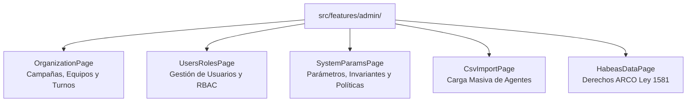

# Capítulo 08: Módulos de Auditoría y Administración (`src/features/auditor/` y `admin/`)

> **Objetivo del capítulo**: Analizar las dos áreas de máxima responsabilidad institucional en Pulso360: el **Auditor de Cumplimiento** (que verifica la inmutabilidad criptográfica y trazabilidad bajo Ley 1581) y el **Administrador del Sistema** (que gobierna usuarios, campañas, parámetros globales y el cumplimiento legal de Habeas Data).

---

## 1. Módulo del Auditor: Trazabilidad e Inmutabilidad Criptográfica

En sistemas empresariales, un administrador malintencionado con acceso a la base de datos podría intentar alterar o borrar registros para ocultar negligencias. 

Para evitar esto, Pulso360 implementa en el backend un modelo de **Registro de Solo Adición (Append-Only Log)** con una **Cadena Criptográfica de Hashes SHA-256 (Hash Chain)** persistida en la tabla `auditoria_sistema`:

```mermaid
graph LR
    subgraph Registro Génesis
        L1[Log 1: INICIO_SESION<br>prevHash: GENESIS<br>hash: SHA-256(1+GENESIS+payload)]
    end
    subgraph Registro Enlazado
        L2[Log 2: CHECKIN_GUARDADO<br>prevHash: Hash(Log 1)<br>hash: SHA-256(2+Hash1+payload)]
    end
    subgraph Registro Continuo
        L3[Log 3: CONSULTA_AGREGADA<br>prevHash: Hash(Log 2)<br>hash: SHA-256(3+Hash2+payload)]
    end

    L1 --> L2 --> L3
```

Si alguien altera un solo carácter de un registro intermedio directamente en PostgreSQL, **toda la cadena posterior queda rota**, permitiendo al auditor certificar la autenticidad forense ante autoridades de control (Superintendencia de Industria y Comercio o Ministerio del Trabajo).

### Anatomía de Archivos del Auditor
1. **`src/features/auditor/pages/AuditLogPage.jsx`**:
   - **Botón "Verificar Integridad"**: Invoca la comprobación criptográfica en el servidor (`GET /api/v1/auditor/logs`). El backend recorre cada bloque recalculando el hash SHA-256 en JSON canónico. Si coinciden, despliega la insignia de certificación: *"Cadena de auditoría 100% íntegra y verificada"*.
   - **Botón "Exportar Registro Auditado"**: Dispara `POST /api/v1/auditor/export` para descargar el expediente sellado con firma y metadatos de custodia.
2. **`src/features/auditor/components/AuditLogTable.jsx`**:
   - Tabla interactiva con búsqueda por texto y filtros por acción y rol.
   - Muestra la marca de tiempo exacta, el actor, la acción, el recurso afectado, la IP de origen y el hash de enlace.
3. **`src/styles/auditor.css`**:
   - Utiliza el color **Gris Pizarra** (`--c-rol-auditor`: `#475569`), comunicando neutralidad, sobriedad técnica e inspección forense.

---

## 2. Módulo de Administración: Gobernanza del Sistema (`src/features/admin/`)

El Administrador es el custodio de las reglas organizativas. Su labor no es leer métricas clínicas de estrés, sino **mantener la infraestructura de operaciones en funcionamiento armónico y conforme a la ley**.



### 1. `OrganizationPage.jsx`
Permite modelar la estructura real de la empresa en la base de datos:
- **Campañas (`POST /api/v1/admin/campaigns`)**: Crea líneas de servicio (ej. *"Campaña Retención & Bajas MásMóvil"*, *"Banca Preferencial"*).
- **Equipos de Trabajo (`POST /api/v1/admin/teams`)**: Agrupa agentes bajo la tutela de un supervisor específico.
- **Configuración de Turnos**: Define los horarios de inicio de los turnos de mañana, tarde y noche para sincronizar los check-ins automáticos en la zona horaria de Bogotá.

### 2. `UsersRolesPage.jsx`
Gestión del ciclo de vida de los empleados (`GET` y `POST /api/v1/admin/users`):
- **`CreateUserModal.jsx`**: Creación de nuevos usuarios asignándoles correo, contraseña encriptada con bcrypt, campaña, equipo y rol (`AGENTE`, `SUPERVISOR`, `SST`, `AUDITOR`, `ADMIN`).
- **Suspensión de Cuentas (`PATCH /api/v1/admin/users/:id/status`)**: Al cambiar el estado de un usuario a `Suspendido`, el middleware del servidor rechaza cualquier petición subsecuente con `401 Unauthorized` (`AUTH_USER_SUSPENDED`), invalidando su sesión de inmediato.

### 3. `SystemParamsPage.jsx`
Tablero de control de parámetros institucionales (`GET` y `PUT /api/v1/admin/params`):
- **Aprobación de Reglas SST**: Autorización formal de reglas preventivas propuestas por el equipo de Salud Ocupacional.
- **Umbral Global de k-Anonimato**: Ajusta el valor mínimo de $N$ (por defecto 5) necesario para mostrar métricas agregadas en toda la plataforma.
- **Protección de Invariantes del Negocio**: Si se intenta modificar un parámetro congelado por diseño, el servidor responde con error `409 Conflict` (`PARAM_READONLY`), preservando la integridad del sistema.
- **Publicación de Políticas de Privacidad (`POST /api/v1/admin/policies`)**: Permite publicar nuevas versiones de la política de datos personales (ej. `v3.999.0`), activando de inmediato el requerimiento de re-consentimiento informado para todos los agentes.

### 4. `HabeasDataPage.jsx`
Atención de derechos fundamentales bajo la **Ley 1581 de 2012 de Colombia** (`GET` y `PATCH /api/v1/admin/habeas-data`):
- **Bandeja de Solicitudes ARCO** (*Acceso / Consulta, Portabilidad, Rectificación y Supresión*).
- **Flujo de Estados Legal**: Cada solicitud pasa por un ciclo formal:
  1. `Radicada`: El agente la envía desde su panel. El sistema calcula automáticamente el plazo legal máximo de respuesta en días hábiles (10 o 15 días según el tipo).
  2. `En tramite`: El administrador la evalúa junto al área jurídica.
  3. `Resuelta`: Se emite la resolución formal y se ejecuta la acción (ej. corrección o certificación).

---

En el siguiente capítulo analizaremos los módulos que conectan a todos los roles: el sistema de Notificaciones, el Generador de Reportes Consolidados y la Landing Page pública.

👉 **Siguiente paso**: [Capítulo 09: Módulos Transversales y Cara Pública](./09_modulos_transversales_y_landing.md)
