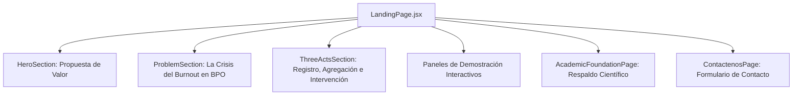

# Capítulo 09: Módulos Transversales y Cara Pública (`notifications/`, `reports/` y `landing/`)

> **Objetivo del capítulo**: Examinar los componentes transversales que comunican a todos los roles dentro de la plataforma (el Centro de Notificaciones y el Generador de Reportes Ejecutivos) y la cara pública de Pulso360 (la Landing Page y la Fundamentación Académica basada en evidencia científica).

---

## 1. El Centro de Notificaciones (`src/features/notifications/`)

En un entorno de alta velocidad como un Contact Center, los eventos ocurren constantemente: un supervisor registra el seguimiento de una pausa, el área de SST responde a una solicitud de apoyo o el sistema recuerda que es hora de registrar el check-in somático.

```mermaid
graph LR
    Eventos[Eventos del Backend Express<br>Checkin, Alerta, Intervención, Chat] --> API[/api/v1/notifications]
    API --> Bell[Icono de Campana en AppLayout<br>Badge con contador de no leídas]
    Bell --> Page[NotificationsPage.jsx<br>Bandeja con filtros y preferencias]
```

### Anatomía de Archivos de Notificaciones
1. **`NotificationsPage.jsx`**:
   - Presenta una bandeja limpia con pestañas de filtrado: `Todas`, `No leídas`, `Operativas` y `Bienestar`.
   - Consulta las notificaciones del usuario mediante `GET /api/v1/notifications`.
   - Permite marcar todas como leídas con una sola acción accesible (`PATCH /api/v1/notifications/read-all`).
2. **`NotificationItem.jsx`**:
   - Renderiza cada aviso con un icono semántico y un indicador visual de lectura.
   - Si la notificación está vinculada a una acción (por ejemplo, una alerta de SST), al hacer clic navega automáticamente a la pantalla correspondiente.
3. **`ReminderPreferencesCard.jsx`**:
   - Exclusivo para agentes: permite silenciar notificaciones durante llamadas o ajustar la frecuencia de los recordatorios de pausas activas.

---

## 2. El Centro de Reportes Consolidados (`src/features/reports/`)

Los supervisores, profesionales de SST y administradores necesitan exportar datos agregados para comités gerenciales y auditorías de riesgos laborales.

### El Reto: Exportación Segura sin Fuga de Datos
Un reporte no puede simplemente "volcar la base de datos". Si un supervisor pudiera descargar un Excel con nombres y niveles de estrés, se violaría la intimidad de los trabajadores.

Por eso, el generador de reportes en `ReportsPage.jsx` cuenta con una **Barrera de Validación de k-Anonimato en Tiempo Real**:
- Antes de permitir la generación, el hook `useReports.jsx` evalúa la variable `isAllowedByPrivacy`.
- Si el ámbito seleccionado (por ejemplo, una célula de 3 personas) tiene $N < 5$, el botón de descarga se bloquea y se muestra `<PrivacyBlockedCard />`.
- **Integridad Criptográfica del Reporte**: Cada reporte generado por el servidor (`GET /api/v1/reports`) incorpora una firma hash canónica. Si el archivo es alterado, el backend rechaza con `409 Conflict` (`REPORT_INTEGRITY_MISMATCH`).

### Formatos de Exportación Disponibles:
1. **CSV (Comma-Separated Values)**: Archivo tabular descargable optimizado con codificación UTF-8 con BOM para que abra perfectamente en Microsoft Excel sin dañar caracteres con tilde o la letra ñ.
2. **JSON Estructurado**: Para importación en herramientas corporativas de Business Intelligence (PowerBI o Tableau).
3. **Vista de Impresión / PDF**: Mediante `window.print()`, renderiza una vista ejecutiva limpia sin menús laterales, formateada para hojas tamaño carta.

---

## 3. La Cara Pública: Landing Page y Fundamentación Académica (`src/features/landing/`)

Pulso360 incluye un portal público de presentación institucional que explica a directores de BPO y comités de bienestar la filosofía de la plataforma:



### 1. `LandingPage.jsx`
Estructurada narrativamente para educar al visitante:
- **`HeroSection.jsx`**: Plantea el dilema central: *"La productividad sin salud mental no es sostenible"*.
- **`ProblemSection.jsx`**: Ilustra con datos objetivos la rotación de personal (turnover) en los call centers, que en Latinoamérica supera el 60% anual debido al agotamiento.
- **`ThreeActsSection.jsx`**: Explica cómo opera el sistema en tres actos claros:
  1. *El Agente se Desahoga en Privado*.
  2. *El Algoritmo Agrega Tendencias con k-Anonimato ($k \ge 5$)*.
  3. *SST Interviene la Organización, no a la Persona*.
- **Paneles Interactivos de Demostración**:
  - `AgentDemoPanel.jsx`: Permite al visitante interactuar con un simulador de check-in.
  - `PrivacyDemoPanel.jsx`: Permite probar cómo el k-anonimato bloquea datos cuando el grupo es pequeño.
  - `SstDemoPanel.jsx`: Muestra un mapa de calor psicosocial interactivo de muestra.

### 2. `ContactenosPage.jsx`
Formulario corporativo de solicitud de demostración:
- Controlado por `useContactForm.jsx` y validado por `contactValidation.jsx`.
- Valida formato de correo empresarial, tamaño de la operación (número de agentes) y mensaje de interés.

### 3. `AcademicFoundationPage.jsx`
Este documento (`academicFoundationData.jsx`) es el **sustento teórico del software**:
- Cita los modelos científicos más respetados en psicología ocupacional:
  - **MBI (Maslach Burnout Inventory)**: Las tres dimensiones del agotamiento: agotamiento emocional, despersonalización y baja realización personal.
  - **Modelo Demanda-Control de Karasek**: Cómo la alta demanda combinada con bajo control sobre las tareas genera tensión psicológica destructiva.
  - **Modelo Desbalance Esfuerzo-Recompensa de Siegrist**.
- Detalla el marco legal colombiano (Resolución 2646 de 2008, Resolución 2764 de 2022 y Circular 064 de 2020 de salud mental).
- Demuestra que Pulso360 no es una idea improvisada, sino un instrumento rigurosamente alineado con la ciencia de la salud ocupacional.

---

En el siguiente capítulo revisaremos las herramientas de calidad, los scripts de desarrollo y la suite de pruebas automatizadas del proyecto.

👉 **Siguiente paso**: [Capítulo 10: Herramientas, Pruebas y Calidad](./10_calidad_pruebas_y_herramientas.md)
