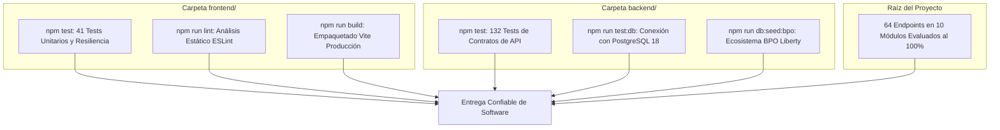

# Capítulo 10: Herramientas, Pruebas y Calidad

> **Objetivo del capítulo**: Comprender cómo se asegura la estabilidad de Pulso360 sin sorpresas ni errores en producción: los scripts de `package.json` tanto en frontend como en backend, la suite de 132 pruebas de contratos de API, las 41 pruebas unitarias de resiliencia del cliente y la suite de pruebas de 64 endpoints en Postman Desktop.

---

## 1. El Doble Quality Gate del Monorepo

Pulso360 divide su arquitectura en dos entornos independientes y coordinados: `frontend/` y `backend/`. Cada uno cuenta con sus propios scripts de control de calidad:



---

## 2. Scripts del Frontend (`frontend/package.json`)

```json
"scripts": {
  "dev": "vite",
  "build": "vite build",
  "lint": "eslint .",
  "preview": "vite preview",
  "test": "node --test tests/*.test.mjs"
}
```

1. **`npm run dev`**: Inicia el servidor de desarrollo de Vite en `http://localhost:5173` con reemplazo de módulos en caliente (HMR).
2. **`npm run lint`**: Ejecuta ESLint sobre todos los componentes `.jsx` para validar las reglas de los Hooks de React y erradicar código muerto.
3. **`npm test`**: Ejecuta **41 pruebas unitarias** que verifican:
   - Resiliencia del motor NLP en 4 capas (tolerancia a erratas Damerau-Levenshtein y lematización).
   - Manejo de cuota de disco agotada y modo de memoria temporal.
   - Normalización de parámetros y estados de error del servidor.
4. **`npm run build`**: Compila y optimiza el cliente para producción generando la carpeta `dist/`.

---

## 3. Scripts del Backend (`backend/package.json`)

```json
"scripts": {
  "start": "node src/index.js",
  "dev": "node --watch src/index.js",
  "test": "node test/run-contracts.js",
  "test:db": "node -e \"import('./src/infrastructure/db.js')...\"",
  "db:migrate": "node database/migrate.js",
  "db:seed:bpo": "node database/seed_bpo_ecosystem.js",
  "job:alerts": "node src/jobs/runAlerts.js"
}
```

1. **`npm start` / `npm run dev`**: Levanta el servidor Express 5 y Socket.IO en `http://localhost:3000`.
2. **`npm test` (Pruebas de Contratos de API)**:
   - Ejecuta **132 pruebas automatizadas** contra la base de datos real PostgreSQL.
   - Comprueba cada código de estado HTTP (`200`, `201`, `400`, `401`, `403`, `404`, `409`).
   - Verifica el aislamiento estricto de roles (RBAC) y la imposibilidad de que un supervisor acceda a chats o bitácoras.
   - Valida el cálculo de k-anonimato ($k \ge 5$) y las transacciones ACID con rollback ante fallos.
3. **`npm run db:seed:bpo`**: Puebla la base de datos con el ecosistema hiperrealista BPO Liberty: 100 agentes, campañas, supervisores y alertas históricas.

---

## 4. La Suite de Postman Desktop (Sustentación Académica)

Para la demostración en vivo ante el jurado docente, la raíz del proyecto contiene dos archivos clave:
- `Pulso360_Postman_Collection.json`
- `Pulso360.postman_environment.json`

Contiene **64 peticiones ordenadas en 10 carpetas** que cubren el 100% de los endpoints REST:
1. **⭐ 1. DEMO RÁPIDA CRUD COMPLETO**: Demostración de *Create, Read, Update, Delete* en vivo sobre la bitácora con verificación post-borrado.
2. **⭐ 2. DEMO CRUD ADMINISTRACIÓN**: Creación, consulta, modificación y suspensión de usuarios.
3. **3. Autenticación y Control de Acceso**: Inicio de sesión de los 5 roles y recuperación de credenciales.
4. **4. Módulo Agente**: Consentimiento C1 a C5, check-in diario de 6 dimensiones, solicitudes de apoyo y Habeas Data.
5. **5. Módulo SST**: Métricas k-anónimas, alertas tempranas, planes de intervención y buzón de radicados.
6. **6. Módulo Supervisor**: Consulta de acciones asignadas y registro de seguimiento operativo BPO.
7. **7. Módulo Administración**: Creación de campañas, equipos y parámetros con protección de invariantes.
8. **8. Módulo Auditoría**: Trazabilidad inmutable y verificación criptográfica de registros.
9. **9. Middlewares y Validación (Pruebas Negativas)**: Verificación de fallas controladas (token ausente, firma inválida, violación de rol, cuerpo vacío).
10. **10. Módulo Chat de Apoyo Psicosocial**: Ciclo de vida REST completo (activación de sala por SST, consulta de estado, mapa de chats del agente, historial de mensajes y cierre con notas confidenciales).

---

## 5. El Protocolo Anti-Deuda Técnica ("Cirugía de Código")

Para mantener el código legible y limpio para cualquier estudiante o ingeniero que se sume al proyecto, el repositorio sigue tres directrices inquebrantables:

1. **Toque Mínimo (Minimal Touch)**:
   - Si una tarea consiste en corregir un endpoint o una pantalla, se modifica **únicamente** ese archivo. No se reescriben módulos adyacentes sin justificación.
2. **Prohibido Alucinar Dependencias**:
   - No se instalan paquetes externos pesados para resolver necesidades que se satisfacen con JavaScript estándar o utilidades nativas de Node.js.
3. **La Tríada de Validación Pre-Entrega**:
   ```bash
   npm --prefix backend test      # 132 tests pasando
   npm --prefix frontend test     # 41 tests pasando
   npm --prefix frontend run lint # 0 errores de ESLint
   npm --prefix frontend run build# Vite build exit 0
   ```

---

En el próximo capítulo consultaremos el catálogo de referencia de funciones y el glosario de términos de Pulso360.

👉 **Siguiente paso**: [Capítulo 11: Diccionario Maestro A-Z y Glosario](./11_diccionario_funciones_y_glosario.md)
