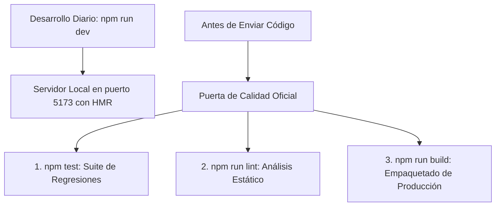

# Capítulo 10: Herramientas, Pruebas y Calidad

> **Objetivo del capítulo**: Comprender cómo se asegura la estabilidad de Pulso360 sin sorpresas ni errores en producción: los scripts de `package.json`, la configuración de Vite y ESLint, la suite de pruebas automatizadas con el ejecutor nativo de Node.js y el protocolo para evitar deuda técnica.

---

## 1. Los Scripts de `package.json`

En el archivo [package.json](file:///c:/Users/brahi/OneDrive/Escritorio/TdeA/4to%20semestre/Construccion3/Pulso360/package.json) residen los cinco comandos oficiales del ciclo de vida del proyecto:

```json
"scripts": {
  "dev": "vite",
  "build": "vite build",
  "lint": "eslint .",
  "preview": "vite preview",
  "test": "node --test tests/*.test.mjs"
}
```



### 1. `npm run dev`
Inicia el servidor de desarrollo de Vite. Gracias a la tecnología de reemplazo de módulos en caliente (HMR), cualquier cambio que guardes en un archivo `.jsx` o `.css` se refleja en tu navegador en milisegundos sin perder el estado del formulario en el que estés trabajando.

### 2. `npm run lint`
Ejecuta **ESLint** sobre todo el código fuente. Verifica que:
- No existan variables huérfanas sin usar.
- Se respeten rigurosamente las reglas de los Hooks de React (`react-hooks/rules-of-hooks` y `react-hooks/exhaustive-deps`), garantizando que un `useEffect` no cause bucles infinitos de renderizado.
- No se mezclen patrones anticuados de JavaScript.

### 3. `npm test`
Dispara la suite de pruebas automatizadas de regresión en `tests/regressions.test.mjs`.

### 4. `npm run build`
Compila y optimiza todo el proyecto: genera HTML, JavaScript minificado y CSS depurado dentro de la carpeta `dist/`. Si hay un error de importación o una etiqueta JSX mal cerrada, el comando fallará de inmediato, evitando subir código roto a producción.

---

## 2. Configuración de Herramientas: `vite.config.js` y `eslint.config.js`

### [vite.config.js](file:///c:/Users/brahi/OneDrive/Escritorio/TdeA/4to%20semestre/Construccion3/Pulso360/vite.config.js)
```javascript
import { defineConfig } from 'vite';
import react from '@vitejs/plugin-react';

export default defineConfig({
  plugins: [react()]
});
```
Es minimalista y veloz. Utiliza `@vitejs/plugin-react` para transformar la sintaxis JSX en llamadas estándar de JavaScript (`React.createElement`) de forma ultrarrápida utilizando el compilador Babel internamente.

### [eslint.config.js](file:///c:/Users/brahi/OneDrive/Escritorio/TdeA/4to%20semestre/Construccion3/Pulso360/eslint.config.js)
Utiliza el nuevo formato estándar de configuración plana (*Flat Config*) de ESLint 9. Activa las mejores prácticas de la comunidad de React:
- Reglas recomendadas de JavaScript moderno (`@eslint/js`).
- Reglas de React JSX y control de versiones de runtime.
- Prevención de desincronización en dependencias de Hooks.

---

## 3. La Suite de Pruebas de Regresión: [tests/regressions.test.mjs](file:///c:/Users/brahi/OneDrive/Escritorio/TdeA/4to%20semestre/Construccion3/Pulso360/tests/regressions.test.mjs)

A diferencia de muchos proyectos que instalan bibliotecas pesadas de pruebas como Jest o Mocha (que añaden cientos de dependencias a `node_modules`), Pulso360 aprovecha el **ejecutor de pruebas nativo de Node.js (`node:test`)** y la biblioteca de aserciones estricta (`node:assert/strict`).

### El Truco de Ingeniería: El Fixture `withApp`
Dado que `pulsoStore.jsx` y `env.jsx` son módulos JSX que normalmente corren en el navegador, ¿cómo los probamos dentro de Node.js en la terminal?

A través de la función `withApp()` (líneas 15-34):
1. Crea un almacenamiento en memoria simulado (`memoryStorage()`) usando un `Map()` de JavaScript.
2. Inyecta este almacenamiento en `globalThis.window.localStorage` y `sessionStorage`.
3. Levanta una instancia silenciosa de Vite en modo SSR (`middlewareMode: true`).
4. Carga dinámicamente los módulos de la aplicación (`server.ssrLoadModule('/src/core/storage/pulsoStore.jsx')`).
5. Ejecuta la prueba con aislamiento absoluto: cada prueba tiene su propio almacenamiento limpio, evitando que una prueba contamine a la siguiente.

### Qué Protegen las Pruebas de Regresión:
- **Resiliencia ante Almacenamiento Corrupto**: Prueba qué ocurre si `localStorage` contiene `null`, texto inválido (`'not-json'`), un objeto vacío (`'{}'`) o un array (`'[]'`). En todos los casos, el sistema se recupera de forma transparente sin lanzar pantallas blancas de la muerte.
- **Protección de Bitácoras Históricas**: Verifica que si la aplicación se actualiza o normaliza su esquema, **las notas íntimas de los agentes jamás se borren**.
- **Integridad de la Cadena de Auditoría**: Comprueba que cada nuevo log genere un hash válido enlazado al `prevHash` del registro anterior.
- **Migración de Datos**: Valida que si se actualizan estructuras de correos corporativos o parámetros, los datos preexistentes del usuario se conserven intactos.

---

## 4. El Protocolo Anti-Deuda Técnica ("Cirugía de Código")

Para mantener el código legible y limpio para cualquier estudiante o ingeniero que se sume al proyecto, el repositorio sigue tres directrices inquebrantables:

1. **Toque Mínimo (Minimal Touch)**:
   - Si una tarea consiste en agregar un botón a una pantalla, modifica **únicamente** ese archivo. No aproveches para reescribir tres servicios adyacentes solo porque prefieres otra sintaxis.
2. **Prohibido Alucinar Dependencias**:
   - No instales paquetes externos (`npm install ...`) para resolver problemas que se pueden solucionar con 5 líneas de JavaScript moderno o un hook nativo.
3. **El Chequeo Previo a Entrega**:
   - Antes de considerar cualquier cambio como listo, es obligatorio ejecutar la tríada de validación en la terminal:
     ```bash
     npm test
     npm run lint
     npm run build
     ```
   - Si los tres pasan en verde, tienes la garantía matemática de que no rompiste ningún contrato existente.

---

En el último capítulo de este libro, accederemos a la herramienta de consulta más potente: el Catálogo A-Z de todas las funciones exportadas de Pulso360 y el Glosario de Términos.

👉 **Siguiente paso**: [Capítulo 11: Diccionario Maestro A-Z y Glosario](./11_diccionario_funciones_y_glosario.md)
