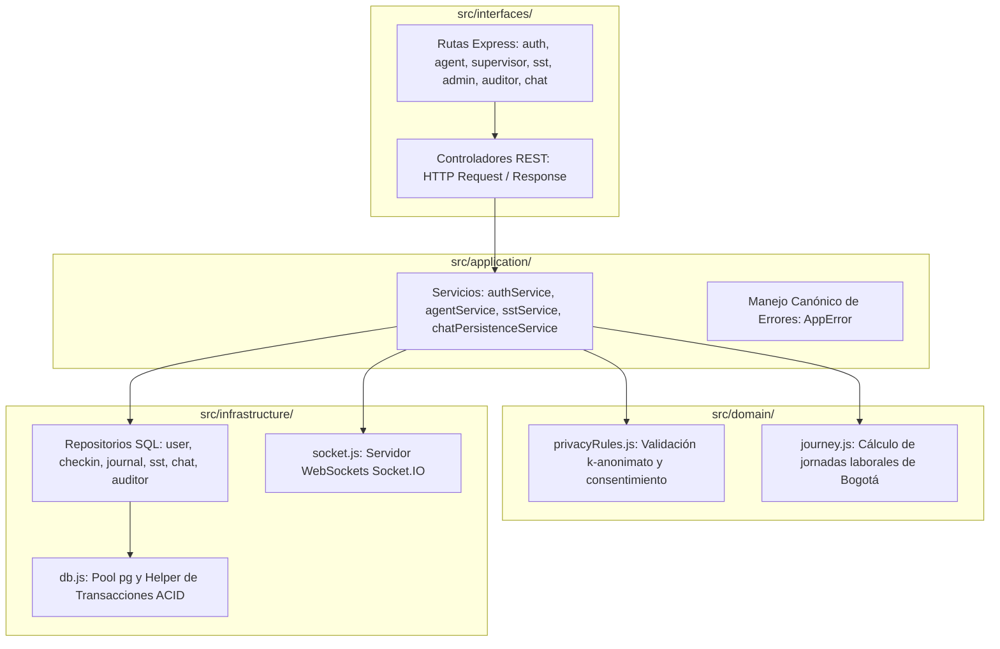
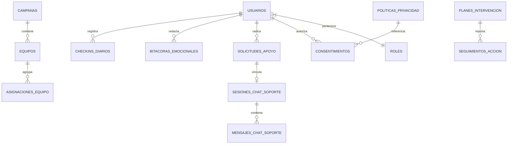

# Capítulo 12: Arquitectura de Backend y Base de Datos Relacional (`backend/`)

> **Objetivo del capítulo**: Examinar la anatomía del servidor en Node.js con Express 5 y PostgreSQL 18: la arquitectura en cuatro capas (Interfaces, Aplicación, Dominio e Infraestructura), la gestión de transacciones ACID, el pool de conexiones, las 31 tablas relacionales, los middlewares de seguridad (RBAC, Rate Limiting y Fail-Fast) y el planificador cron de alertas epidemiológicas en la zona horaria de Bogotá.

---

## 1. La Arquitectura en Cuatro Capas del Backend

El backend de Pulso360 sigue una arquitectura limpia inspirada en los principios de *Clean Architecture* y *Spec-Driven Development (SDD)*, separando rigurosamente las responsabilidades técnicas de las reglas del negocio:



1. **Capa de Interfaces (`src/interfaces/`)**:
   - **Rutas (`routes/`)**: Declaran los endpoints REST agrupados por rol y aplican los middlewares de autenticación (`authenticate`), autorización RBAC (`requireRole`) y validación Fail-Fast (`validateBody`).
   - **Controladores (`controllers/`)**: Desempaquetan los parámetros (`req.params`, `req.query`, `req.body`), invocan el servicio correspondiente y devuelven respuestas HTTP estructuradas con el sobre canónico `{ success: true, data: { ... } }`.
2. **Capa de Aplicación (`src/application/`)**:
   - Contiene la orquestación de los casos de uso: login con bcrypt, verificación de consentimiento previo, activación transaccional de salas de chat y registro de auditoría.
3. **Capa de Dominio (`src/domain/`)**:
   - Reglas puras independientes de la base de datos o el protocolo HTTP. Aquí reside la validación matemática de las dimensiones de check-in y las fórmulas de turnos de Bogotá.
4. **Capa de Infraestructura (`src/infrastructure/`)**:
   - Conexión con PostgreSQL mediante el paquete `pg`, repositorios SQL parametrizados que previenen inyección SQL y servidor Socket.IO para eventos bidireccionales en tiempo real.

---

## 2. El Modelo Relacional de Base de Datos (PostgreSQL 18)

La base de datos relacional `pulso360_db` está estructurada en **31 tablas normalizadas** que garantizan la integridad referencial y el aislamiento de datos:



### Principales Tablas del Sistema:
1. **`usuarios`**: Almacena las cuentas del ecosistema (identificador único, nombres, apellidos, correo institucional, `contrasena_hash` encriptada con bcrypt, rol, estado `Activo`/`Suspendido` y turno).
2. **`checkins_diarios`**: Registros somáticos diarios con las 6 dimensiones numéricas (1 a 5), código de jornada y marca de tiempo.
3. **`bitacoras_emocionales`**: Diario íntimo del agente con contenido privado, contexto operativo y hash criptográfico.
4. **`consentimientos`**: Registro inmutable de cada evento de aceptación o revocación de las cláusulas C1 a C5 con versión de política e IP de origen.
5. **`solicitudes_apoyo`**: Radicados de soporte psicosocial en modo identificado o anónimo.
6. **`sesiones_chat_soporte` y `mensajes_chat_soporte`**: Historial persistido y auditado de las conversaciones entre Agente y Especialista SST.
7. **`alertas_psicosociales`**: Registro epidemiológico de alertas emitidas por el cron job semanal.
8. **`auditoria_sistema`**: Tabla de solo adición (*Append-Only*) con la cadena de hashes SHA-256 para inspección forense.

---

## 3. Transacciones ACID y Bloqueos de Concurrencia

En un centro de contacto con cientos de agentes y especialistas interactuando simultáneamente, pueden ocurrir condiciones de carrera (por ejemplo, dos supervisores intentando cerrar la misma intervención o un agente cerrando un chat mientras SST envía un mensaje).

Para garantizar la integridad atómica, el archivo `backend/src/infrastructure/db.js` exporta un helper transaccional:

```javascript
export async function transaction(callback) {
  const client = await pool.connect();
  try {
    await client.query('BEGIN');
    const result = await callback(client);
    await client.query('COMMIT');
    return result;
  } catch (err) {
    await client.query('ROLLBACK');
    throw err;
  } finally {
    client.release();
  }
}
```

### Bloqueo Pesimista (`SELECT ... FOR UPDATE`):
En operaciones sensibles como el ciclo de vida del chat (`chatPersistenceService.js`), el sistema adquiere bloqueos en orden estricto `Radicado ➔ Sesión` mediante `FOR UPDATE`:
- Serializa las escrituras concurrentes.
- Si ocurre cualquier error o excepción de negocio (`CONSENT_REQUIRED`, `AUTH_FORBIDDEN_RESOURCE`), el bloque `ROLLBACK` revierte cualquier cambio parcial de forma instantánea, dejando la base de datos intacta.

---

## 4. El Planificador de Alertas Epidemiológicas (Cron Job en Bogotá)

La detección de riesgo psicosocial colectivo no ocurre al azar ni depende de que alguien abra una pantalla:
- El script `backend/src/jobs/runAlerts.js` implementa un evaluador cron semanal.
- Opera en la zona horaria legal de Colombia (`America/Bogota`).
- **Ventana de Cierre**: Evalúa los lunes a las 06:00 AM las semanas epidemiológicas concluidas.
- Comprueba las reglas aprobadas contra los check-ins agrupados por campaña y equipo:
  - Excluye a trabajadores sin consentimiento C4 activo.
  - Verifica que el grupo cumpla el umbral de k-anonimato ($N \ge 5$).
  - Si el promedio supera el umbral durante las semanas consecutivas configuradas, inserta la alerta en `alertas_psicosociales` y registra el log de auditoría.

---

## 5. Middlewares de Seguridad y Control Fail-Fast

El pipeline de Express en `backend/src/app.js` aplica cinco barreras defensivas antes de que cualquier petición llegue a un controlador:

1. **Helmet & CORS**:
   - `helmet()`: Añade encabezados HTTP de seguridad que previenen ataques de Cross-Site Scripting (XSS), Clickjacking y MIME sniffing.
   - `cors()`: Restringe el acceso exclusivamente a los orígenes permitidos configurados en el archivo `.env`.
2. **Rate Limiting (`express-rate-limit`)**:
   - Protege la ruta `/api/v1/auth/login` contra ataques de fuerza bruta por diccionario, bloqueando IPs que excedan los intentos permitidos con código `429 Too Many Requests`.
3. **Autenticación JWT (`authMiddleware.js`)**:
   - Extrae el token `Bearer` del encabezado `Authorization`.
   - Verifica la firma criptográfica con la clave secreta `JWT_SECRET`.
   - Consulta el estado real del usuario en la base de datos: si fue suspendido, rechaza inmediatamente con `401 Unauthorized` (`AUTH_USER_SUSPENDED`).
4. **Autorización RBAC (`requireRole`)**:
   - Comprueba si el rol del token coincide con los roles permitidos en la ruta. Si no coincide, rechaza con `403 Forbidden` (`AUTH_FORBIDDEN_ROLE`).
5. **Validación Fail-Fast (`validateBody`)**:
   - Examina los campos obligatorios del cuerpo JSON antes de consultar la base de datos. Si faltan datos o no cumplen el tipo o longitud mínima, aborta con `400 Bad Request` y el código canónico del dominio (ej. `JOURNAL_CONTENT_EMPTY`, `AUTH_MISSING_FIELDS`).

---

Con este capítulo, el Libro Técnico de Pulso360 cubre el 100% de la arquitectura: desde el píxel en pantalla y el diseño ergonómico de tokens, hasta el almacenamiento relacional, la auditoría criptográfica y la seguridad de red en el servidor.

👉 [Volver al Índice Maestro](./INDICE_MAESTRO.md)
