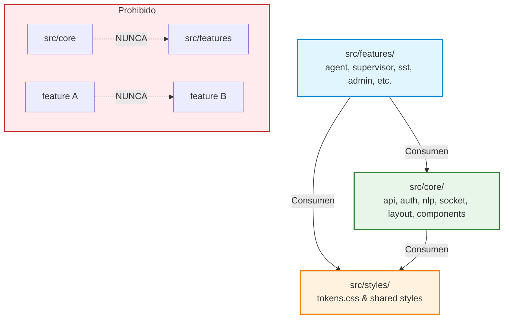

# Libro Técnico Definitivo de Pulso360
## Guía de Arquitectura, Código y Sistema de Bienestar para Entornos BPO

Bienvenido al **Libro Técnico de Pulso360**. Este documento ha sido diseñado como una obra de estudio integral y enciclopedia técnica para comprender a fondo cada archivo, cada función, cada estilo y cada decisión de diseño que dan vida a Pulso360.

> 📐 **Compendio de Diagramas de Software:** Para consultar los diagramas canónicos de Arquitectura C4, Casos de Uso UML, Jerarquía de UI, Flujos de Procesos, Componentes, Clases de Dominio, Modelo ER y Modelo Relacional Físico de Base de Datos, dirígete al [Compendio Maestro de Diagramas](../DIAGRAMAS.md).

Si estás empezando en la programación web o nunca has visto una aplicación en React y Node.js, este libro te llevará de la mano desde los conceptos más elementales hasta los detalles más profundos de la arquitectura fullstack.

---

## 🗺️ Mapa de Navegación del Libro

El libro se organiza en **13 capítulos modulares**, estructurados por capas conceptuales y funcionales:

| Capítulo | Título | Descripción y Enlace |
| :---: | :--- | :--- |
| **00** | **Dominio, Contexto BPO y Ética de Privacidad** | La realidad de los Contact Centers, el burnout, k-anonimato ($k \ge 5$) y la "Constitución" del proyecto.  👉 [Leer Capítulo 00](./00_fundamentos_y_dominio.md) |
| **01** | **Fundamentos Web, React y Ecosistema Fullstack** | HTML, CSS, JS, JSX, Estado (`useState`), Efectos (`useEffect`), Vite y arquitectura cliente-servidor.  👉 [Leer Capítulo 01](./01_fundamentos_tecnologicos.md) |
| **02** | **El Sistema Visual y Tokens CSS** | Variables CSS, paletas ergonómicas HSL (`tokens.css`), escalas de espaciado, tipografía y radios anti-cliché.  👉 [Leer Capítulo 02](./02_sistema_visual_y_tokens.md) |
| **03** | **El Núcleo del Sistema (`src/core/`)** | Enrutamiento con React Router, `apiClient` con Bearer JWT, `socketClient` con WebSockets y motor NLP en 4 capas.  👉 [Leer Capítulo 03](./03_arquitectura_core.md) |
| **04** | **Módulo de Autenticación y Consentimiento** | Login con bcrypt, control de fuerza bruta, consentimiento granular C1 a C5 y régimen de Ley 1581.  👉 [Leer Capítulo 04](./04_modulo_autenticacion.md) |
| **05** | **Módulo del Agente de Contact Center** | Check-in de 6 dimensiones normativas, bitácora privada, chat en vivo por WebSockets y técnica Grounding 5-4-3-2-1.  👉 [Leer Capítulo 05](./05_modulo_agente.md) |
| **06** | **Módulo del Supervisor Operativo** | Gestión de turnos sin espionaje: agregación de métricas k-anónimas, planes de acción y prevención IDOR.  👉 [Leer Capítulo 06](./06_modulo_supervisor.md) |
| **07** | **Módulo SST (Salud y Seguridad en el Trabajo)** | Matriz epidemiológica de calor, alertas preventivas, separación de funciones y activación de salas de chat.  👉 [Leer Capítulo 07](./07_modulo_sst.md) |
| **08** | **Módulos de Auditoría y Administración** | Trazabilidad inmutable con hashes SHA-256 en PostgreSQL, directorios, campañas, invariantes y Habeas Data.  👉 [Leer Capítulo 08](./08_auditoria_y_administracion.md) |
| **09** | **Módulos Transversales y Cara Pública** | Sistema de notificaciones, reportes ejecutivos con firma de integridad y Landing Page académica con respaldo científico.  👉 [Leer Capítulo 09](./09_modulos_transversales_y_landing.md) |
| **10** | **Herramientas, Pruebas y Calidad** | Doble Quality Gate: 132 tests de contratos backend, 41 tests frontend, ESLint y suite de 64 endpoints en Postman Desktop.  👉 [Leer Capítulo 10](./10_calidad_pruebas_y_herramientas.md) |
| **11** | **Diccionario Maestro A-Z y Glosario** | Catálogo exhaustivo de todas las funciones exportadas del código, parámetros, retornos y glosario de salud laboral.  👉 [Leer Capítulo 11](./11_diccionario_funciones_y_glosario.md) |
| **12** | **Arquitectura de Backend y Base de Datos Relacional** | Servidor Express 5, pool PostgreSQL 18 (31 tablas), transacciones ACID con `FOR UPDATE`, middlewares Fail-Fast y cron job de Bogotá.  👉 [Leer Capítulo 12](./12_arquitectura_backend_y_persistencia.md) |

---

## 🏛️ Filosofía Arquitectónica y Regla de Dependencias

Pulso360 sigue un principio estricto de **Dirección Unidireccional de Dependencias**:

### Reglas de Oro Inquebrantables del Repositorio:
1. **`features ➔ core`**: Los módulos funcionales pueden importar utilidades, almacenamiento o clientes del núcleo. El núcleo **jamás** debe importar nada de una feature específica.
2. **Sin dependencias entre hermanas (`feature A ↛ feature B`)**: El módulo de `supervisor` no puede importar componentes de `agent`. Si ambos necesitan algo común, ese elemento pertenece a `core/components/` o `core/api/`.
3. **Todo en `.jsx`**: Por convención académica del proyecto, todos los archivos de aplicación bajo `src/` usan la extensión `.jsx`, incluso servicios, hooks y configuración. No se utiliza TypeScript.
4. **Arquitectura Monorepo y Persistencia Centralizada en PostgreSQL 18**: La persistencia de dominio no reside en almacenamiento local del navegador; la aplicación opera como cliente ligero conectado contra la API REST de Express 5 y la base de datos PostgreSQL 18 (31 tablas) a través de `src/core/api/apiClient.jsx`. El navegador no persiste registros sensibles, protegiendo la confidencialidad en puestos de trabajo compartidos y garantizando una única fuente de verdad relacional.
5. **NLP Determinista en 4 Capas**: No se usan APIs externas de OpenAI ni modelos de lenguaje generativos en la nube. El análisis emocional es 100% léxico, determinista, privado y auditable en `src/core/nlp/`.

---

## 📖 Cómo Leer este Libro

- **Si eres principiante absoluto**: Comienza en orden secuencial por el **Capítulo 00** y **Capítulo 01**. Te darán las bases del negocio, de React y de la arquitectura cliente-servidor.
- **Si buscas entender la lógica de un rol específico**: Ve directo al capítulo correspondiente (Agente = Cap. 05, Supervisor = Cap. 06, SST = Cap. 07, Auditor y Admin = Cap. 08).
- **Si necesitas saber cómo funciona la base de datos y la API**: Ve directo al **Capítulo 12**.
- **Si necesitas saber qué hace una función o dónde se usa**: Dirígete al **Capítulo 11 (Diccionario Maestro A-Z)** para consultarla directamente.
