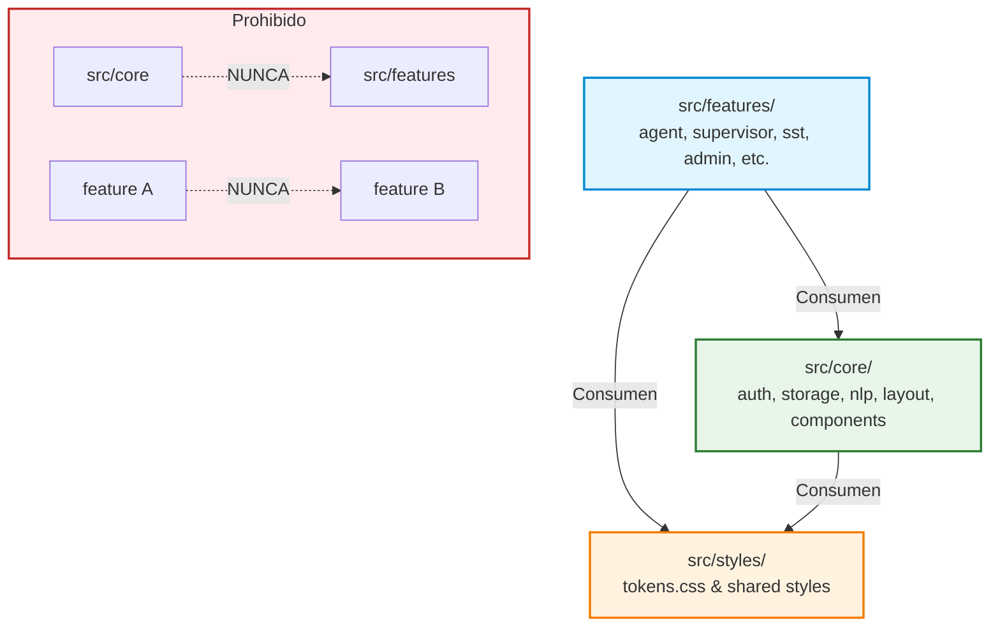

# Libro Técnico Definitivo de Pulso360
## Guía de Arquitectura, Código y Sistema de Bienestar para Entornos BPO

Bienvenido al **Libro Técnico de Pulso360**. Este documento ha sido diseñado como una obra de estudio integral y enciclopedia técnica para comprender a fondo cada archivo, cada función, cada estilo y cada decisión de diseño que dan vida a Pulso360.

> 📐 **Compendio de Diagramas de Software:** Para consultar los diagramas canónicos de Arquitectura C4, Casos de Uso UML, Jerarquía de UI, Flujos de Procesos, Componentes, Clases de Dominio, Modelo ER y Modelo Relacional Físico de Base de Datos, dirígete al [Compendio Maestro de Diagramas](../DIAGRAMAS.md).

Si estás empezando en la programación web o nunca has visto una aplicación en React, este libro te llevará de la mano desde los conceptos más elementales hasta los detalles más profundos de la arquitectura.

---

## 🗺️ Mapa de Navegación del Libro

El libro se organiza en **12 capítulos modulares**, estructurados por capas conceptuales y funcionales:

| Capítulo | Título | Descripción y Enlace |
| :--- | :--- | :--- |
| **00** | **Dominio, Contexto BPO y Ética de Privacidad** | La realidad de los Contact Centers, el burnout, k-anonimato y la "Constitución" del proyecto.  👉 [Leer Capítulo 00](./00_fundamentos_y_dominio.md) |
| **01** | **Fundamentos Web y React desde Cero** | De la URL al navegador: HTML, CSS, JS, JSX, Estado, Efectos, Hooks y Enrutamiento explicados con analogías sencillas.  👉 [Leer Capítulo 01](./01_fundamentos_tecnologicos.md) |
| **02** | **El Sistema Visual y Tokens CSS** | HSL, paletas cromáticas, escalas de espaciado, tipografía, radios y la cascada ordenada de estilos.  👉 [Leer Capítulo 02](./02_sistema_visual_y_tokens.md) |
| **03** | **El Núcleo del Sistema (`src/core/`)** | `App.jsx`, autenticación RBAC, motor NLP léxico determinista, persistencia en `pulsoStore` y componentes compartidos.  👉 [Leer Capítulo 03](./03_arquitectura_core.md) |
| **04** | **Módulo de Autenticación y Consentimiento** | Login, recuperación de claves, gestión ética de consentimiento informado y Habeas Data.  👉 [Leer Capítulo 04](./04_modulo_autenticacion.md) |
| **05** | **Módulo del Agente de Contact Center** | Check-in en 3 pasos, bitácora emocional, ejercicios de Grounding (5-4-3-2-1), pausas sonoras y privacidad personal.  👉 [Leer Capítulo 05](./05_modulo_agente.md) |
| **06** | **Módulo del Supervisor Operativo** | Gestión de equipos sin espionaje: agregación de métricas, planes de acción y el muro del k-anonimato.  👉 [Leer Capítulo 06](./06_modulo_supervisor.md) |
| **07** | **Módulo SST (Salud y Seguridad en el Trabajo)** | Detección de riesgo psicosocial, matriz de calor, motor de reglas de alerta e intervenciones tempranas.  👉 [Leer Capítulo 07](./07_modulo_sst.md) |
| **08** | **Módulos de Auditoría y Administración** | Trazabilidad inmutable de eventos, gestión de usuarios, roles, campañas y solicitudes de Habeas Data.  👉 [Leer Capítulo 08](./08_auditoria_y_administracion.md) |
| **09** | **Módulos Transversales y Cara Pública** | Sistema de notificaciones, generador de reportes consolidados y Landing Page académica.  👉 [Leer Capítulo 09](./09_modulos_transversales_y_landing.md) |
| **10** | **Herramientas, Pruebas y Calidad** | Scripts de `package.json`, Vite, ESLint, Node Test Runner y protocolos para evitar deuda técnica.  👉 [Leer Capítulo 10](./10_calidad_pruebas_y_herramientas.md) |
| **11** | **Diccionario Maestro A-Z y Glosario** | Catálogo exhaustivo de todas las funciones exportadas del código, parámetros, retorno y glosario técnico y de negocio.  👉 [Leer Capítulo 11](./11_diccionario_funciones_y_glosario.md) |

---

## 🏛️ Filosofía Arquitectónica y Regla de Dependencias

Pulso360 sigue un principio estricto de **Dirección Unidireccional de Dependencias**:

### Reglas de Oro Inquebrantables del Repositorio:
1. **`features ➔ core`**: Los módulos funcionales pueden importar utilidades, almacenamiento o autenticación del núcleo. El núcleo **jamás** debe importar nada de una feature específica.
2. **Sin dependencias entre hermanas (`feature A ↛ feature B`)**: El módulo de `supervisor` no puede importar componentes de `agent`. Si ambos necesitan algo común, ese elemento pertenece a `core/components/` o `core/storage/`.
3. **Todo en `.jsx`**: Por convención académica del proyecto, todos los archivos de aplicación bajo `src/` usan la extensión `.jsx`, incluso servicios, hooks y configuración. No se utiliza TypeScript.
4. **Arquitectura Monorepo y Persistencia Centralizada en PostgreSQL**: La persistencia de dominio no reside en almacenamiento local del navegador; la aplicación opera como cliente ligero conectado contra la API REST de Express 5 y la base de datos PostgreSQL 18 (31 tablas) a través de `src/core/api/apiClient.jsx`. El navegador no persiste registros sensibles, protegiendo la confidencialidad en puestos de trabajo compartidos y garantizando una única fuente de verdad relacional.
5. **NLP Determinista**: No se usan APIs externas de OpenAI ni modelos de lenguaje generativos en la nube. El análisis emocional es 100% léxico, determinista, privado y auditable en `nlpEngine.jsx`.

---

## 📖 Cómo Leer este Libro

- **Si eres principiante absoluto**: Comienza en orden secuencial por el **Capítulo 00** y **Capítulo 01**. Te darán las bases del negocio y de React para entender qué significa cada palabra del código.
- **Si buscas entender la lógica de un rol específico**: Ve directo al capítulo correspondiente (Agente = Cap. 05, Supervisor = Cap. 06, SST = Cap. 07, etc.).
- **Si necesitas saber qué hace una función o dónde se usa**: Dirígete al **Capítulo 11 (Diccionario Maestro A-Z)** para consultarla directamente.
