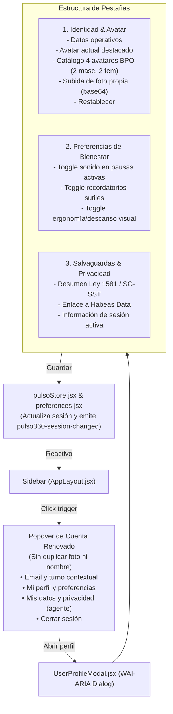

# [PLAN-011] Technical Plan: User Profile, Avatar Diversity & Preferences

Date: 2026-10-20
Spec: SPEC-011

## Evidence and existing architecture

- **Menú y Tarjeta de Cuenta (`AppLayout.jsx`)**:
  - `user-card` (L336-369) renderiza el avatar, nombre del colaborador y badge de rol en la parte inferior del sidebar.
  - Al abrirse, `account-popover` (L270-334) duplica verticalmente el avatar, nombre, badge de rol y campaña, generando redundancia visual.
  - Para supervisores, SST, auditores y administradores, el popover contiene únicamente "Cerrar sesión" tras el separador.
  - La resolución del avatar (`roleAvatarImg`, L154-159) está forzada por rol (`agente` -> `bpo-agent-profile.jpg`, `sst` -> `bpo-sst-guardian.jpg`, resto -> `null`).
- **Persistencia de Preferencias (`preferences.jsx`)**:
  - Funciones ya implementadas pero huérfanas de interfaz: `readPauseSound`, `savePauseSound`, `readReminder`, `saveReminder`.
- **Datos de Prueba Iniciales (`seed.jsx`)**:
  - Los usuarios mock (`usr-1` a `usr-5`) no declaran propiedad `avatar`, dependiendo del cálculo forzado de `AppLayout`.

## Proposed change



### Componentes y Archivos Afectados

1. **`frontend/src/core/layout/AppLayout.jsx`**:
   - Sustituir la cabecera duplicada del popover por una barra de contexto ligera (email corporativo + badge de turno).
   - Añadir acción interactiva *"Mi perfil y preferencias"* que abre el diálogo modal.
   - Leer `user.avatar` de la sesión en lugar de forzar por rol, con fallback institucional inteligente.
2. **`frontend/src/core/components/UserProfileModal.jsx` (Nuevo)**:
   - Componente modal WAI-ARIA (`role="dialog"`, `aria-modal="true"`, `aria-labelledby`, trampa de foco con Tab/Shift+Tab, tecla `Escape`).
   - Pestaña *Identidad & Avatar*: selector de catálogo predeterminado, preview en vivo, input file para imagen propia (validación ≤ 2 MB, `FileReader.readAsDataURL`) y botón de restablecer.
   - Pestaña *Preferencias*: switches accesibles para sonido ambiente, recordatorios y descanso visual ergonómico.
   - Pestaña *Privacidad*: resumen institucional de salvaguardas y enlace a Habeas Data.
   - Notificación de guardado accesible con `role="status"`.
3. **`frontend/src/styles/profile.css` (Nuevo)** y **`frontend/src/styles/layout.css`**:
   - Estilos tokenizados ergonómicos para el selector de avatares, tabs, switches y cabecera del popover desacoplado.
   - Compatibilidad responsive a 375px (móvil), 768px (tablet) y 1440px (escritorio).
4. **Nuevos Activos Fotográficos/3D Documentales BPO**:
   - Generados mediante el subagente `bpo-asset-designer`:
     - `frontend/public/assets/fotos/bpo-avatar-male-agent.webp`
     - `frontend/public/assets/fotos/bpo-avatar-male-supervisor.webp`
     - `frontend/public/assets/fotos/bpo-avatar-female-agent-2.webp`
5. **`frontend/src/core/storage/seed.jsx` y `frontend/src/core/storage/pulsoStore.jsx`**:
   - Asignar avatares predeterminados a los usuarios iniciales (`usr-1`: Laura Gómez, `usr-2`: Carlos Mendoza con avatar supervisor masculino, `usr-3`: Patricia Silva, `usr-4`: Marcos Rivas con avatar agente masculino).
   - Agregar método `updateUserProfile(userId, profileData)` en `pulsoStore` que actualice el almacenamiento, sincronice `sessionData` y despache `pulso360-session-changed`.

## Contracts and compatibility

### Contrato de Datos de Usuario (`user`)

```typescript
interface UserProfile {
  id: string;
  name: string;
  email: string;
  role: 'agente' | 'supervisor' | 'sst' | 'auditor' | 'admin';
  campaign?: string;
  teamName?: string;
  shiftStartHour?: number;
  avatar?: string;           // URL institucional o data:image/... en base64
  avatarType?: 'preset' | 'custom';
}
```

### Contrato de Preferencias de Usuario

```typescript
interface UserPreferences {
  pauseSound: boolean;       // Conectado con preferences.readPauseSound / savePauseSound
  reminderCheckin: boolean;  // Conectado con preferences.readReminder / saveReminder
  reducedMotion: boolean;    // Conectado con localData 'pulso_reduced_motion'
}
```

### Compatibilidad y Manejo de Errores
- Si una imagen subida supera 2 MB, se rechaza inmediatamente con un mensaje de error accesible y no se guarda en el storage para evitar saturar la cuota de `localStorage`.
- Si el archivo cargado no es de tipo imagen válido (`image/jpeg`, `image/png`, `image/webp`), se notifica al usuario sin romper el estado del modal.
- Si falla la carga de un avatar por red o ruta rota, se maneja con `onError` degradando de forma segura a las iniciales estilizadas del colaborador.

## Verification

| Criterio | Método de Verificación | Comando / Procedimiento |
| :--- | :--- | :--- |
| **AC-01** | Manual / DevTools | Inspeccionar en navegador que al abrir el menú de cuenta no se duplica la tarjeta y aparecen los enlaces correctos según el rol. |
| **AC-02** | Automatizado / Filesystem | Comprobar existencia física de los 3 nuevos archivos de imagen y verificar su asignación en `seed.jsx`. |
| **AC-03** | Manual / DevTools | Seleccionar un avatar del catálogo y subir una imagen PNG/JPG propia; verificar que el cambio se visualice en la vista previa y persista. |
| **AC-04** | Manual / Storage | Modificar los toggles de preferencias de bienestar y comprobar su persistencia en `localStorage`. |
| **AC-05** | Manual / Teclado | Navegar con Tab y Shift+Tab en el modal, verificar que el foco no escape y cerrar con la tecla Escape, validando retorno de foco. |
| **AC-06** | Automatizado | `cd frontend && npm run lint` (0 errores, 0 warnings) y `cd frontend && npm run build` (build Vite exitoso). |

## Rollback / recovery

En caso de inconsistencias o regresiones:
- `git checkout -- frontend/src/core/layout/AppLayout.jsx frontend/src/core/storage/seed.jsx` restaura el comportamiento anterior sin afectar el resto de la aplicación.
- La estructura del almacenamiento de `pulsoStore` mantiene total retrocompatibilidad: usuarios sin propiedad `avatar` explícita degradan sin error a la inicial del nombre o al avatar del rol.
